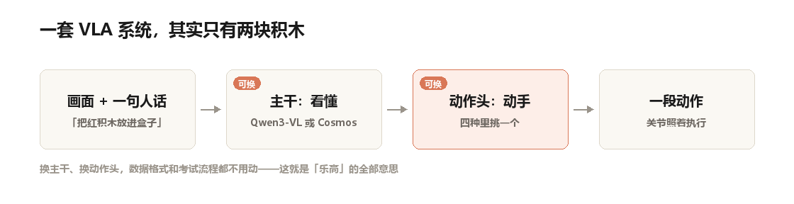
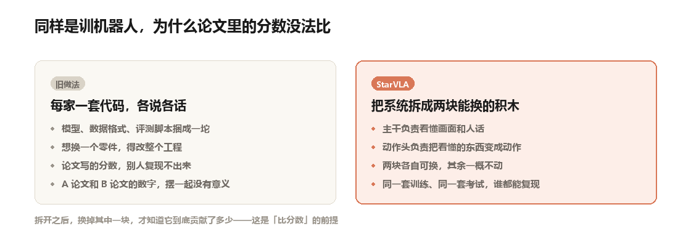
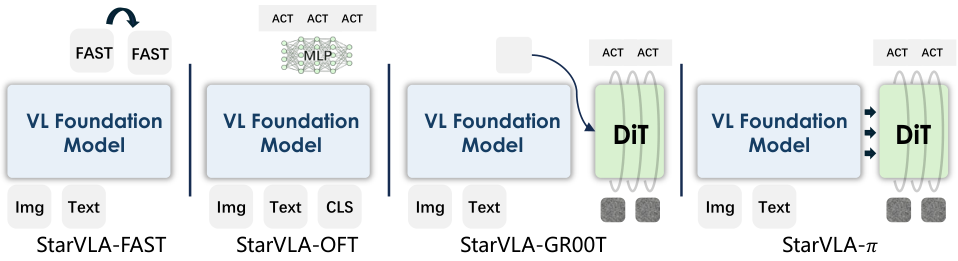
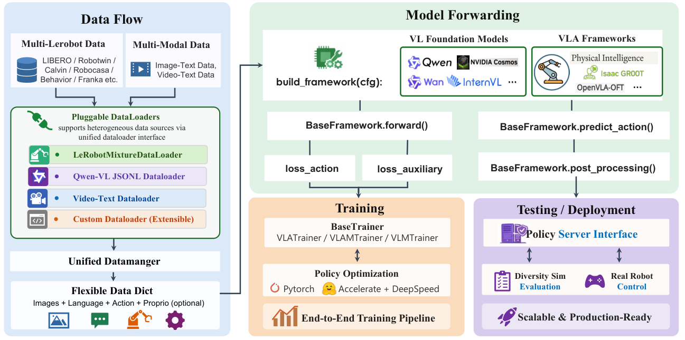
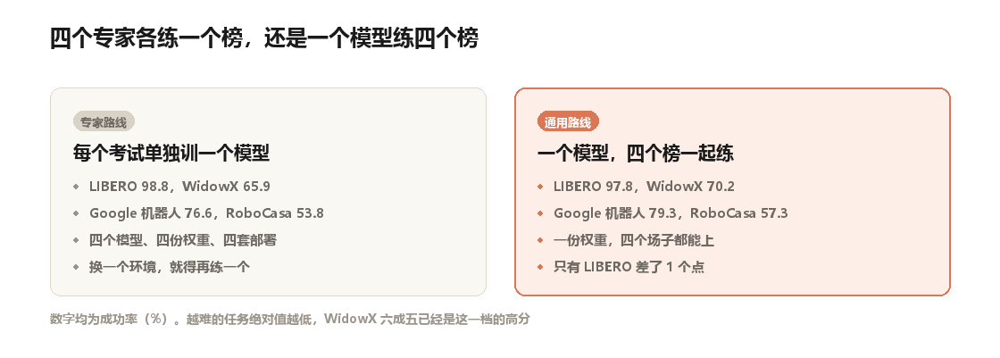

一个博士生想复现半年前的一篇论文。

git clone，装依赖，下数据集，跑训练脚本。

第四天他放弃了。不是代码有 bug。

是他想对比的那篇论文，字段名对不上。
一个叫 action，一个叫 actions。

一个把视频存成 hdf5，一个存成 mp4。

想比一比两个模型谁更强？先花两周把两边改成一样的。

这不是他一个人的问题。
论文很多，分数很多，但没有两篇能直接摆到同一个天平上。这是整个机器人 AI 领域此刻的处境。

今年 4 月，一群人放出了一个叫 StarVLA 的代码库，想在接缝上动刀。
牵头的是香港科技大学冯·诺依曼研究院，外加一批开源社区的人。

现在它有 3,893 个 star，519 个 fork，两天前还有人提交代码。
仓库去年十月才建，一年多攒到这个数，在 VLA 这类项目里排第一。

## 先花三分钟，把两个词说清楚

**具身智能**：有身体的 AI。ChatGPT 只输出文字，具身智能要输出动作——抬手、抓取、转身。

**VLA**：三个英文词的头字母——视觉、语言、动作。
它看着摄像头画面、听着人话，直接吐出机器人该怎么动的数字。

一个 VLA 系统，可以拆成前后两段。前一段叫**主干**，负责"看懂"。
看懂的是：这堆像素里有个红色方块，人说的是"把它放进盒子"。

后一段叫**动作头**，负责"动手"：把刚才看懂的结论，翻译成一串关节角度。
说人话就是：主干是眼睛加理解力，动作头是那只手。

StarVLA 的全部主张，其实只有一句。

**这两段之间的接缝，应该变成标准件。**

自制示意图：主干和动作头是两个接口，都能单独更换

## 为什么这个领域的论文，没法互相比较

论文里用了一个挺重的词：巴别塔。所有人都在盖同一座塔，但说着互相听不懂的语言。

具体碎在三个地方。**一是架构**。有人让模型把动作当成一个个"词"往外蹦。有人一次算出整段动作。有人套用 AI 画图那套去噪流程。
三种思路，代码结构完全不同。

**二是系统**。每个仓库都把模型、数据、训练脚本用胶水粘死在一起。
你想借用别人的一个模块，得先把他的整个工程搬过来。

**三是评测**。这个模型在 A 榜上刷到 90 分，那个在 B 榜上刷到 85 分。榜单不同、测试次数不同、成功判定标准也不同。两个数字放在一起，什么也说明不了。

第三点最要命。
它意味着这个领域很难积累。每个人都在重新发明轮子，而且不知道自己的轮子比别人的圆多少。

自制示意图：左边把模型、数据、评测捆成一坨，右边拆成两块可替换的积木

## 拆开之后，动作头变成了四选一

StarVLA 的做法很朴素。

它把系统切成"主干"和"动作头"两个标准接口，中间的对接方式写死。

主干这一层，它支持阿里系的 Qwen3-VL，也支持英伟达的 Cosmos。
后者是"世界模型"：能预测接下来画面会变成什么样。

动作头这一层，它把四个代表性流派都实现了一遍。

论文原图（Figure 2）：四种动作头，共用同一个视觉语言主干

**FAST**：把动作切成一个个"词"，像说话一样一个字一个字蹦出来。

**OFT**：不一个个蹦，一口气把整段动作直接算出来。

**π**：先给一团噪声，再一步步擦干净，擦出动作。跟 AI 画图是同一个思路。

**GR00T**：先在"心里"说一句话（"先伸手，再合拢"），然后才动手。
这四个东西原本分散在四个仓库里，四套依赖、四种数据格式。现在它们共享同一份数据接口、同一个训练循环、同一套考试流程。
换动作头，只需要改一行配置。

论文原图（Figure 3）：左边数据怎么进来，右边模型怎么训练、怎么部署

## 换掉"眼睛"，画面居然没糊

这里有个结果，我觉得比分数有意思。把主干换成 Cosmos-Predict2-2B 之后，平均分是 95.2%。
用原来那个主干是 96.6%。

只掉了 1.4 个点。
要知道，这两个主干在概念上属于两个阵营。

一个是"看图说话"的语言模型，一个是"预测未来"的世界模型。
过去两年，两边的论文各写各的，读者很容易以为是两条路。
StarVLA 给出的解释是：它们不是两个物种。

用同一套形式化写下来，一个 VLA 系统就是"看着画面和指令，吐出一段动作"。
差别只在训练时额外让模型学什么：学语言推理，还是学预测下一帧画面。

这话说得有点大。
但至少在这个代码库里，它是被实验支持的：换掉阵营，性能几乎不变。

## 训练量只有六分之一，分数只差半个点

LIBERO 是机器人操作领域最常用的考卷之一，130 个任务，分四个套卷。
StarVLA 用 3 万步训练，平均成功率 96.6%。
之前公开的最强基线 OpenVLA-OFT 是 97.1%。

但它练了 17.5 万步。

换算一下：**不到六分之一的训练量，差 0.5 个百分点**。

0.5 个点在这个榜上几乎不算差距。LIBERO 是个刷到 97 分就见顶的榜。
早期强基线 π+FAST 是 85.5%，GR00T-N1.5 是 86.5%。从 86 爬到 97，这个领域花了两年。

所以这句话可以反过来读：不是它的模型更聪明，是它的管线更省。
换个更难的场子看，SimplerEnv 的 WidowX 场景。

StarVLA 在这里最高 65.3%。
这个数字单看很寒酸。但同一张表里，OpenVLA 只有 4.2%，Octo-Small 是 26.7%。

最强的那一档 GR00T N1.5，是 61.9%。
六成五在这个任务上，已经是高分。

## 一个模型，四个考场

前面都是"一个模型打一个榜"。

真正让我坐直的是另一组实验。

他们把四个榜的训练数据全部倒进一个模型里，一起练。
四个榜是 LIBERO、SimplerEnv、RoboTwin（双臂机器人）和 RoboCasa。

练完直接拿去考，不做任何针对性微调。

自制示意图：四个专家分头练，和一个模型练四个榜，成绩相差不大

结果是这样：

RoboCasa 从 53.8% 涨到 57.3%。

WidowX 从 65.9% 涨到 70.2%。

Google 机器人从 76.6% 涨到 79.3%。

只有 LIBERO 退了 1 个点，从 98.8 掉到 97.8。
一个模型，四个场子，三项更好。

RoboCasa 是另一个考卷：24 个桌面任务，考的是人形机器人。

这个榜上四成出头就已是当前最好水平（π0.5 是 37.0%）。57.3% 明显高一档。

为什么会涨？论文没做深入分析，但给了两个可以推的线索。
一是数据混着练，等于变相扩了数据量。

二是不同机器人的手臂关节数不一样。他们把动作统一补齐到 32 维。
这个粗暴做法反而逼模型学会忽略"多出来的那几维"，学出一层共通的动作表示。

## 工程上的账：九成的卡没闲着

一个代码库好不好用，最后要落到"跑得动吗"。
单机八张 A100 显卡，每张卡喂 8 条样本。GPU 利用率 92%，每秒处理 56.6 条样本。

九成以上的利用率，意味着喂数据的管线没拖后腿。
不少研究代码卡在八成上下，一半算力在等硬盘。

扩到 256 张卡，每秒 2,200 条样本，并行效率稳在 79% 到 80%。

这个数字不容易。多数训练任务扩到几十张卡，效率就开始往下掉。
能撑到 256 张还保住八成，说明通信和切分做得比较干净。

不过要提醒一句。

这组数据来自仓库里一个公开 issue（讨论帖）的自测记录，不是严格控制的对照实验。

## 说点不好听的

**第一，所有数字都来自仿真，没有真机。**

论文说这套接口支持真机部署，代码里也确实有对应的服务端。
但正文报告的每一个成功率，都跑在仿真环境里。仿真里的杯子不会滑，桌面不会有反光，夹爪不会因为电机发热而变慢。真机上是什么水平，论文未提及。

**第二，它不是新方法。**

四个动作头都是别人的，两个主干也是别人的。它的贡献是整合、复现和训练配方。这意味着那些"SOTA"（当前最好）的说法要打个折扣。
有些是它复现得比别人好，有些是它多练了几步。

**第三，有一项是输的。**

Google 机器人还有另一种考试规则：同一批任务，换配色、换镜头，再取平均。
在这种规则下，它 70.2%，SpatialVLA 是 70.7%。

差得不多，但确实没赢。论文正文对此的描述是"comparable"，没有展开。

**第四，说集成的榜，不一定都跑了。**

摘要列了五个基准，包括 BEHAVIOR-1K。但正文的结果只覆盖四个。
BEHAVIOR-1K 只出现在"已集成"的表述里，一个成绩都没给。

**第五，这是一份技术报告。**

没有经过同行评审，作者署名是"StarVLA 社区"而不是具体的人。真出了问题，找不到谁负责。

**第六，复现门槛不低。** 单机八张 A100 起步，普通实验室得排队。

## 最后

开源基础设施的成果，通常不写在摘要里。
一篇论文的分数会被记住，一套让所有人的分数变得可比的管线，往往被当成"工程活"。

但这次的事情有点不一样。
当所有变量都被摁住，只让一块积木动，你才知道那块积木值多少分。这件事本身，比多刷一个点重要。

---

**论文信息**

StarVLA: A Lego-like Codebase for Vision-Language-Action Model Developing

StarVLA Community（冯·诺依曼研究院，香港科技大学）

技术报告｜arXiv: 2604.05014（2026 年 4 月 6 日提交）

项目页：starvla.github.io　代码：github.com/starVLA/starVLA

文中两张论文配图的版权归原作者所有，此处仅用于介绍与评论；两张示意图由本号据论文内容绘制。
