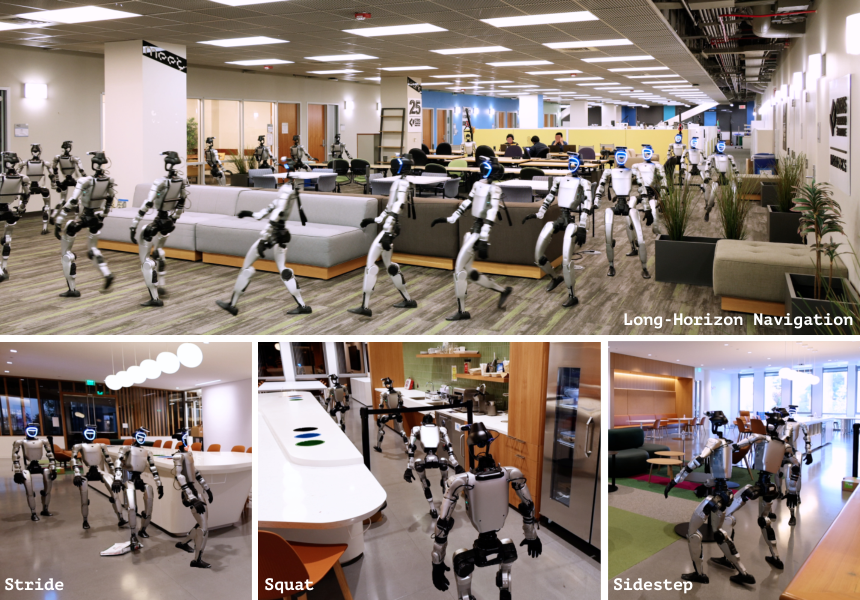
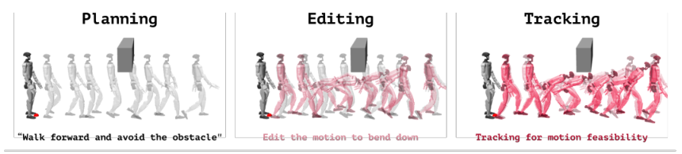
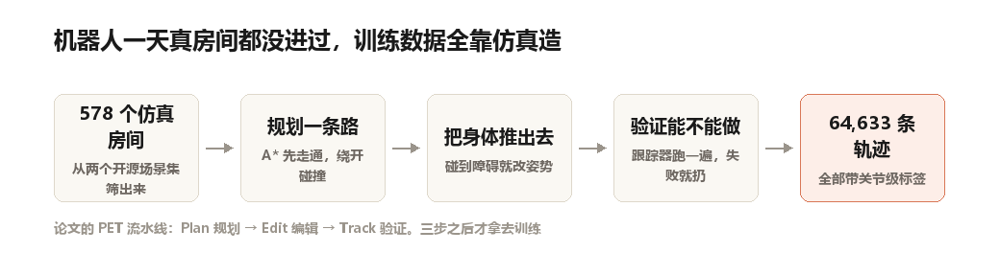
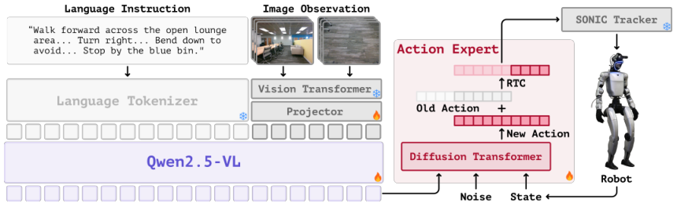
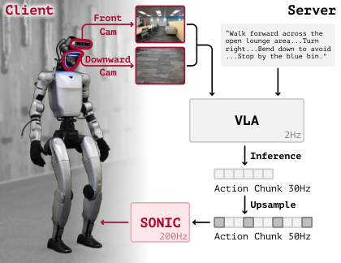
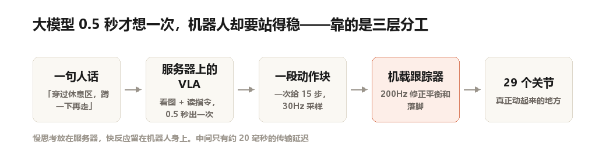
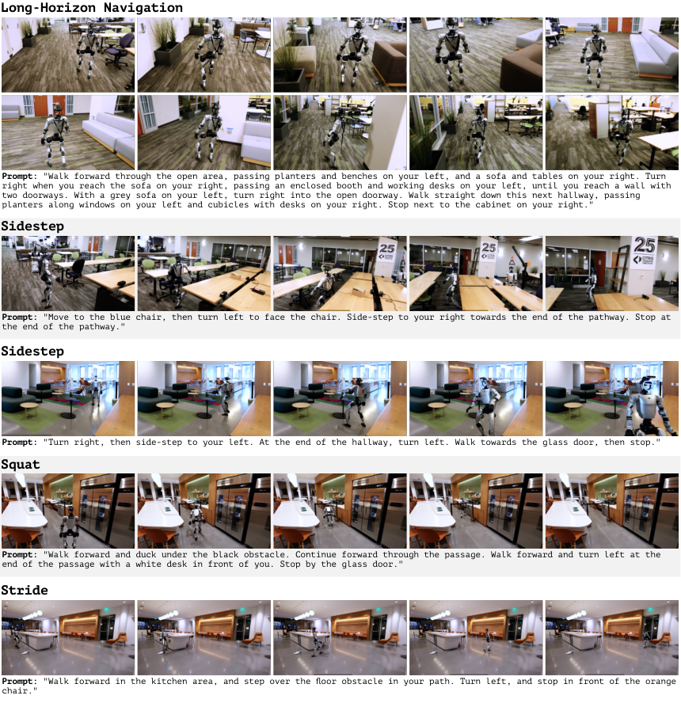

想象一下这个任务。

一台人形机器人站在办公室门口，接到一句话：「穿过休息区，经过那排沙发，注意头顶的横梁，从那两个纸箱中间走过去。」

它面前是三十米长的真实办公空间。沙发、矮桌、绿植、半开的玻璃门，还有头顶突然压下来的一段吊顶。

论文里它走完了全程。而且——**真实世界的训练数据，零**。

这是 CoRL 2026 收录的 TANGO，来自伯克利、北大、清华、港大和普林斯顿的联合团队。它的核心结论其实一句话就能说完：

> 人形机器人穿过杂乱空间，不是一道"找路"的题。

下面说说为什么。

## 把机器人当成地图上的一个点，是错的

过去十几年，视觉语言导航（VLN）基本是这么建模的：把机器人抽象成地图上的一个点，给定语言指令，让模型输出一条 2D 路径或者一串转向指令。

对轮式机器人来说，这个抽象几乎没损失。它的"身体"约等于它的"占地"，只要点在可行区域内，整台机器就在可行区域内。

人形机器人不是这样。

它身高一米三，肩宽半米出头，全身 29 个自由度。地图上一个点能穿过的缝，它的肩膀可能过不去；路径上方有一根横梁，那个点不会低头，但它的脑袋会撞上去。

论文把这层差异说得很直接：人形机器人在杂乱环境里的穿行，需要的是**连续的、几何感知的全身适应**——什么时候该把手臂收回来，什么时候该侧过身子，什么时候该把重心压低蹲下去。

这些动作没有一个能靠 2D 路径表达出来。

## 那就不输出路径，直接输出关节角

TANGO 的改法很干脆：不告诉你"往哪走"，直接告诉你**29 个关节的目标角度，加上基座的位姿**。

输入是自然语言指令加第一人称的 RGB 画面，输出是一段连续的关节空间动作，交给下游的全身控制器去执行。

也就是说，它把导航问题重新写成了动作生成问题。

听起来只是换了输出格式，但这一换，模型必须同时对两件事负责：既要看懂"要从纸箱中间过"，又要知道"过的时候左肩得抬高一点"。而后者，是没有语言标注的。

这就是整篇论文最难的地方——**这些知识从哪来？**

## 真机数据太贵，那就全在仿真里造

人形机器人的遥操作采集，成本高得离谱。一条高质量轨迹，需要操作员穿着动捕设备带着机器人走一遍，一小时也攒不下多少条。

TANGO 的做法是绕开这条路：**一条真实数据都不用**，全部在仿真里合成。

具体分三步，论文叫它 PET。

**第一步，规划（Plan）。**

从两个开源场景集里筛出 578 个室内房间，往里加入三类障碍：地上的（要跨过去）、侧面的（要侧身挤过去）、头顶的（要蹲下来）。

然后跑 A* 规划一条路径。但他们在代价函数里加了一项避障惩罚，路径会主动贴着安全距离走，而不是擦着障碍边缘。

有个细节挺巧：如果检测到前方是窄道，直接把行进方向改写 90 度——让机器人**横着走**过去。这样规划器输出的就不再是"走过去"，而是"侧身挪过去"。

**第二步，编辑（Edit）。这是核心。**

光有路径还不够，得知道身体怎么摆才不撞。

他们把场景的体素占用转成三维距离场，然后在路径周围半米宽的"管道"里，给肩膀、手肘、手腕、躯干、膝盖、骨盆这些关键部位施加一种软推力——碰到障碍就往外推一点，推到一个刚好不碰的位置。

据此生出三类动作：跨越（Stride）、侧身（Sidle）、下蹲（Squat）。最终分布是 44%、15%、41%。

**第三步，验证（Track）。**

编辑出来的动作不一定能真的执行。用现成的 SONIC 动作跟踪器在仿真里跑一遍，执行失败或者发生碰撞的轨迹直接丢掉。

三步之后，剩下 **64,633 条**带关节级标签的轨迹。生成加渲染，一共花掉 211 个 GPU 小时。

这里有个容易被忽略的设计，但我觉得是全文最见功力的地方：

> 训练时用的监督信号，是**编辑后的参考动作**，而不是跟踪器实际跑出来的动作。

因为跟踪器会为了物理稳定性牺牲动作形态，跑出来的动作往往比参考动作更"猥琐"——步子变小、手臂僵硬。如果拿它的输出去当标签，模型就会一点点学歪，最后学出一个能动但不像人的东西。

宁可保留一点不可执行的瑕疵，也要保住动作的人味。

## 大模型 0.5 秒才想一次，机器人怎么站得稳

模型这边，TANGO 用了三层结构。

最上面是 **Qwen2.5-VL-7B**，负责看懂画面和指令，用 InternVLA-N1 的权重热启动。前后两个视角的图像垂直拼在一起喂进去，历史帧做网格池化，近的看得细，远的看得粗。

中间是**扩散动作专家**，基于 flow matching，一次输出一段动作块。

最下面是**现成的 SONIC 跟踪器**，负责把高层下发的关节目标变成真正稳定的运动。

真机部署时，这三层不在同一台机器上。

VLA 跑在一台装 RTX PRO 6000 的服务器上，**每 0.5 秒**推理一次，一次给出 15 步动作，采样频率 30Hz。跟踪器跑在机器人机载的 Jetson Orin NX 上，**200Hz** 修正平衡和落脚。中间通过普通网络传输，延迟约 20 毫秒。

为什么要拆开？因为大模型的思考速度和控制器的反应速度差了 400 倍。机器人被碰一下要 5 毫秒内稳住重心，这件事等不了 0.5 秒的推理结果。

慢思考放服务器，快反应留在身上。这个分工在近两年的具身智能系统里越来越常见。

## 结果

仿真里，在需要处理障碍的杂乱场景上，TANGO 的成功率是 43.75%，最强基线（InternVLA-N1 配 HumanoidPF 跟踪器）是 41.88%。看起来差距不大，但碰撞率从 15.81% 降到了 **9.90%**——差不多砍掉四成。

更值得注意的是，基线 HumanoidPF 额外用了 LiDAR，而 TANGO 只吃纯 RGB。

真机上，三种场景各跑 5 次：短程 10 米带一次转弯、长程 30 米带两三次转弯、以及含一个挑战性障碍的杂乱路线。TANGO 在三种设置下成功率都是最高的，平均碰撞次数也都更低。

## 一个反直觉的发现

消融实验里有一组数字，我看的时候愣了一下。

把动作块之间的连续性机制（RTC）去掉，成功率从 **43.75% 掉到 10.94%**。

掉了三十多个百分点。

意思是：让模型每次预测得更准，还不如让相邻两段预测"接得住"。

对一个每 0.5 秒才更新一次的系统来说，相邻两次输出之间的衔接质量，比单次输出的精度重要得多。这条经验对所有做 VLA 的团队都成立，不只是导航。

另一组：把动作编辑那一步去掉，成功率降到 36.25%，碰撞率从 9.90% 涨到 20.60%。也就是说，光有路径规划不够，那一步"把身体推出去"的编辑，贡献了大约一半的避障能力。

## 几个该说清楚的不足

**没开源。** 论文承诺开源数据管线、生成数据集、VLA 框架、模型权重和部署系统，但截至我写这篇稿子的时候，项目主页上只有 PDF、演示视频和 BibTeX，没有代码链接。想复现的话，目前只能等。

**只用纯视觉。** 纯 RGB 打赢了带 LiDAR 的基线，这很漂亮，但作者没讨论逆光、透明玻璃、纯白墙面这些视觉退化场景下的表现。办公楼里恰好这些情况都不多。

**路径偏保守。** SPL 指标（成功率按路径长度加权）明显低于基线，作者自己承认是跟踪器太谨慎，宁可绕远也不冒险。这在演示里是优点，在真实配送场景里可能就是缺点。

**场景还是太干净。** 578 个仿真房间主要来自住宅和办公场景，杂物密度和真实的仓库、家庭比起来还是低。地面的电线、地毯边缘、半开的抽屉，这些才是真实世界最烦的东西。

## 最后一句

"让机器人学会走路"和"让机器人学会挤过去"，是两个完全不同的问题。

前者是控制问题，后者是空间理解加身体意识的问题。TANGO 的贡献不在于模型有多大——7B 的主干在今天的具身模型里算中等偏小——而在于它老老实实把"人形"这件事放进了问题定义里：既然身体有 29 个关节，那输出就该是 29 个关节。

这个思路朴素得有点不像一篇顶会论文。但很多时候，把问题重新定义一遍，比把模型再堆大一层更管用。

---

**论文信息**

TANGO: Humanoid Navigation in Cluttered Environments with a Whole-Body Vision-Language-Action Model

Anqi Li, Yuxin Chen, Zhaobo Li, Zhuo Cao, Junli Ren, Masayoshi Tomizuka, Dhruv Shah

UC Berkeley / 北京大学 / 清华大学 / 香港大学 / 普林斯顿大学｜CoRL 2026

arXiv: 2609.09158　项目页: tango-vla.github.io

文中论文配图版权归原作者所有，此处仅用于介绍与评论。
