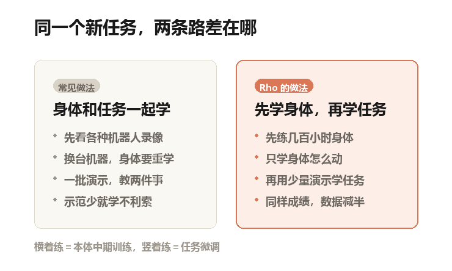
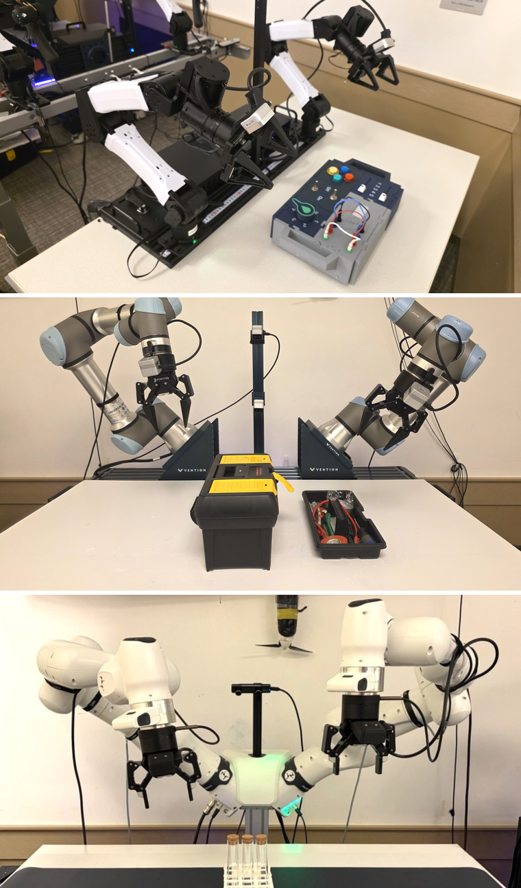
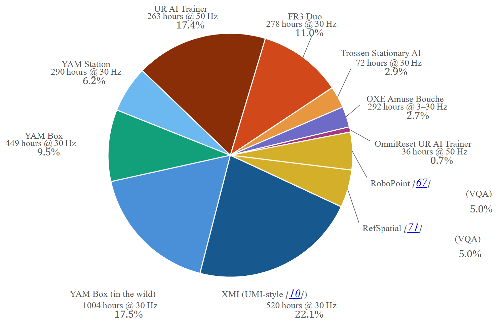
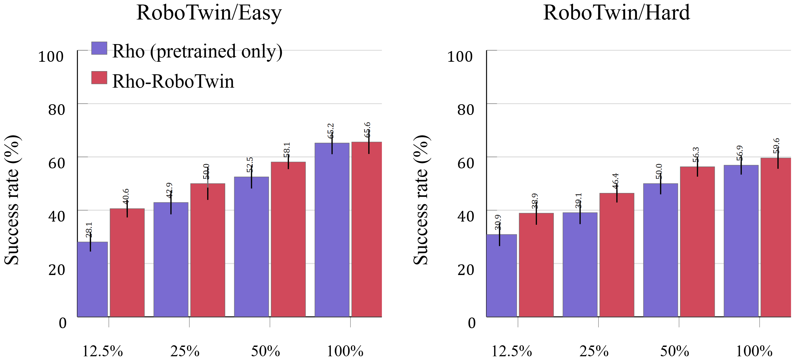
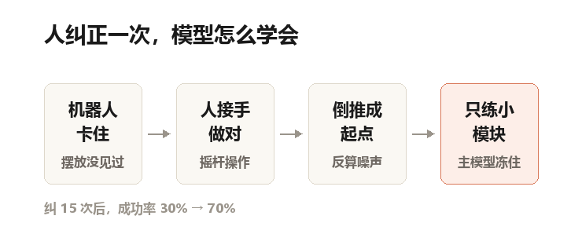

两条机械臂悬在桌面上。

桌上摆着一个敞开的工具箱，还有一个装满零件和工具的托盘。

机器人的任务不复杂：把托盘端起来，平平地塞进工具箱。不能歪，不能洒。合上盖子，再把锁扣按下去。

工程师录了 150 次示范。人手扶着机械臂，一遍一遍做给它看。

模型学完，30 次试跑成功 14 次。
听起来是不及格。

但这已经是同一批数据、同一套评分里最好的成绩了。另外两个开源模型的成功率，是 20.0% 和 16.7%。

微软研究院 9 月底挂出一份技术报告，主角叫 Rho。它想解决的问题只有一个：
让机器人学一门新手艺时，少要一点示范数据。

## 先把 VLA 这个词拆开

VLA 是三个英文词的头字母：视觉、语言、动作。
说人话就是：它看着摄像头画面，听着你说的话，直接吐出一串数字。每个数字代表手臂该往哪儿挪一点。

它不是先想出一段文字，再翻译成动作。它是算一次，出来的就是动作。

这门技术在 2023 年前后成形，现在全世界几十个团队在做。彼此的差别大多在三个地方：拿什么模型当眼睛和大脑、动作怎么生成、喂什么数据。

## 换一台机器人，像换了一副身体

每一台机器人的身体都不一样。
关节数量不同，手臂长度不同，摄像头装在哪儿不同，控制指令的含义也不同。

同样是"往前 10 厘米"，在一台机器上是往前伸，在另一台上可能是往下压。

论文里用 embodiment 这个词，中文一般译"本体"。说人话就是：这具身体长什么样、怎么动。

过去的做法是：先拿大量各种机器人的录像，预训练一个通用模型；再拿你的任务示范，微调它。

问题出在微调这一步。
模型要在同一批数据里，同时学两件事：这具身体怎么动，这个任务怎么做。

150 条示范，教身体都不够，更别说教任务。

Rho 的判断是：这两件事该拆开。

自制示意图：左边是常见做法，右边是 Rho 的做法——先花几百小时熟悉身体，再学一个任务

## 先横着练，再竖着练

论文把训练分成三段。
第一段，多本体预训练。模型看十几个机器人的数据，学会"机器人干活长什么样"。

第二段，本体中期训练，英文叫 embodiment midtraining。把模型放到你这一台机器人上，用几百小时、几十种任务的数据练两遍。这一步只学身体：摄像头在哪、手能伸到哪、动作怎么对应。

第三段，任务微调。这时候才拿你那 150 条示范，教一个具体任务。

作者的原话很直白：先横着练一遍身体，再竖着练一个任务。

论文原图（Figure 1）：三种双臂机器人，从上到下是 YAM Box、UR AI Trainer、FR3 Duo。三个版本的中期训练权重都已开源

## 喂进去的素材里，九成是机器人干活

预训练的数据配比被作者起了个名字，叫 Rho-Tomyum，一种泰式沙拉的名字。
九成是机器人演示，一成是视觉语言问答。

论文原图（Figure 3）：预训练数据的构成。最大的两块是 XMI 手持采集 520 小时、YAM Box 实景 1004 小时

那一成是给模型补"看懂图"的能力：图里哪个是杯子、那块空位能不能放东西。
作者的担心是，一直喂动作数据，模型原来会看图说话的本事会退化。

机器人那九成里，最大的两块分别是：一套叫 XMI 的夹爪手持采集数据，520 小时；YAM Box 在真实环境里采的 1004 小时。

三台目标机器的数据也各占一块：UR AI Trainer 263 小时，FR3 Duo 278 小时，YAM Box 449 小时。

预训练用了 48 张 B200 显卡。这个量级你大概能感觉出来：不是一个实验室随便能复现的。

## 模型不大，动手那部分更小

整套模型 50 亿参数出头。参数可以粗略理解成模型的脑容量。
负责"看懂"的部分 46.8 亿，负责"动手"的部分只有 5.4 亿。

作者做了一串拆零件测试，专门调"动手"那部分的形状。
结论是：宽度 2048、每个注意力头 128 维的组合最好。然后他们把这块的参数量从 16.5 亿一路压到 5.4 亿，成绩只掉了 0.2 个百分点。

这不是为了炫技。动作部分小，算得才快，机器人才跟得上每秒几十次的控制节奏。

## 数据少一半，成绩不变

最关键的实验，在一个叫 RoboTwin 的仿真平台上做。
仿真就是电脑里造的三维假世界，有物理引擎，撞到桌子会真的被挡住。

作者拿 45 个任务做中期训练，留 5 个任务做微调，再把这 5 个任务的示范数据切成 12.5%、25%、50%、100% 四档。

论文原图（Figure 6）：紫色是只做过预训练的模型，红色是加做中期训练的模型。右图加了干扰物，更难

关键不是柱子多高，是两条柱子的高度差在哪儿被抹平。

先看最左边那组，12.5% 数据：28.1% 对 40.6%。
作者的表述是，在这个数据最少的档位，中期训练过的版本比不做的版本好约三成。

再看 25% 那组：42.9% 对 50.0%。

而没做中期训练、用 50% 数据的版本是 52.5%。
也就是说，中期训练过的模型只用 25% 的示范，就几乎追平了没中期训练、用一半数据的版本。

这就是摘要里那句话的来源：达到同样的成功率，微调数据可以砍掉一半。

## 真机上，差距更明显

三台真机都测了。
YAM Box 上是个叫 BusyBox 的测试台：按钮、开关、旋钮、拉线、滑块。

这一组数据很足，约 2000 条示范。Rho 拿到 90.0% 的平均成功率，和目前最强的开源模型 π0.5 打平，比另外两个高。

数据足的时候，它只是不掉队。
数据少的时候，差距才出来。

同样是 150 条示范，UR AI Trainer 的工具箱任务，Rho 46.7%，π0.5 是 20.0%，GR00T-N1.7 是 16.7%。

FR3 Duo 上五个任务变体，Rho 平均 80.0%，GR00T 50.0%，π0.5 46.7%。

难的那几个拉得更开：叠玻璃杯，Rho 93.3% 对最高基线 60.0%；往架子上插试管，63.3% 对 33.3%。

仿真里也一样。
第一个评测集叫 RoboEval，Rho 平均 73.4%，比第二名高 6.3 个百分点。

第二个叫 LIBERO，平均 97.9%，其中最难的 LIBERO-Long 一组是 95.9%，比第二名高 2.7 个百分点。

## 一个反直觉的地方

上面那张图里有个细节，作者没多讲，但值得看。
最右边那组，100% 数据：65.2% 对 65.6%。

差距没了。
中期训练的好处，只在你数据不够的时候才存在。数据一管够，两个版本会收敛到同一个水平。

这既是好消息也是限制。
好消息是它不拖后腿。限制是：如果你手上已经有几千条高质量示范，这套流程带来的收益会很小。

## 人接管 15 次，成功率翻倍

还有一个模块，我觉得是整份报告里最有意思的部分。

任务微调之后，模型总会撞见没见过的摆放：插头歪着，试管靠在架子边上。离线数据里没有这些情况，它就容易卡住。

Rho 的做法是：让模型自己决定"从哪个噪声起点开始生成动作"。

这里的噪声可以理解成一团随机数。生成动作的过程，就是把这团随机数一步步推成一条动作轨迹。起点不同，推出来的动作就不同。

标准做法是每次随机抽一个起点。Rho 多了一个小模块，专门看当前画面，挑一个起点。

自制示意图：人纠正一次，系统把这段正确动作倒推成一个"起点"，只用来训练那个挑起点的小模块

这个小模块怎么学？靠人纠正。
机器人卡住，人拿摇杆接管，把动作做对。系统把这段正确动作倒推回去，算出"如果一开始从这个起点出发，就会做出这个动作"。然后用这个起点训练小模块。

全程主模型冻住不动，只练这个小模块。
真机上的效果：试管装配任务，15 次人工纠正，成功率从 30.0% 提到 70.0%。

插头任务从 66.7% 提到 93.3%，失败次数从 10 次降到 2 次。

## 这份报告没说的事

局限有好几层，作者自己写了一段，我觉得还不够。

**第一层，绝对成功率仍然低。**

46.7% 的工具箱任务，意味着两次里失败一次。作者承认，150 条示范对这类长流程、高精度的任务本来就不够。这是全行业的坎，不是 Rho 一个人的问题。

**第二层，覆盖范围窄。**

三台机器都是固定的双臂平台，都在桌面上干活。人形机器人、移动底盘、单臂，都没测。作者明确写了：这些实验不能证明跨硬件的通用性。

**第三层，语言的服从性没系统评测。**

你在指令里换个说法，它的表现会不会变差？论文说这是留给未来的问题。对一个号称"听懂人话"的模型来说，这个空白不小。

**第四层，数据被清洗过。**

作者说，三台目标机器的演示里，动作做错的片段被人工挑出来删掉了。真实工厂的数据往往带着错误，删干净之后模型更"好看"，也更脆弱。

**第五层，算力门槛。**

48 张 B200 做预训练，普通团队碰不到。好在中体训练和微调便宜得多，权重也确实开源了。

还有一点：这是一份技术报告，不是经过同行评审的会议论文。数字可信，但暂时没有第三方复现。

## 最后

机器人领域最容易被高估的词是"通用"，最容易被低估的词是"适配"。
一个模型在演示视频里做出漂亮动作，那是实验室。

在你的车间、你的桌子、你那台机器上稳定干活，是另一回事。
中间隔着的往往不是算法，是数据。

Rho 没有让机器人变聪明。它只是把"适应一台机器"和"学会一个任务"这两件事，从一次做完改成分两次做。
分两次做，第二次要的数据就少了。

这个思路不新，不少团队提过类似的分段训练。但把它做成能下载的权重、能复现的流程，还配了三台真机的对照数据，这是它的价值。

## 论文信息

- 标题：Rho: A Foundation for Efficiently Adaptable VLA Models
- 作者：Rho Team（Simran Bagaria, Daphne Chen, Dean Fortier, Jianlong Fu, Michael Harrison, Tess Hellebrekers, Neel Joshi, Andrey Kolobov, Dalton Moore, Galen Mullins, Michael Murray, Eduardo Salinas, Reuben Tan）
- 机构：Microsoft Research
- 类型：技术报告（arXiv 归类 cs.RO，未见会议接收信息）
- arXiv：2609.38164（v1，2026 年 9 月 29 日提交）
- 项目页：https://microsoft.github.io/rhobotics
- 代码：https://github.com/microsoft/rhobotics
- 权重与数据：https://huggingface.co/collections/microsoft/rho

## 图片版权

文中三张论文原图：Figure 1 机器人实拍、Figure 3 数据配比、Figure 6 数据效率。版权归 Microsoft Research 所有，取自 arXiv 论文 HTML 版。两张示意图由本号自制。
