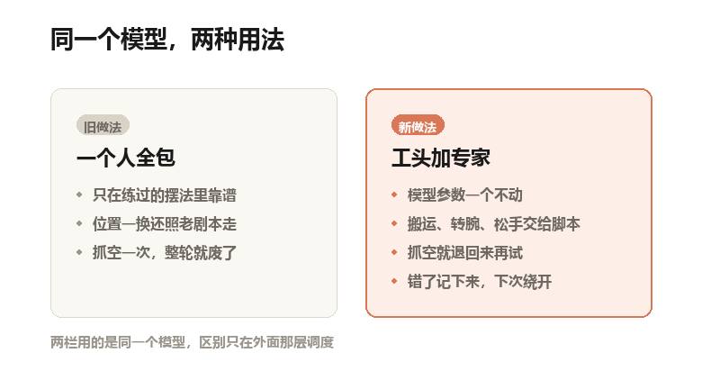
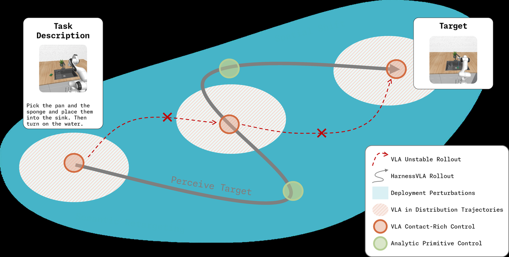
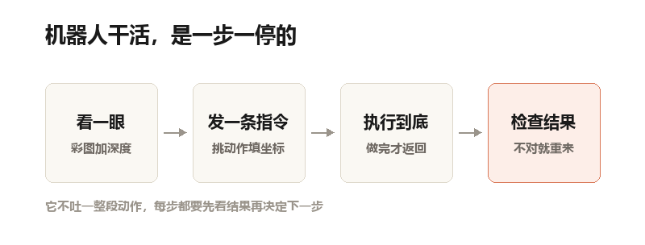
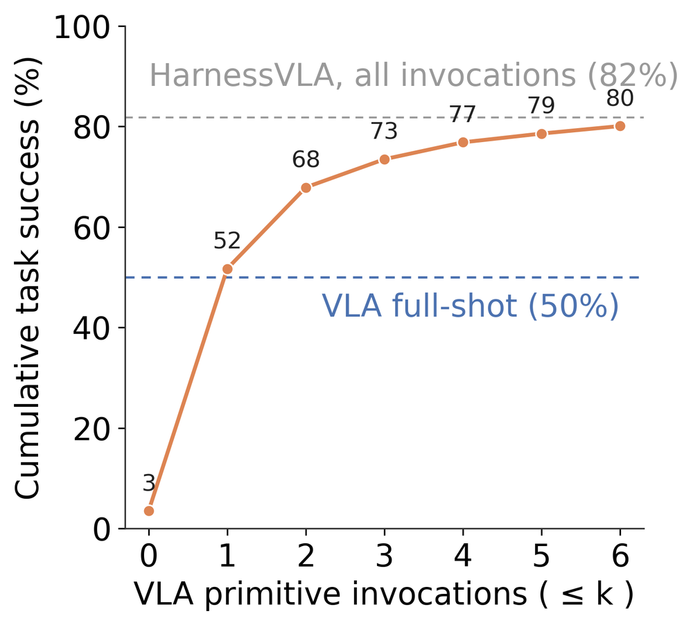
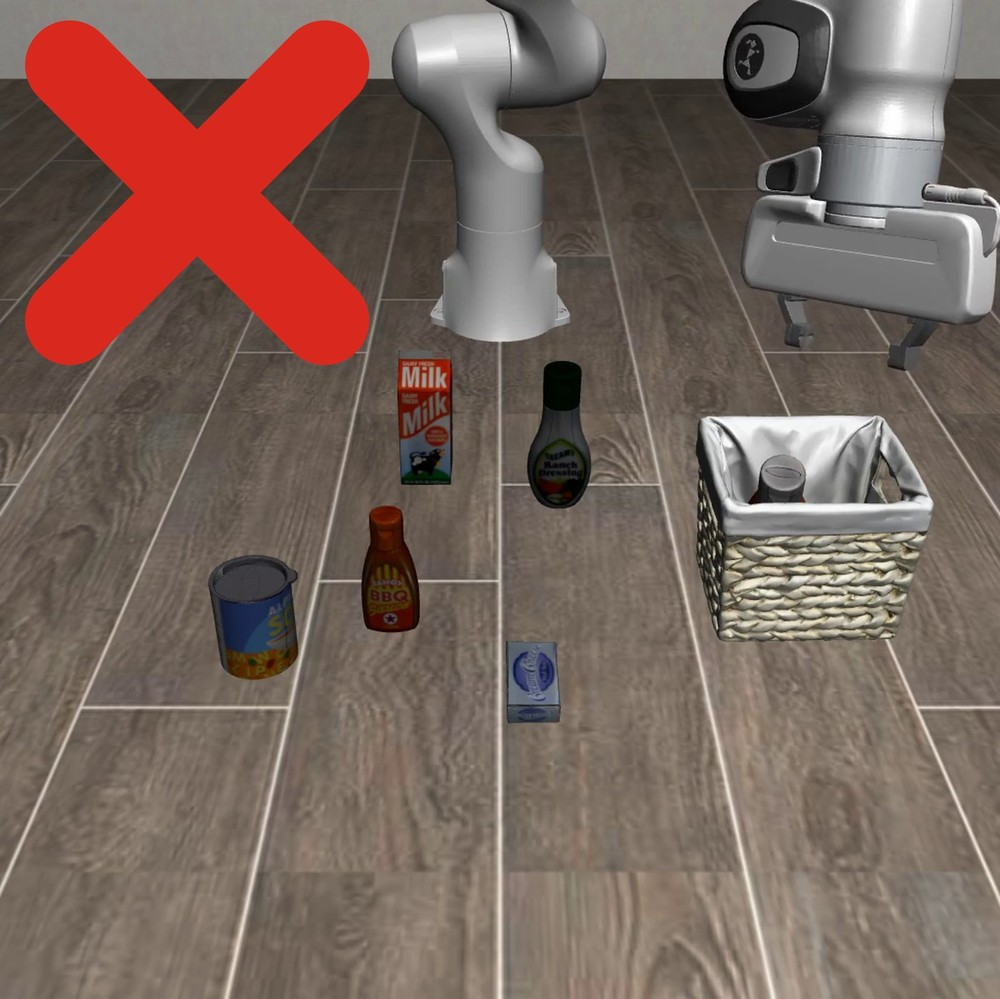
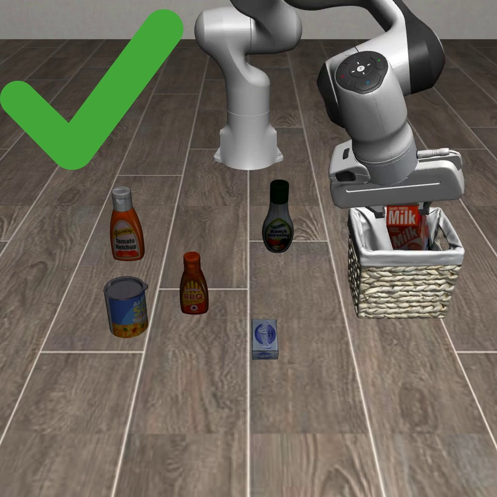

机器人伸手去抓台面上的牛奶盒。
夹爪合拢，是空的。

它没有停。它沿着原来的路径继续往前走，把空着的手往篮子里送了一下，然后判定任务结束。

这一幕在论文里有个说法，叫"空抓"。说人话就是：手上什么都没有，机器人自己不知道。
更麻烦的是它不会退回来重抓。动作是一整段吐出来的，中间没有回头看的机会。

今天要讲的项目，改动其实很小：在机器人抓空的那一下，替它踩一脚刹车。
它叫 RPent，GitHub 上的开源框架，今年七月建库，现在 1,689 个 star。牵头的是清华团队，另有几家机构一起做。
配套的论文叫 Harness VLA，论文里的代码就是这个仓库。

## 先把两个词说清楚

**VLA**：三个英文词的头字母，视觉、语言、动作。它看着摄像头画面，听着人话，直接吐出机器人该怎么动的数字。

**冻结**：参数一个都不改，不重新训练。相当于老师傅不许再进修，只能改怎么给他派活。

这个项目的核心主张，一句话就说完：**模型不要动，在外面加一层调度。**

调度由一个通用大模型来当，论文里管它叫"规划器"。你可以理解成工地上那个工头：不亲自动手，只负责看图纸、派活、验收。

## 它到底改了哪一块

老办法是让一个模型全程包办。看画面是它，想步骤是它，出手也是它。
练过的摆法里它很稳。桌子上的东西一换位置，它还是照老剧本走。

新办法把活拆成两半。

工头负责看：读指令、认物体、判断这一步该干什么。
那个被冻结的 VLA 只负责"接触"的那几秒：抓住、按键、拧阀门、插进去。

中间那些搬来搬去的活，交给几个写死的脚本动作。名字很朴素：移动到某点、合拢夹爪、松开、转动手腕。

说人话就是：工头动嘴，老师傅只干手上最难的那一下，剩下的路让传送带自己走。

自制示意图：两栏用的是同一个模型，区别只在外面那层调度

具体到代码，能调用的动作一共七个：六个脚本动作，一个 VLA。厨房场景再加两个底盘动作，用来走到远处柜子前。

关键是这份清单在开始评测前就定死了。工头不能临场发明新动作，只能学着怎么把这七个用对。
这条限制听着很死板，其实是整篇论文最想说的那句：不是把技能库做大，是把用法学会。

论文原图（Figure 2）：灰色是加调度后的路线，红色虚线是直接跑模型的路线，红叉是撞墙的地方。蓝底是"环境被改动过"的区域，橙色圈里才轮到 VLA 出手，绿色圈交给脚本动作

看图就明白一半。
红色虚线想直接从起点冲到目标，中间撞了两次。灰色路线绕了远路，但它每次进入橙色圈都换了个方位。

橙色圈就是"要接触物体"的地方。论文的观点是：模型在自己熟悉的那一小块里最可靠，所以想办法每次都从那一小块开始。

## 它是一步一停的

这一点容易被忽略，但它是"能重试"的前提。

工头不直接输出关节角度。每轮它只写一条指令，格式是 JSON。那是一种用花括号、键值对写成的文本，机器读得懂，人也看得懂。一条指令长这样：动作名，加上坐标和参数。

机器执行完，回报一张新画面。工头看一眼，再决定下一步。
所以整个任务不是一口气跑完的，是几十上百个"发指令、等结果"的回合。

自制示意图：每一轮只做一件事，做完必须看一眼结果

因为中间有停顿，才有"停下来检查"的机会。因为能检查，才谈得上"抓空了，退回去，再抓一次"。

## 它记得上一次是怎么搞砸的

项目里有两本记忆。

**流程单**：一次成功探索的完整步骤，原样存下来。坐标不写死，改成"相对某个物体的位置"。桌子挪了二十厘米，单子照样能用。

**错题本**：成功规律和失败模式。比如"夹爪合拢但物体没动，就是空抓""这个停止条件会把没做完当成做完"。
分工很清楚：流程单告诉你上次怎么成的，错题本告诉你上次为什么没成。

## 分数：从五成到八成

先解释考卷。
LIBERO 是机器人操作领域最常用的仿真考试，一百多个桌面任务。LIBERO-Pro 是它的"刁难版"。同样一批任务，但换掉目标物体，或者把物体位置对调，专治背题。

在这个刁难版上：

- 冻结的 π0.5 模型，综合成功率 11.0%
- 直接跑冻结的 πRLinf 模型（也就是后面被冻住的那只手），50.0%
- 之前公开的最强方法 RATS（靠测试时反复搜索来提鲁棒性），43.8%
- 这套系统，工头用 Claude Code，82.4%

四成多已经是这张卷子之前的最好水平。八成二是另一个量级。

同一个模型，参数一个没改，50.0 变成 82.4，多了三十二个点。

如果工头换成 GPT-6 Astra，能到 92.63%。八百次测试里成了七百四十一次。

注意这句：成绩和工头强不强高度相关。同一套框架，GPT-5.5 当工头是 72.1，Opus-4.7 是 82.4，Astra 到 92.63，差出二十个点。

再看厨房。

RoboCasa365 考的是长流程家务：走到柜子前，开柜门，拿出锅，放到灶上。直接跑冻结的 RLDX-1 是 30.0%，这套系统 57.2%。

最难的一栏是"没见过的动作组合"，13.8%，直接跑是 5.0%。这一栏本来就是全场最低的一角，13.8% 已经是原来的两倍多。

双臂机器人那边（RoboTwin，从干净环境直接搬到随机环境），58.4%。同一个冻结模型的直接成绩是 50.4%。π0.5 是 47.9%，GR00T-N1.7 是 20.7%。

标准版 LIBERO 上，它是 96.0%，模型自己是 95.3%。但它输给了 AtomVLA 的 97.0%。这个榜已经卷到 97 分封顶，一个点说明不了太多。

## 反直觉之一：VLA 只干了 15.8% 的活

论文统计了每个动作被调了几次。
桌面上，脚本动作占了 84.2%，VLA 只占 15.8%。其中"移动到某点"一个动作，就占了全部调用的 61.8%。厨房里 VLA 涨到 35.3%，双臂是 47.4%。越难的场子，越依赖学出来的手感。

这个比例有点反常识。大家以为的机器人 AI 是模型接管一切。实际是模型只干最难那一下，其余交给能写清楚的规则。

## 反直觉之二：多抓两次，值三十个点

他们做了个很朴素的实验：限制每一轮任务里允许叫几次 VLA。结果是这张图。

论文原图（Figure 4 局部）：横轴是每次任务最多允许叫几次 VLA，纵轴是累计成功率。蓝色虚线是原来的整段执行，灰色虚线是这套系统的上限

一次都不叫，只剩脚本动作，成功率 3%。也就是说抓取、按键这类事，写死的规则基本干不了。

叫一次，52%，已经超过原来整段执行的 50%。叫三次，73%。六次，80%。不限制，82%。
同一条曲线上，"敢再抓一次"这个能力，值三十个点。

论文的解释是：第一次抓空，多数不是模型不会，是手没摆到它熟悉的姿势。工头把它退回舒服的位置再叫一次就行。

## 两张截图

同一条指令，同一张桌子，物体位置被换过。先看直接跑冻结模型的结果：牛奶盒还在台面上，篮子空着。红叉是论文加的。

论文原图（Figure 3 局部）：同一个模型直接跑，位置一换就抓空了

再看同一个模型，外面加了调度：牛奶盒进了篮子。

论文原图（Figure 3 局部）：同一张桌子，同一个模型，只是多了工头重新摆位

两张图说的是同一个任务：同一张桌子、同一次位置扰动，区别只在外面有没有那层调度。

## 代价：一个任务要想九分钟

好听的说完了，说点代价。工头是个大模型，它每轮都要看图、想、写指令，这个流程很慢。
LIBERO-Pro 上跑完一个任务，规划器平均耗时 529 秒，接近九分钟。关掉推理模式，344 秒。

他们还有个"快放"模式：把成功流程存成一张卡片，部署时不思考，直接照单执行。56 秒，但分数掉到 72.63%，介于高推理和关推理之间。

这里要留个心眼。论文自己写明了：这两个时间口径不一样。一个是工具执行时长，一个是规划器时长，不能当作加速比。

"快放"的挑卡方式也不干净。它是从同一批测试种子里事后挑出成功率最高的卡片。属于回头选优，比真实部署乐观。

## 说点不好听的

**真机只有演示，没有数字。**

实验在两个 Franka 双臂平台上做，Franka 是实验室常见的机械臂品牌。演示内容全是定性的：目标改向、抓空了重来、把两个动作拼成新流程。没有一个成功率。而且这些演示靠人复位场景、靠人肉眼判定成功。论文原话是，这些录像提供的是定性演示，不是可比的成功率估计。

**反馈是开环的。**

工头只能看到"动作执行完了，画面变成了这样"。它看不到 VLA 内部在想什么，也不知道这次为什么没抓稳。论文把这列为第一条局限。

**它没有从奖励里学。**

整套系统没有用强化学习，也没有用人类偏好微调。记忆是写进去的，不是练出来的。论文说这需要样本效率高的强化学习。

**杂物一多就容易看走眼。**

系统没有细粒度的图像描述能力。柜子里塞满东西、任务又长时，工头对场景结构的判断会变弱。

**它是一份预印本。**

arXiv 上是第五版，没有标注任何会议录用。里面所有数字都来自仿真，没有一个来自真实产线。

**还有一条最现实的：工头是租来的。**
Claude Code、Codex、GPT-6 Astra，都是闭源大模型。换一个大脑，分数从 72.1 到 92.63。

这意味着这套系统的上限，有一半取决于你买得起哪个模型、能连上哪家服务。仓库是开源的，能力不是完全开源的。

## 最后

这两年，机器人圈子比的是模型本身：参数多大，数据多少小时，榜上高几个点。

这个项目提醒了另一件事。

同一双手，换一种用法，分数能差出一倍。它没有让机器人变聪明，它只是允许机器人失败一次。

而"允许失败一次"这件事，在真实世界里比多刷一个点重要得多。

---

**论文与项目信息**

Harness VLA: Steering Frozen VLAs into Reliable Manipulation Primitives via Memory-Guided Agents

作者：Yixian Zhang、Huanming Zhang、Feng Gao、Xiao Li、Zhihao Liu、Yi Nie、Chunyang Zhu、Jiaxing Qiu、Yuchen Yan、Jiyuan Liu、Wenhao Tang、Jiaji Rao、Zhengru Fang、Changxu Wei、Yu Wang、Wenbo Ding、Chao Yu

机构：清华大学、Striding AI、普渡大学、中科院自动化所、无问芯穹、香港科技大学、中关村学院

arXiv：2607.08448（2026 年 7 月 9 日提交，第五版 9 月 24 日；预印本，未标注会议录用）

项目页：harnessvla.github.io　代码：github.com/RLinf/RPent（1,689 star，建库四个月；154 fork 即派生仓库）

文中四张论文原图的版权归原作者所有，此处仅用于介绍与评论；两张示意图由本号据论文内容绘制。
