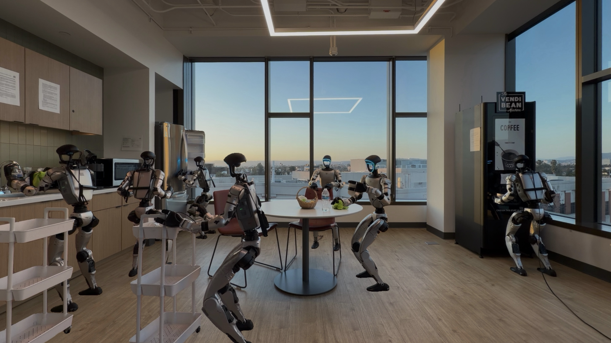
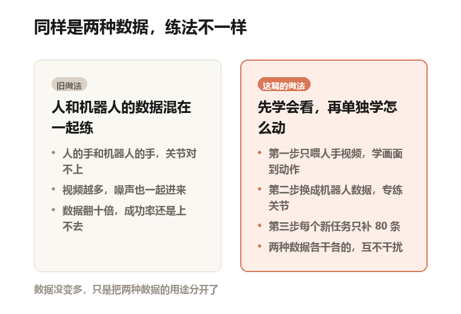
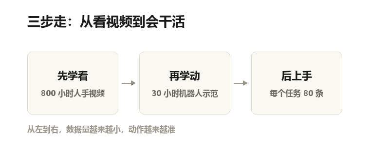
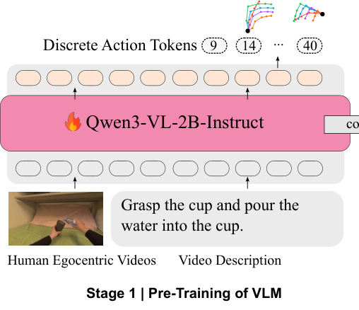
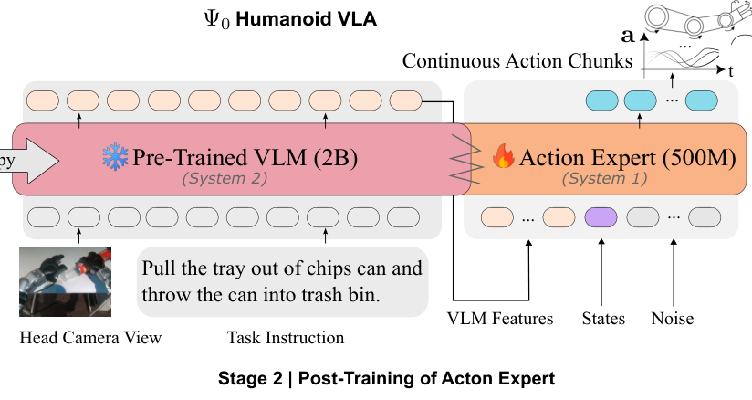
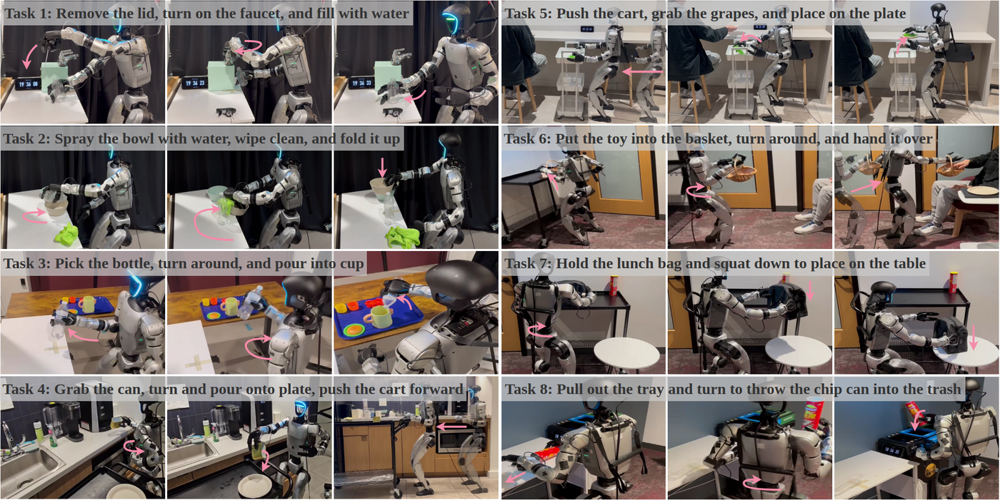

一间办公室改的厨房里，同时站着六七个机器人。
一个在咖啡机前接水，一个推着餐车，一个在擦桌子，还有一个伸手去推冰箱门。

这是论文第一页的那张照片。其实是同一台机器人的不同瞬间，被拼进了同一张画面。

这些活有个统一的名字：移动操作。
说人话就是，一边走一边用手干活。
注意是"一边"。先站定了再伸手，和边走边伸手，难度差很远。

论文原图（Figure 1）：同一台机器人做接水、推车、擦桌、推冰箱门这些活，画面是拼的

## 43 个关节，错一个就接不到水

论文里用的都是同一台机器人：宇树 G1，一台量产的人形机器人，没换过机型。

抓个杯子，你大概只动三处：肩、肘、腕。
机器人要同时算清 43 个数字。腿 12 个，腰 3 个，两条胳膊各 7 个，两只手各 7 根手指。

这个数字在论文里叫"自由度"，说人话就是能单独转动的方向有几个。
43 个，相当于同时用 43 根手指弹琴，每根都不能弹错。

而且它做的不是"抓一下"就完事。
论文测的八个任务，大多要连做两三千步。按每秒三十次算，是一分多钟不停手。
每个任务还拆成三到五个小步骤，全做完才算成功，中间错一步，整条作废。

所以后面那些百分之几十的数字，看着不高，其实不低。

## 大家都想用人类的视频教它

机器人数据很贵。
要人戴着 VR 头显（戴上能看见虚拟场景的头盔）、手上绑追踪器，一个动作一个动作遥控着录。一天录不了多少条。

人类视频便宜。自己拍、网上找，一天能攒很多。
所以这几年最流行的做法是：把人手干活的视频，和机器人干活的录像，混在一起喂给模型。

听着挺合理。但论文的判断是，这个做法是错的。

人的手和机器人的手，骨头就不一样。
手腕能转多少度、手指多长、胳膊伸多远，全对不上。
两种数据混着喂，模型学到的是一个折中的动作，谁的都不像。

自制示意图：左边的困惑是这篇论文想解决的问题，右边是它的答案

一句话：数据没变多，只是把两种数据的用途分开了。

## 他们的办法：先学看，再学动，最后上手

自制示意图：三步走，三种数据，三种练法

第一步只用人手视频，练"看着画面猜下一个动作"。
这一步练的是常识：杯子摆在桌上，手该往哪伸；水龙头在左上方，手该往左上抬。

第二步换成机器人自己的数据，练"把动作落到具体关节上"。
胳膊抬多高、手指弯多少，这一步才管。

第三步来了新任务，每个任务补 80 条示范，快速调一遍。

## 第一步：800 小时，看别人怎么用手

数据用的是 EgoDex，一个公开数据集，约 829 小时第一视角视频，九亿帧上下。
第一视角就是摄像头架在额头上，画面里只有自己的两只手在忙。

喂进去的是"这一帧画面，加上下一帧手在哪"，模型要学会的也是这个：看着现在，猜下一步。
这种一步接一步的猜法叫自回归，说人话就是接龙，猜出来的那个还得当下一句的开头。

模型用的是 Qwen3-VL-2B。VL 是视觉加语言，它本来就会看图说话，这里被借来当"看画面的那一半"。
2B 指二十亿参数，参数可以理解成模型的脑容量刻度。

这一步烧了 64 张 A100 显卡，跑了大概十天，二十三万步。
A100 是英伟达的训练卡，一张几万块，64 张一起跑，是典型的"实验室级"开销。
有个小设计值得一提：前二十万步只喂人类视频，最后三万步才掺进机器人数据。
掺进来是为了让模型提前适应"机器人的眼睛看到的世界"，别到第二步才第一次见。

论文原图（Figure 2 左半）：把人手视频和一整句任务描述喂进 Qwen3-VL，让它一步步猜出下一个动作，再还原成手的轨迹。左边那张小图就是模型看到的第一视角画面

## 第二步：换身体，专练关节

第二步把上一步的"看"冻住，一个字都不改。
然后从零训练一个新的小模型，专门负责吐关节角度，论文里叫"动作专家"，五亿参数。

它学的方式叫流匹配。
说人话：先给它一团噪声，让它一步步把噪声修成一条合理的动作。
AI 画图用的扩散模型是同一个思路，只不过这里修出来的是 43 个关节的转动量，不是像素。

为什么冻住前面那半？
因为"看懂画面"和"把动作算准"是两件事。分开练，各自专一，混在一起反而互相拖。

论文原图（Figure 2 右半）：粉色模型上挂的雪花，意思是冻住不改。橙色的是新训的动作专家，它吃三样东西：画面特征、当前姿态、一团噪声，吐出一小段动作

这一步的数据只有三十小时，全是真人遥操作录的。
遥操作就是人戴着 VR 头显、手里有追踪器，人怎么动，机器人跟着怎么动，一边动一边录。

从 800 小时掉到 30 小时，是故意的。
这一步要的是精度，不是广度。

## 结果：八个任务，平均七成

论文原图（Figure 6）：八个任务，每个任务三格，从左到右是小步骤。任务名用英文写在每组图上方，手机上可以点开看

拧水龙头接水、喷水擦碗、拿瓶子转身倒水、抓罐子倒进盘子、推车抓葡萄、把玩具递给别人、蹲下放餐盒、拉托盘丢垃圾。
八个，每个试十次。

论文里的模型叫 Ψ0，读作 Psi-Zero。
把论文表格里八个任务的整体成功率平均一下：它是 71%，第二名 GR00T N1.6 是 29%，另一个老对手 π0.5 是 24%。
差了 42 个百分点。论文自己的说法是"高出 40% 以上"。

这个 71% 是什么水平？
前面说过，任务要连着做完三到五个小步骤，全对才给分，瞎撞的概率接近零。
同类方法以前大多在 0 到 4 成之间晃。能稳过七成，是这批任务里目前最好的成绩。
八个任务，它每一个都是第一。

挑两个看。
拿瓶子转身倒水：它 8/10，GR00T 4/10，最早那批方法（扩散策略、ACT）是 0。
拉出托盘把薯片罐丢进垃圾桶：它 5/10，其余七种方法没有一个超过 1/10。

## 反直觉的地方：数据砍到十分之一，成绩塌了

论文做了组对照，只用 10% 的人类视频预训练。
抬箱子那个任务，完整数据是 8/10，砍到十分之一，掉到 1/10。

另一个方向也试了：不要人类视频，只用机器人数据预训练。
结果是 4/10。两个都用，才是 8/10。

这条结论挺反常识。大家默认数据越多越好，这里证明的是：数据少一点没关系，顺序错了才致命。

还有一个发现不太好看：多个任务放在一起微调，每个单任务的成绩都会掉。
作者猜是学习目标被摊薄了，模型没学透。
这意味着每上一个新任务，还得单独训一版。"通用"两个字，目前还差这一步。

## 一个 0.16 秒的问题

整个模型二十五亿参数。在服务器上跑一次，要 160 毫秒。

机器人这边的控制环是 30 赫兹，也就是每 33 毫秒要一个新指令。
差了五倍。

老老实实"想完再动"，机器人就会一顿一顿地卡。
论文的办法叫实时分块。分块的意思是，模型一次吐出一小段连续动作，不是一步一步吐。
执行的时候不等它想完，下一段已经在算了，两段接上就能连成流畅的一条。

接缝处容易对不上。所以训练时就故意把开头几个动作遮住，逼它学会接着上一段的尾巴往下写。
这个技巧叫 RTC。
加不加它，同一套模型在双臂搬运任务上从 8/10 变成 9/10。

## 它现在还做不到什么

第一，样本太少。八个任务，每个试十次，一次就值十个百分点。
基线还是作者自己调的，论文老实列了每个基线用多少步、什么学习率、几张卡。
但没有第三方复现，也没换一台机器人重测。换个实验室，数字未必一样。

第二，"数据少"这个说法要拆开看。
省的是机器人数据，三十小时。人类视频那 800 小时，其实不算少，只是比录 800 小时机器人便宜太多。
而且三十小时的遥操作数据，前提是你得有一台 G1，还得有一套单人全身遥操作系统。对多数实验室仍然是门槛。

第三，硬件拖了后腿。
作者自己写，机器人的载重能力限制了更复杂的操作。重活、需要使劲的活，这次没测。
算力和时间也不够，没能继续加数据。这一条是他们明说的。

第四，它也会输。
同一个任务里的小步骤，拧水龙头 6/10，对手 π0.5 是 8/10；拉托盘 5/10。
整体赢，局部输，这种赢法不够干净。

第五，开源还停在口头上。
论文写的是"将开源"，项目页已经挂了代码仓库的地址。权重和推理引擎到不到位，我没有逐项核对。
想复现的人，最好自己先去仓库看一眼。

## 最后

这几年大家讲机器人，总在比谁的模型大、数据多。
这篇论文给的答案有点扫兴：顺序比数量重要。

先让它看懂别人的手，再让它用自己的手。
两件事分开练，八百小时的人类视频就顶过了别人十倍的数据量。

**论文信息**

- 标题：Ψ0: An Open Foundation Model Towards Universal Humanoid Loco-Manipulation
- 作者：Songlin Wei、Hongyi Jing、Boqian Li、Zhenyu Zhao（前四位同等贡献）等 15 人，通讯作者 Yue Wang
- 机构：USC Physical Superintelligence (PSI) Lab、NVIDIA、WorldEngine
- 会议：RSS 2026（已接收，RSS 是机器人领域的三大顶会之一）
- arXiv：2603.12263（2026 年 3 月 12 日提交）
- 项目页：https://psi-lab.ai/Psi0
- 代码：https://github.com/physical-superintelligence-lab/Psi0

**图片版权**

Figure 1、Figure 2（局部）、Figure 6 均取自论文原文，版权归论文作者所有，本文仅作解读引用。
两张示意图（对比图、三步走）为本号自制。
