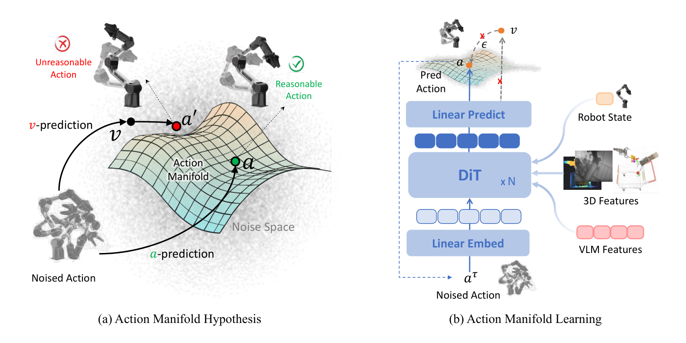
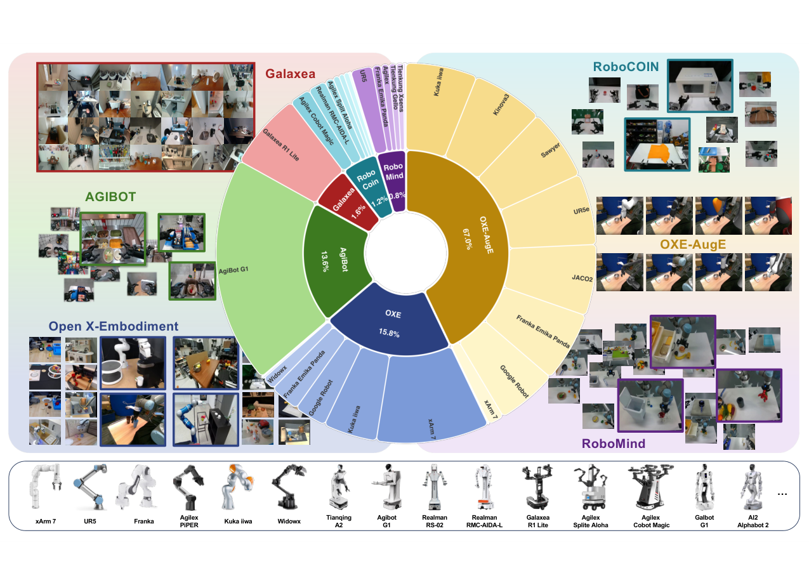
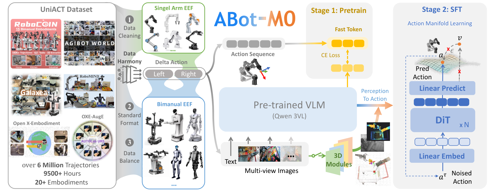

一台机械臂停在杯子前面。
接下来几十毫秒，它要定下一串数字：手腕转多少度，手指张多开，往哪个方向挪几厘米。
这串数字错一个，杯子就被拍飞。

有意思的是，现在大多数机器人模型，在这一刻猜的并不是这串数字。
它们猜的是噪声。

噪声是什么？想想电视没信号时的雪花屏。
AI 画图用的扩散模型，就是从一团雪花开始，一步步擦，擦出一张清楚的图。
机器人模型把这套办法搬了过来，把关节角度当成像素来"画"。

搬得挺顺。可雪花屏上的东西没有物理。
擦到一半的中间态，完全可能是"手指穿过桌面"。

这篇论文叫 ABot-M0，来自高德（AMAP）的计算机视觉实验室，2 月挂到论文预印本站 arXiv 上。
它想说的就一句：别猜噪声了，直接猜动作。

## 老办法到底在猜什么

先解释一下这类模型的名字，VLA。
视觉、语言、动作三个词的首字母，说人话就是：看着画面、听懂人话、直接吐出动作。

它内部一般分两半。一半看图听指令，另一半专门生成动作。
出问题的就是后一半。

按照主流做法，这一半学的是"去噪"，也就是把噪声一点点擦掉。
论文的原话是，这些模型预测的是噪声，或者速度。
噪声不用解释。速度在这里指"每步该往哪挪、挪多远"，也不是动作本身。

麻烦在于维度。
动作有几个关节就有几维，机器人的手一张开，维度就上去了。
GR1 这台机器人有两条胳膊、两只手、一个腰，动作是 29 维，也就是 29 个数字要一起定。
模型一次预测 16 个时间点，就成了 464 个数字。

一口气猜 464 个没有物理意义的数，只能靠模型容量硬扛。
论文的说法是，这让网络把本事花在了"从一大片空间里滤掉噪声"上。

## 他们赌的是：动作只躺在一张薄纸上

论文的假设叫"动作流形"。
流形这个词吓人，说人话就是一张薄纸。

把机器人所有可能的动作想象成一间大屋子。
屋里绝大多数位置都很荒唐：关节反折、手穿墙、两条胳膊自己打架。
真正能用的动作，挤在屋里一张皱巴巴的薄纸上。
这张纸被物理规律和任务捏出来，维度低、表面光滑。

老办法是在整间屋子里找。
新办法把问题换成了：怎么把结果按回这张纸上。

论文原图（Figure 4）：左图是论文画的"动作薄纸"，纸上那个绿点才是能用的动作，红点是被噪声带偏的结果；右图是网络结构，生成那一半每一步直接输出动作

具体怎么按回去？改动只有一处：让网络输出的不是噪声，是动作。
论文把这个叫 a-pred，a 就是 action，动作。

训练时它还是老套路，先把真动作和噪声混在一起，混多少由一个系数控制。
区别在于网络要回答的问题变了：不是"这里面掺了多少噪声"，而是"原来的干净动作长什么样"。
算误差的时候，仍然换算成速度来比。论文对比过，这样比直接在动作上算更稳。

## 改动小得有点意外

为了证明不是别的东西在起作用，论文做了一组很干净的对照。
两个模型用的是同一个底子，生成动作的那一半都是 1.6 亿参数，都不开 3D 模块。
3D 模块是帮模型判断远近深浅的那部分，后面会讲。
参数可以先理解成模型的脑容量刻度。
唯一区别：一个猜噪声，一个猜动作。

默认设置下，结果是 71.0 对 69.3。
只差 1.7 个点，看着不起眼。

把动作块拉长，差距才出来。
动作块是什么？说人话就是模型一次吐出一小段连续动作，不是一步一个。
短块好猜，长块难猜，因为要一口气说准更多数字。

块长从 8 拉到 30，猜噪声那个掉到 45.7，掉了 23.6 个点。
猜动作那个还有 62.8，只掉 8.2 个点。

自制示意图：两边走的步数一样，差别在每一步猜的是噪声还是动作。右边那组数字来自论文表 7

这个结果有点反直觉。很多人会觉得，换个预测目标能有多大差别。
差别在维度上。块越长，要猜的高维噪声越多，噪声里的无用信息涨得更快。
动作不管拉多长，都还压在那张薄纸上。

论文的判断是，这条结论对以后的活更要紧。
长任务需要更长的动作块，灵巧手和全身控制需要更高的维度。
维度越高，直接猜动作越占便宜。

## 600 万条轨迹，是从六个仓库里凑的

模型另一半本事来自数据，这部分花的功夫比改预测目标多得多。

论文收了 6 个公开数据集：OXE、OXE-AugE、AgiBot-Beta、RoboCoin、RoboMind、Galaxea。
合起来 600 万条轨迹，9500 小时，20 多种机器人。
论文的说法是，这是公开数据里最大的一份。

麻烦是它们各说各话。
指令语言不一样，有法语、西班牙语、中文。
动作表示不一样，有的存关节角度，有的存手的坐标。
帧率也不一样，慢的只有 5 帧每秒。快慢对不上，模型就分不清一个动作花了多久。

所以先统一格式。
动作全部换成"手相对上一刻挪了多少"，不再记绝对坐标。这样换台机器人也能对上。
转动用一个方向和角度来描述，避开"转到某个姿势就算不出来"的坑。
单臂的数据补零，当成双臂存。一套模型同时吃单臂和双臂。

然后过筛。
指令乱码的、画面全黑的、糊成一片的、手被挡住的、动作抖得厉害的、说不清怎么转的，全扔。
一共扔掉了大约 16%。换算一下，一万条里扔掉一千六。

自制示意图：六个数据集进厂，统一格式、过筛、合并，剩下的才拿去训练

论文原图（Figure 2）：中间是六个数据集的比例，OXE-AugE 一家占 67%；四周是各家数据的画面，底下那排是 20 多种机器人的样子

比例很不均。OXE-AugE 占 67%，四个双臂数据集合起来才 17.2%。
论文的做法是每个任务抓一样多的数据，不然模型会被单臂数据喂偏。

## 整台机器长这样

论文原图（Figure 3）：左边是数据进厂，中间是第一步预训练，右边是第二步微调，那半个蓝方块就是生成动作的部分

感知那半用的是 Qwen3-VL，40 亿参数。
说人话，就是一个本来就会看图说话的大模型，被借来当眼睛和常识。

生成动作那半只有 1.6 亿参数，论文叫它 DiT，一种专门生成序列的网络。
两边差了 25 倍。论文的设计意图是让大的那半负责看懂，小的那半负责动手。

训练分两步。第一步拿 600 万条轨迹练通用本事，10 万步，每步喂 1024 条数据。
第二步拿少量高质量数据再练一遍，专门补精细动作。

## 成绩单：一个挤满分的榜，一个刚及格的榜

论文在四个仿真考场测。

第一个是 LIBERO，考基础操作，分空间、物体、目标、长任务四类。
ABot-M0 平均 98.6%。
这个数漂亮，但要说清参照系：这个榜前几名早就挤在 96 到 98 之间。
第二名 X-VLA 是 98.1，π0.5 是 96.9。
在这个区间往上抠 0.5 个点，像百米从 9 秒 85 跑到 9 秒 80。

第二个是 LIBERO-Plus，专门使坏：换机位、换机器人、改指令、调灯光、换背景、加噪声、动布局。
模型只在标准 LIBERO 上练过，第一次见这些改动就直接上，这叫零样本。
ABot-M0 是 80.5%，最强的一套对手 OpenVLA-OFT 是 69.6%。
差 10.9 个点。这是真差距，不是抠出来的。

第三个是 RoboCasa 的桌面家务，24 个活，每个试 50 次。
ABot-M0 是 58.3%，最好的对手 48.8%。
不到六成。这数字不好看，但它说明活本身难：开柜门、塞抽屉、把牛奶放进微波炉再关上。

第四个是 RoboTwin 2.0，50 多个双臂任务。
干净场景 86.1%，随机化场景 85.1%。对手 X-VLA 是 72.8% 和 72.8%。
随机化指的是换背景、堆杂物、改桌子高度、乱打光。掉 1 个点，算稳。

## 还有一半本事，来自"看见深度"

论文另外塞了一个可选模块，专补 3D。
原因很实在：看图的大模型知道"杯子在左边"，但说不清"离我 30 厘米还是 60 厘米"。
论文原话是，它知道"在哪"，说不出"多远""够不够得着"。

补法有两种。
一种用 VGGT，一个能从单张照片推算场景立体结构的模型。
另一种更巧：用 Qwen-Image-Edit 凭空画出两张新视角的照片，让模型多看两眼。

在 LIBERO-Plus 上，用 VGGT 那版，整体从 66.4% 涨到 71.1%。
零样本条件下，4.7 个点不算小。
最明显的是相机那一栏。会画新视角那版能到 46.7%，不加只有 32.9%。
换个机位就瞎，一直是这类模型的毛病，多视角能救回不少。

还有个细节挺反常识：喂给动作那半的，用大模型最后一层的原始特征最好。
加工过的、拼多层的，反而更差。
论文的解释是，加工会掺进冗余，有用的信号被稀释了。

## 它现在还不敢下地

第一，它没上过真机。
四个考场全是仿真：电脑里造的三维假世界，有物理引擎，撞到桌子会真的被挡住。
仿真里 98.6%，换到真机器人上掉多少，论文没测。
这在这个领域不算少见。但读者得知道，这些百分比不代表一台真机器能干这些活。

第二，训练成本没交代。
论文写了学习率、批量、步数、图像尺寸 224×224。
用了多少张卡、跑了几天，论文未提及。
对想复现的实验室，这是最关键的一栏，偏偏空着。

第三，开源还停在"将"字上。
摘要的原话是"我们将放出全部代码和流程"。
项目页和代码仓库地址都给了。
但模型权重放不放、600 万条数据放不放，论文没写。
没有权重，98.6% 这个数就只能信，不能验。

第四，3D 模块不是万能的。
那个会画新视角的模块，在"布局"那一栏反而比不加更低，69.5 对 73.6。
在"噪声"那一栏也不如 VGGT，60.6 对 65.5。
作者没有解释这两处为什么退步。

第五，有一处数字对不上。
摘要写 RoboTwin 的平均是 81.2%。
表 6 里干净场景是 86.06%，随机化是 85.08%。
两个口径不一样。本文按表 6 写，因为表里给了每个任务的明细。
以后再看到 81.2% 的说法，知道它和表格不是一回事就行。

## 最后

这几年讲机器人，大家习惯比参数、比数据、比谁的模型更大。
这篇论文的答案有点朴素：动作本来就受约束，那就让模型照着约束说。

机器人缺的往往不是更大的脑子，是一条更窄的路。

**论文信息**

- 标题：ABot-M0: VLA Foundation Model for Robotic Manipulation with Action Manifold Learning
- 作者：Yandan Yang、Shuang Zeng、Tong Lin、Xinyuan Chang、Dekang Qi、Junjin Xiao、Haoyun Liu、Ronghan Chen、Yuzhi Chen、Dongjie Huo、Feng Xiong、Xing Wei、Zhiheng Ma、Mu Xu，共 14 人
- 机构：高德（AMAP）计算机视觉实验室
- 会议：arXiv 预印本，2026 年 2 月 11 日提交，4 月 14 日更新第二版；论文未写明会议接收情况
- arXiv：2602.11236
- 项目页：https://amap-cvlab.github.io/ABot-Manipulation/
- 代码：https://github.com/amap-cvlab/ABot-Manipulation

**图片版权**

Figure 2、Figure 3、Figure 4 取自论文原文，版权归论文作者所有，本文仅作解读引用。
两张示意图（左右对比、数据流程）为本号自制。
