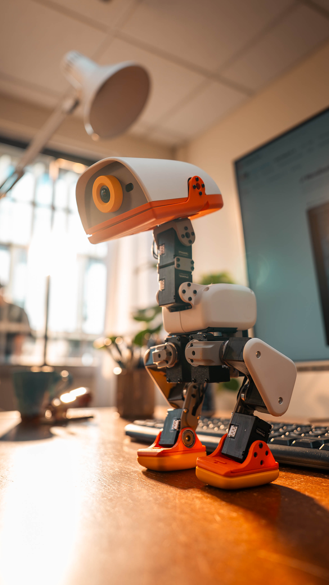
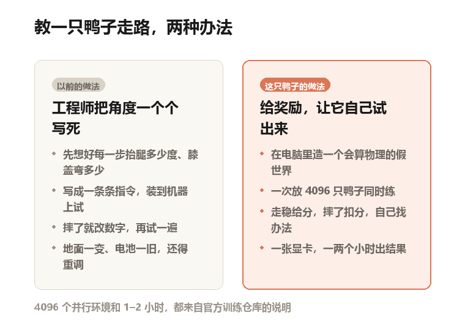
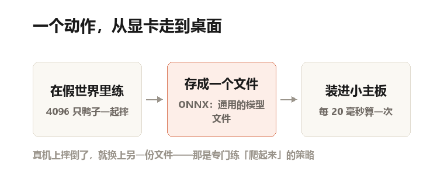
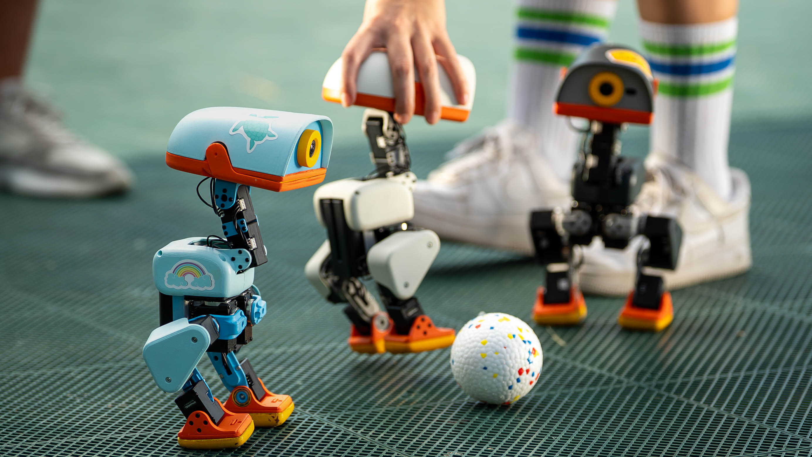
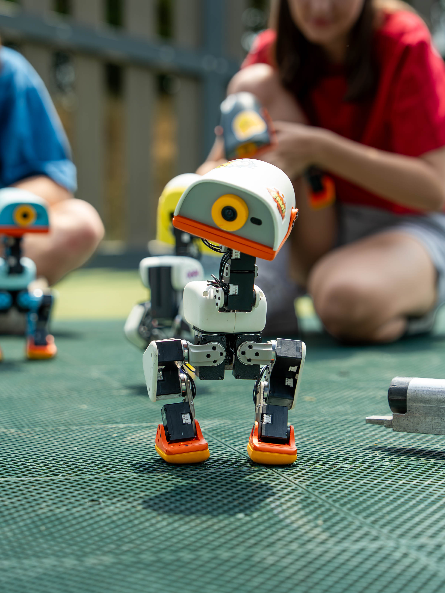

你伸手，把它推倒。

它侧躺在地上，两条腿在空中蹬了两下，脑袋歪着，像在找地面。

然后它翻回来，站住了。

这段不是动画，是厂商拍的实拍视频。从躺平到站起，全程没人扶。

它叫 Microduck，法国 Pollen Robotics 做的。这家公司 2025 年并进了 Hugging Face（做开源 AI 模型的那家）。
鸭子今年 7 月底在 GitHub（程序员存代码的网站）上开源。到 11 月初攒了 1.3 万颗星，平均一天一百多颗。

我想写它，不是因为可爱。
是因为它身上有件事，正在改掉机器人行业的老规矩：它走路的本事，不是人写出来的。

官方产品图：Microduck 站在办公桌上。整机 25 厘米高、不到 800 克，差不多一瓶半矿泉水

## 先说清楚，这是只什么鸭子

25 厘米高，不到 800 克，14 厘米宽。放在桌上，比一瓶 500 毫升的矿泉水高一点、沉一点。

15 个电机。电机就是能转的关节。你抬手拿杯子，大概只动三个：肩、肘、腕。它全身有十五个。
399 美元。官方说这是预购的介绍价，税前、不含运费，折合一台平板的钱。

出厂自带七个动作。
走路、坐下、站起、蹲下用嘴叼东西、踢球、踩轮滑、摔倒了自己爬起来。

这里有个词得先说清楚：**自由度**。
自由度，指一个东西能单独转动的方向有几个。它一个电机管一个方向，所以电机数就是自由度。

十五个，等于同时用十五根手指弹琴，每根都得弹对。

其中十四个由走路的程序直接管：两条腿各五个，脖子和脑袋四个。
第十五个在嘴上。那张嘴能张开、能夹住东西，是单独的一个关节。

## 走路这件事，以前是写出来的

一只两条腿的机器人要走路，最难的地方是：它随时会倒。
站着不动也难。重心压在两只脚上，稍微一晃就得靠脚踝掰回来。

以前的做法，是工程师把动作拆开，一个个写死。

先定好这一秒左腿抬多高、膝盖弯多少度，再定下一秒。
写成一条条指令，装到机器上试。

摔了，改数字，再试。
这套办法能行，就是费人。

地面从地毯换成瓷砖，脚底摩擦力变了，原来的数字就不灵了。电池满电和快没电，电机力气不一样，步态又会飘。

自制示意图：左边是以前的做法，右边是这只鸭子的做法

## 它执行的不是程序，是一份练出来的反射

Microduck 的走法换了个思路。
没有人告诉它"膝盖弯 20 度"。

工程师只告诉它一件事：走稳了加分，摔了扣分。
然后把它扔进一个虚拟的世界里，让它自己摔。

摔的次数多到没人愿意数，它自己摸出了一套办法。这套办法在行话里叫**策略**。

说人话就是：一份条件反射。
看到什么，就做什么。中间不需要有人想。

更准确地说，这份反射是**强化学习**练出来的。
强化学习，你可以理解成训狗。做对了给零食，做错了没得吃。狗不知道什么叫"坐下"，它只知道那样做有零食。

鸭子也一样。它不知道什么叫"平衡"，它只知道腿这么摆，分数高一点。

## 训练场在显卡里，一次放 4096 只鸭子

那个虚拟世界叫 **MuJoCo**。
说人话就是：电脑里造的三维假世界，带物理引擎。撞到桌子会被真的挡住，脚踩滑了会真的摔。

鸭子摔了不心疼，重来就行。
训练一次开 4096 只鸭子，各摔各的，谁也不等谁。

4096 这个数，是官方训练仓库里的默认设置。

要练出一个能用的走路姿态，一张显卡跑一到两个小时。
参照一下：人类小孩从扶着走到自己走稳，大概要一年。

鸭子这个"一年"，被压缩成了两小时。它一次能上 4096 个分身。

它每一步要看 61 个数字。
48 个来自身体自己：每个关节现在转到哪、转得多快、身体歪了多少。

这种"闭着眼也知道自己手在哪"的感觉，叫**本体感觉**。剩下 13 个是命令，比如往哪走、走多快、头朝哪看。

看完这 61 个数字，它吐出 14 个数字。
14 个关节，每个该转到什么角度。

没有"思考"，没有"规划"，就是一进一出。

自制示意图：一个动作从训练到上机的三步，回来那一步靠换文件

## 仿真里会走，不代表桌上会走

这里有个所有做机器人的都绕不过去的坑，叫**仿真到现实的落差**。
在假世界里走得稳，装到真机上就摔。

原因很具体，一共三个。
第一，舵机不是理想电机。

舵机就是一个盒子里装了电机、减速齿轮和位置传感器的小东西。它有力气上限，有摩擦，电池快没电时电压一掉，力气也跟着掉。

第二，齿轮之间有缝隙。

你晃过自行车的车把吗？先空转一点点，才带动前轮。那点空隙叫**背隙**。

鸭子的每个关节都有正负 1 度的背隙。关节一多，这点空隙会一层层叠起来。

第三，指令有延迟。

你算完让它抬腿，舵机要晚几毫秒才真的动。这几毫秒里，身体已经又歪了一点。

他们的应对办法，是不假装这些不存在。
训练的时候，故意把电池电压和摩擦力随机改，把指令延迟随机加长。

还专门练了一套"带背隙"的版本，跟不带背隙的对比着看。

说人话就是：不是让孩子在光滑的地板上学走路，是让他在草地、沙地、斜坡上都练一遍。
真到了地板上，反而简单了。

## 上机：一个文件，每 20 毫秒算一次

练完的策略，要装进鸭子脑子里。
主板上是一块 Rockchip RK3566 芯片。内存 1GB，存储 32GB。

这个配置，大概相当于十年前的一部中端手机。

模型先导出成一个文件，格式叫 **ONNX**。
说人话就是：模型界的 PDF。在哪练的都无所谓，机器能读就行。

这个文件装进去以后，主板上有一个程序每 20 毫秒运行一次。
20 毫秒是什么概念？一秒五十次。你眨一次眼大约一两百毫秒，够它算五到十次。

每一次，它把 61 个数字读进来，算出 14 个角度，发出去。

一秒五十次，不能晚，也不能漏。晚了，脚就落地了。

还有个设计挺聪明：七个动作，是七份独立的文件，不是一个大模型。

七份文件的输入格式完全一样，都是 61 个数字。

所以可以随时换。走着走着一脚踩空，程序立刻换上"爬起来"那一份。

像老式游戏机换卡带。卡带形状统一，插进去就能玩。

除了跑策略，鸭子里还跑着七个小程序。

一个专门管电机，别的管 Wi-Fi、蓝牙、摄像头和系统更新。

更新是整包替换，不是打补丁。新版本起不来，它自己退回上一版。

## 一个反直觉的细节：踢球的时候它看不见球

官方训练仓库里有一句很老实的话。
练踢球那个策略时，输入里没有摄像头画面。用他们的话说，踢球的那个"大脑"是看不见球的。

它踢的是一个 70 毫米、15 克的小球，比乒乓球大一圈。

看不见怎么踢？
靠时机。它记住的是"走到某个位置、腿摆到某个角度的时候往前踢"，不是"看见球在那就踢"。

所以场地要平，球也得摆在大概的位置上。

这只鸭子的"看"，还很浅。
它能叼东西，靠的是把头低到地面、用嘴碰。不是认出了那个东西是什么。

官方产品图：三只不同配色的 Microduck 在球场上，中间那只正被一只手扶着。踢球策略的输入里没有画面

## 说点不好听的

第一，它不是开源硬件。
官方的新闻资料里专门写了一句提醒。

开源指的是软件。机械结构和电路设计文件不开放，请不要把它描述成"开源硬件"。

软件是 Apache-2.0 协议，很宽松，你可以改、可以商用。但 3D 模型文件那套协议不许商用。

想照着做一个自己的，材料清单拿不到。

第二，现在还没人拿到手。

399 美元是预购价，8 月底开始收单，首批交付的目标是圣诞节前。

也就是说，所有那些可爱的视频，都是厂商拍的。

没有第三方独立评测，官方也没公布任何成功率。

一只鸭子在你家地毯上能走多稳，现在没人知道。

官方产品图：几个孩子在球场上玩这几只鸭子。照片均由厂商拍摄，也是目前唯一的实机画面

第三，它的传感器很省。
那颗激光雷达是 8×8 的深度矩阵，一共 64 个点。

你手机前置摄像头是一千多万像素，它只有 64 个点。这 64 个点只能告诉你"前面大概有东西"，说不清是什么形状。

板子上的 AI 加速器，官方的常见问题页里自己承认，只够跑一个很小的检测器。想跑大一点的模型，得把摄像头画面传到云端去算。

所以它的"智能"是打了折的：会走、会站，但看不懂房间。

第四，它没有通用的大脑。
想让它学个新动作，还是得重新训练一份，再装进去。

好在流程是通的。练完可以一键发布到 Hugging Face。

别人一条命令，就能装到自己鸭子上。

## 真正变了的，不是它会走路

我一开始想写的是"机器人会走路了"，写完发现不是。

会走路这件事，波士顿动力很多年前就演示过了。

真正变了的，是学会走路的成本。

以前要靠一队人调很久。现在是一张显卡、一两个小时、一条命令。

而且这套流程是公开的。怎么建模、怎么加噪声、怎么导出，全在仓库里。

一只 399 美元的鸭子当然算不上什么突破。

但它把一扇门推开了一条缝：以后"会走路"会像"会说话"一样，变成一件不稀奇的事。

到那时候，稀奇的就不是谁会走路。

是谁愿意把怎么学会的，写给你看。

---

**项目信息**

名称：Microduck（一只 25 厘米高的双足机器鸭）
团队：Pollen Robotics，法国波尔多，2016 年由前 Inria 研究员创立
2025 年 4 月加入 Hugging Face，成为其机器人团队
运行时：github.com/pollen-robotics/microduck
训练：github.com/pollen-robotics/microduck_rl
协议：软件 Apache-2.0；3D 模型 CC BY-NC-SA 4.0；机械与电路设计文件未开源
官网：pollen-robotics.com/microduck
预售：399 美元起，首批交付目标 2026 年圣诞节前
数据来源：项目 README、docs/ 设计文档、microduck_rl 的 AGENTS.md
以及官方新闻资料页

以上页面抓取于 2026-11-05。文中数字均出自这几处，官方没公布的（比如成功率）已注明。

**图片版权**：文中三张实物照片来自 Pollen Robotics 官方新闻资料包，版权归 Pollen Robotics 所有。

此处仅用于介绍该产品。两张示意图为本号自制。
