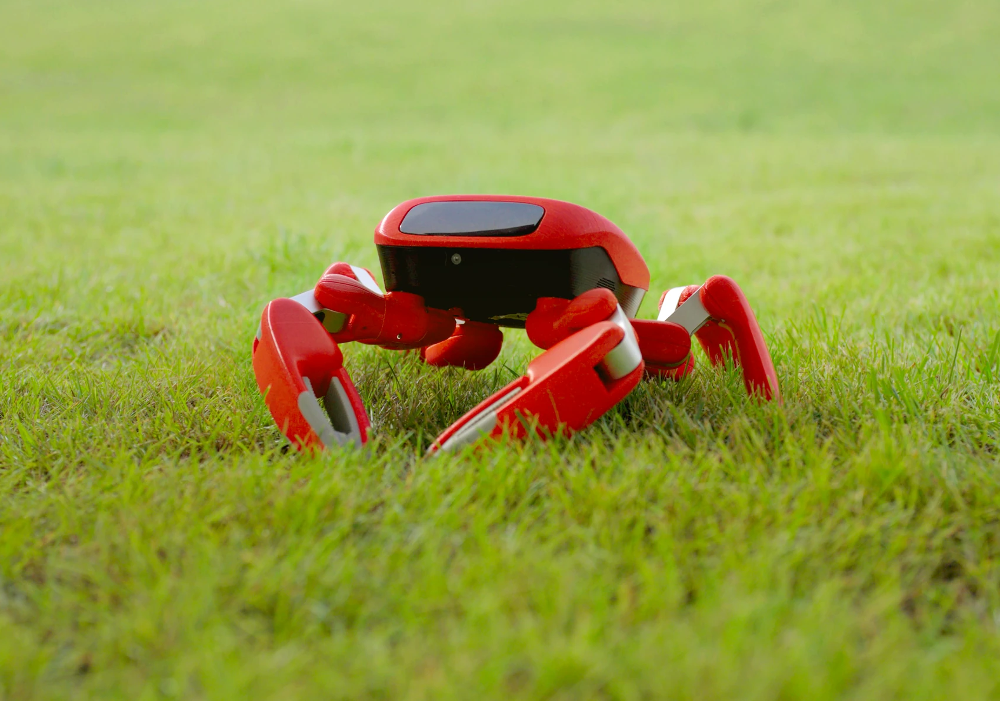
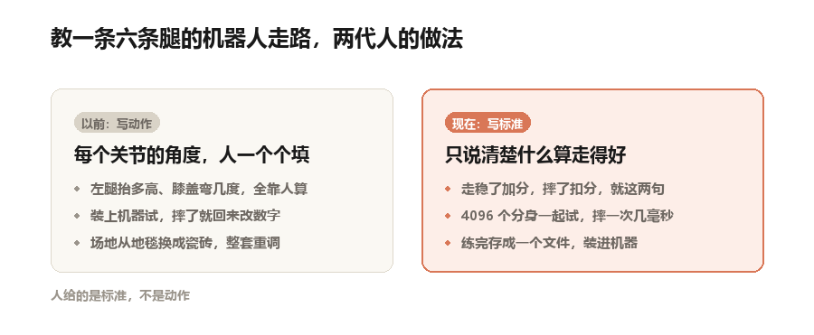
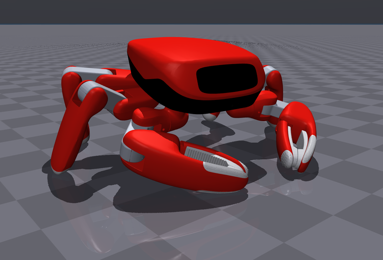
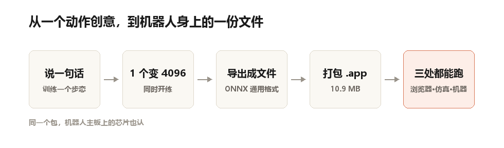

你点一下官网上的地面。

屏幕里那只红色的螃蟹会绕开挡路的箱子，走到你点的地方。

不是预录的动画。你点哪儿，它算到哪儿。

它叫"跳跳"，英文名 Jumper，北京金钢科技做的。今年 9 月 28 日，他们把整套东西搬上了 GitHub（程序员存代码的网站）。

不是甩几段演示视频，是从训练、回放到装进机器人主板的完整流程。

到 11 月初，仓库攒了 3,110 颗星、354 次 fork（把别人的仓库复制一份到自己名下）。五周时间。

我想写它，不是因为长得像螃蟹。

是因为它把一件通常要一个小团队磨几个月的事，压成了几条命令。

先把话说前头：这几条命令背后，是一台带显卡的电脑，和一段不短的等待。不是手机上点两下。

官方产品图：跳跳在草地上。"跳跳"是中文名，Jumper 是英文名

## 先说清楚，这是只什么螃蟹

六条腿。前面两条带钳子，后面四条走路。

整机 40 厘米宽、40 厘米长、20 厘米高，1.8 公斤。比一瓶 1.5 升的矿泉水，重六两。

全身 22 个关节。关节就是能单独转动的地方，一个关节能转的方向，行话叫一个"自由度"。

22 个什么概念？你一只手能做出的动作，差不多就是这个数量级。

它等于把一只手的灵活度，塞进了一个盘子大的身体。

官网给的数字：最高速度 0.5 米每秒，最大跳跃高度 40 厘米，能叼起 1 公斤，续航约 2 小时。

1 公斤差不多是两瓶矿泉水。两小时续航，和你用手机连着看视频差不多。

半米每秒，大概是人正常走路速度的四成。40 厘米，比一张 A4 纸的长边还高一截。

它的关节用的是"触觉舵机"。舵机，就是能转到指定角度、还能顶住不动的电机。

加了"触觉"两个字，意思是它知道自己被多大力气顶住了。你的手被门夹了会疼，它被卡住会知道。

头上那块黑面板里是 500 万像素的摄像头，对角视野 162 度，差不多是你单眼能扫到的范围。

旁边还有一颗深度传感器，一帧测 2,268 个点的距离。

说人话就是：把前方一片区域切成两千多块小格子，每格量一次多远。

主控是一块瑞芯微 RK3576，带一个算力 6 TOPS 的 NPU。
NPU 是专门算神经网络的芯片。TOPS 是它每秒能做多少次运算，单位是万亿次。
6 TOPS 在今天的芯片里不算高，一块手机芯片就有十几 TOPS。但它要跑的不是大模型，是一个很小的动作网络，够用。

（上面这些参数来自仓库的硬件文档和官网参数页，不是估的）

## 走路这件事，以前是人一个关节一个关节写出来的

六条腿要走路，难的不是抬腿，是不倒。

站着不动也难。重心压在几条腿上，稍微一晃就得靠脚踝掰回来。

抬腿的时候只剩三条腿着地。撑住的那一小片，比一个巴掌大不了多少。
以前的做法，是工程师把动作拆开，一个个写死。

这条腿抬 8 厘米，膝盖弯 20 度，撑 0.2 秒，换下一条。

写成指令，装到机器上试。摔了，回来改数字，再试。

这套办法能行，就是费人。而且脆。
地面从地毯换成瓷砖，摩擦力一变，原来的数字全废。
电池满电和快没电，电机力气不一样，步态又开始飘。

自制示意图：左边是以前的做法，右边是这只螃蟹的做法

## 他们换了个办法：不写动作，写标准

跳跳的走法里，没有人告诉它"膝盖弯 20 度"。

工程师只写了两句话：走稳了加分，摔了扣分。

然后把它扔进电脑里造的假世界。那个世界有重力、有摩擦，撞到桌子会真的被挡住。

这套东西行话叫"仿真"，你可以理解成一个可以随便摔的三维沙盘。

学法叫强化学习。当成训狗就好：做对了给零食，做错了没得吃。
狗不知道什么叫"坐下"，它只知道那样做有零食。它也不知道什么叫"平衡"，只知道腿这么摆，分数高一点。

然后是关键的一步：不是训一只，是同时训 4096 只。

4096 是仓库教程里的默认值。同一个模型，在 4096 个平行世界里同时跑。

每个世界的重力、摩擦、初始姿势都不一样。谁摔了谁重来，学到的东西汇总回同一个模型。

4096 个分身一起跑。人一辈子摔的跤，加起来也没这么多。
而且摔一次只花几毫秒，不用担心摔坏机器。

仓库截图：同一个模型在仿真里的样子。灰色格子就是虚拟地面，摔了不会坏

## 一句话就能开工，但这句话不是咒语

这个仓库有个不太一样的做法：它自带一份写给 AI 助手看的说明书。

根目录放着 AGENTS.md、CLAUDE.md，还有一个放操作手册的目录。装环境、开训练、导出、打包，每一步该看什么输出、什么情况算失败，全写在里面。

所以作者敢在首页第一句就写：把这个仓库丢给 AI 编程助手，试试下面这几句话。

原文是英文，翻译过来是：训练一个稳定的三足步态，回放并评估，然后打包成一个 .app。

说人话就是：以前这套流程，得有个懂行的人盯着。

现在作者把老师傅的手艺写成了清单，AI 照着清单跑。卡住了，它自己去翻对应那一页。

注意这不是"AI 自己想通了怎么让螃蟹走路"。

是"人把流程写清楚了，AI 负责不出错地执行"。前者是魔法，后者是工程。

而且训练本身跑不掉，要显卡、要时间。官方文档很老实地写了一句：每次要多久，取决于你的机器，也取决于你调奖励的手感。

这份文档不装作知道。

## 练完的东西，最后变成一个 10.9 MB 的文件

练出来的东西，行话叫"策略"。说人话就是一份条件反射：看到什么，就输出什么，中间不需要有人想。

它有三个数字，很能说明这只螃蟹在被怎么指挥。

走路那个：每秒算 50 次，每次看 411 个数字，吐出 20 个数字。

411 个数字，是它这一刻能感觉到的全部。

里面有 22 个关节各自的角度、转得多快、机身歪了多少，还有上一步做了什么。

吐出的 20 个数字，是一串动作指令。控制器里的代码负责把它翻译成每个关节该转到哪。

每秒 50 次是什么速度？你眨一次眼大约 0.1 到 0.4 秒。你眨一下，它已经算了 5 到 20 次。

跳跃那个不一样：每秒算 200 次。

因为起跳只有 40 毫秒的窗口。按每秒 200 次算，这 40 毫秒里只来得及做 8 次判断。

跳晚了，腿还没伸直就落地；跳早了，力气不够。

（跳舞那个是每秒 50 次，看 209 个数字，管 22 个关节。）

练完要装进机器。过程是这样：

先导出成 ONNX，一种通用的模型文件格式，谁都能打开。再转成 RKNN，那是板子上那颗 NPU 认的格式。

最后把几个动作、按键映射、参考动作打成一个包，后缀 .app。

整套 10.9 MB。比一首无损歌还小。

自制示意图：一个动作创意怎么走到机器人身上

这个包有个讲究：同一个文件，能在三个地方打开。

浏览器里、电脑的仿真里、机器人的主板上。

浏览器是给你看的，仿真里是给开发者调的，板子上是给机器跑的。
三边读的是同一份控制逻辑，所以不会出现"电脑上好好的，装到机器上就乱"。

省掉的正是这种最难查的错。

## 它自己长出来的走法，比人想的怪

仓库给六条腿准备了四种走法：三足、四足、波动、平走。

三足最好玩：六条腿分成两组，三条撑地、三条抬起，交替进行。

真的昆虫就是这么走的。你盯着蚂蚁看，会发现它抬腿是有节奏的，不是随便抬。

有意思的地方在这儿：这四种走法，代码除了"步态"和"速度上限"两项，其余完全一样。

仓库里甚至有专门的测试盯着这件事，谁在别的地方也动手脚，测试就会报错。
换句话说，四种走法不是四套手写的动作，是同一个奖励函数长出来的四个解。

人只说了"要稳、要快"，剩下怎么分岔，是它自己找的。

这是我在这类项目里最喜欢看的部分：你以为你在设计动作，其实你在设计"什么算好"。

## 有几件事得先说清楚

第一，也是最要紧的：所有漂亮的动作，目前都发生在仿真里。

项目自己的状态说明写得很直白：RKNN 推理还没在板子上验证过。

控制程序里的那个环，也还没驱动过真实电机。

那个环要每秒跑 1,000 次。真机上电机靠这个频率实时响应，这一环没跑通，等于练得很好，还没上过场。

仓库里也没有结构图纸和电路文件。HARDWARE.md 只是一张规格表，告诉你有多少个关节、什么芯片，不告诉你怎么把它装起来。

第二，它不卖。官网没有价格，也没有购买入口，只有一个开源动作大赛，用作品去争取一台。
所以"开源"这两个字，覆盖的是软件工具链，不是一台能照着打印的机器。

第三，有些功能是半成品。换外观导出的 .skin，现在只能看，不能拿去训练；导入的场景只能在回放里看，不能用来练。

第四，仓库没有发布版本，也没有版本号。教程开头自己标了一句：按键映射在 9 月 26 日和 29 日改过两次，照着旧教程做会对不上。

第五，没有第三方评测。跳跃高度、续航这些数字都是官方给的，我找不到独立验证的记录。成功率、摔倒率，官方一个字没提。

## 写在最后

一只螃蟹跳起来很好看，但这件事真正有意思的地方不在那 40 厘米。

在于它把"教会一台机器做一件事"，从手艺变成了流水线。

写标准、开 4096 个分身、导出、打包、装进去。

也在于作者没把最后一步藏起来。真机没验，就写在文档里说没验。

开源一个东西，敢把自己没做完的部分标出来，比多放几个炫技视频值钱。

## 项目信息

- 名称：跳跳 Jumper（一只 22 自由度的螃蟹机器人，加一套训练工具链）
- 团队：金钢科技 KingKong Robotics（北京）
- 开源协议：Apache-2.0（一种允许商用和修改的开源许可证，保留署名即可，仓库内第三方素材另有说明）
- 仓库：github.com/KingKongRobotics/jumper，2026 年 9 月 28 日建库，11 月 6 日 3,110 星、354 fork
- 官网：kingkong.tech/jumper
- 底层依赖：MuJoCo（物理仿真）、mjlab（训练框架）、rsl_rl（强化学习算法库）

**图片版权**：正文两张实拍与渲染图，来自项目仓库的 media 目录与官网产品页，版权归金钢科技所有。

两张示意图由本号用项目文档自制。文中数字均取自仓库文档与官网，未做推测。
