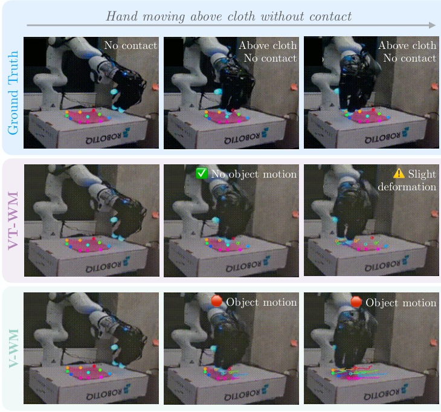
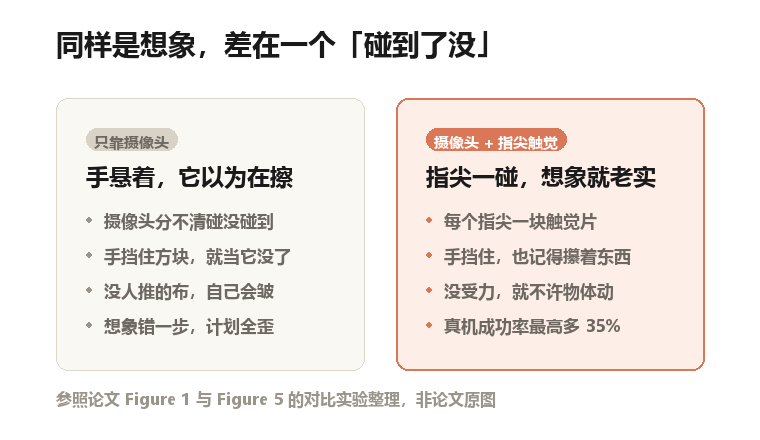
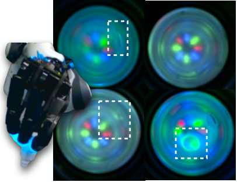
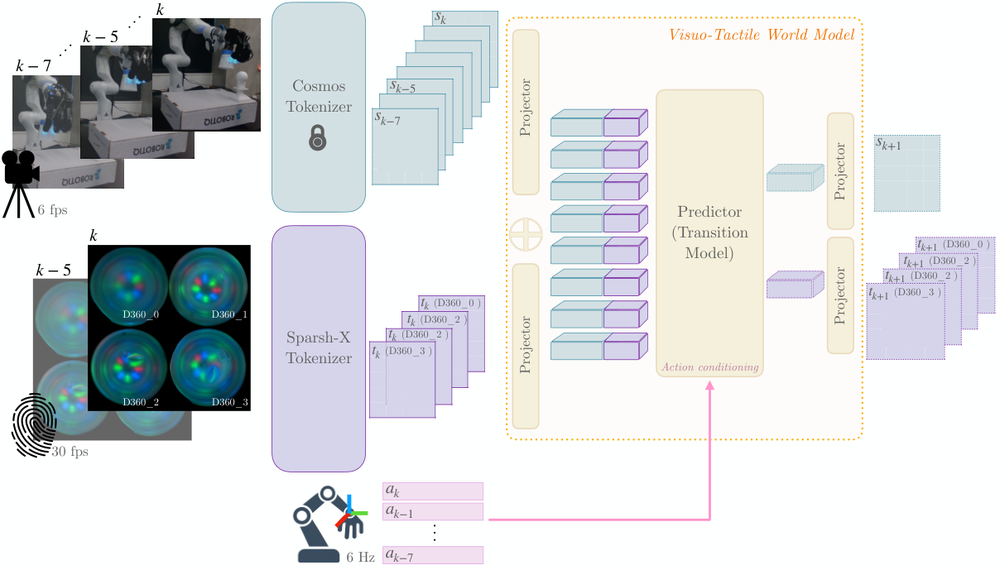
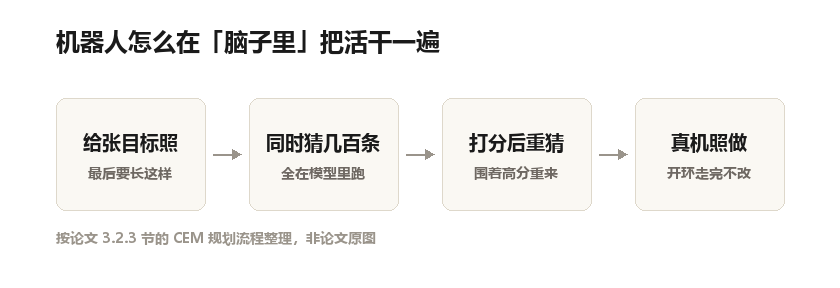
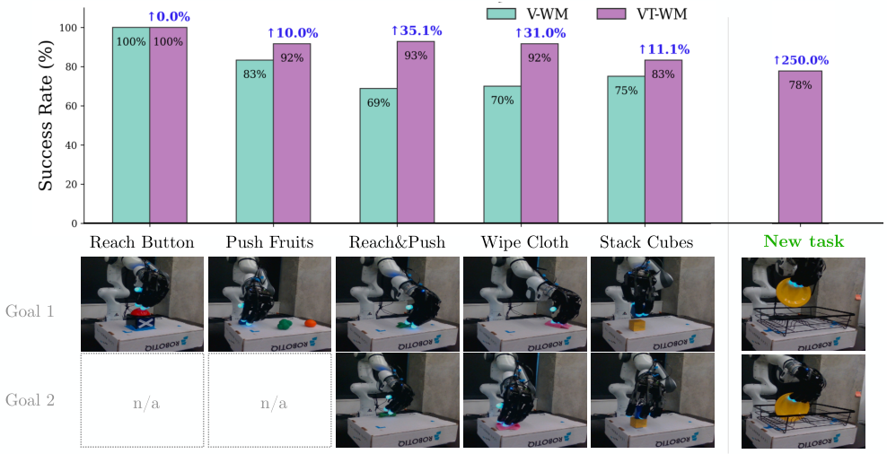

桌上铺着一块布，布上散着几颗彩色小水果。机械手悬在布的上方，横着划过去。

手没碰到布。可摄像头拍下来，手指几乎贴着布面，划过的动作也很像在擦。

于是机器人在脑子里演了一遍接下来会发生什么：布被推着皱起来，水果跟着手一起走。

真实情况是，布和水果都一动不动。

论文里有一组对比图，同一件事的三种版本：真的、加了触觉想的、只靠摄像头想的。只靠摄像头那版，水果被拖走了。

论文原图（Figure 5）：三行依次是真实画面、加了触觉的想象、只靠摄像头的想象。手在布上方划过但不接触，中间一行标着"物体没动"，最后一行标着"物体在动"

## 机器人动手之前，先在脑子里演一遍

这件事，行话叫世界模型。说人话：让 AI 先想一下"我这么做，会怎样"，再决定动不动手。

你端一碗满汤往前走，会先估一下这样走会不会洒。机器人干的是同一件事，只不过它是在脑子里放一段画面。

这条路线很热。Meta 的 V-JEPA、英伟达的 Cosmos，都在做同一件事：给机器人一个能预演未来的模型。

有了它，机器人不用真去试错。想错了重想一遍；试错了，桌上东西就掉地上了。

问题是，这些模型几乎都只用摄像头。

## 只靠眼睛，它会自己骗自己

摄像头有个天花板：它看不到力。

手悬在布上方，和手按在布上，从侧面拍，画面可能只差几个像素。物理上却是两件事：一个什么都不会发生，一个会把布推走。

模型看不出差别，就按见过的多数情况猜。它见过太多"手贴着布划过去，布就皱了"的画面，于是也想：布该皱了。

还有更离谱的。手一抓，方块被手指挡住，看不见了。模型有时直接当它不存在，想象的下一个画面里，方块就消失了；手一松开，它又凭空出现在别处。

论文管这叫幻觉：消失、瞬移、没受力自己动。

对做视频的公司，这最多是画面不好看。对机器人是致命的：它靠这段想象决定手往哪走。想象里布皱了，它就以为活干完了。

自制示意图：按论文的对比实验整理，左边是只靠摄像头的失败模式，右边是加上指尖触觉之后的差别

## 指尖上那台小相机

研究者的办法很朴素：眼睛看不到力，就给手指加上触觉。

传感器叫 Digit 360。长得像个指尖套，里面装了一台小相机，镜头对着上面一层软胶。

手指按到东西，软胶被压出形状，相机拍下来。压得深浅、往哪歪、滑不滑，全在这张图里。

所以触觉传感器的输出，本身也是一张图。

论文原图（Figure 2）：机械手捏着一颗螺丝时，四个指尖传感器拍到的画面。白框圈出的是真正接触的位置

既然触觉也是图像，就能借视觉那套现成的深度网络来处理，不用从头造轮子。

论文直接用了两个训练好的编码器：视觉是 Cosmos，触觉是 Sparsh-X。编码器把一张图压成一串数字，说人话就是把画面翻译成模型能算的东西。

## 两路信号，一个预测器

架构不复杂：两路输入，一个预测器。

视觉那路取最近 1.5 秒的画面，9 帧，每秒 6 帧。触觉那路，每个指尖只取最近 0.16 秒的 2 帧。

为什么触觉取得这么短？因为接触是瞬间的事，打滑、力度突变都在几十毫秒里。用看云的节奏看闪电，什么都看不清。

两路数字拼在一起，交给一个 12 层的 transformer。transformer 就是今天大模型用的那种网络结构，ChatGPT 内部也是它，只不过这里拿来看画面、摸触觉、输出下一步。

论文原图（Figure 3）：左边两路输入——相机画面进 Cosmos（锁头表示这一路不训练），四个指尖的触觉图进 Sparsh-X；右下角是机械臂的动作；右边输出下一步的视觉和四张触觉图

模型一共 1.73 亿参数，其中真正参与训练的 9600 万。参数就是模型的旋钮数量，旋钮越多，能装下的规律越复杂，也越吃算力。

1.73 亿这个体量很小。今天手机里跑个图像模型都不止这个数。它赢的不是"大"。

动作也从这进来。机械臂每一帧的位移、旋转，加一个"手张开还是合上"的信号。每秒采样 30 次，每 5 个打成一包。这些动作喂进去，模型才知道"如果这么动，下一步会怎样"。

然后它输出的不只是下一帧画面，还有四个指尖各自的触觉图。这一步是整篇论文的关键：它不只想象"看起来会怎样"，还想象"摸起来会怎样"。

训练数据是人遥控采的：拿一套设备操纵机械臂干活，相机和指尖同步记录。八个任务，124 条演示，11.2 万个数据点，每条平均 40 秒，加起来不到一个半小时。

这个量很小，别的工作动辄几万小时真机数据。失败的那些也留着，没筛掉。

## 想象变准了，准在哪

怎么衡量"想象得准"？不能靠人眼看。

他们用了一个叫 CoTracker 的追踪工具。先在物体上打点，看这些点在真实视频和想象视频里各走了什么路线。再算两条路线差多远，用的是 Fréchet 距离。

说人话：两条线像不像。完全重合是 0，差越大，想象越离谱。

测两个东西。一个是物体恒存：东西被挡住时，模型还记不记得它在。这是婴儿半岁到一岁才学会的能力：玩具藏到布下面，婴儿先以为没了，后来才知道还在。

另一个是因果合规，没有外力推的物体，模型会不会让它自己动。

结果，物体恒存这一项，误差平均降了 33%。五个任务里，降幅在 18% 到 47% 之间。因果合规这一项，平均降了 29%。

33% 要这么读：不是准确率 33%，是错误少了三分之一。原来错得厉害，现在少一些，离完美还远。

也不是每个任务都灵。擦布、用马克笔画这两项，误差降了，但没到统计显著，说白了可能是运气。

更麻烦的是，用马克笔画这一项，因果合规反而变差了。加了触觉，更容易让不该动的东西动。论文把这点如实写出来了，没藏。

## 真机上多出来的那两成

想象准了，能换来什么？他们在真机上测规划。

做法是这样。给一张目标照片，让模型在脑子里试几百条动作，挑出终点最像的那条，直接上真机。

这套试错法叫交叉熵方法，简称 CEM。说人话就是：先瞎猜一批，挑出最像的，围着它们再猜一轮，几轮就收敛了。

还有个词要注意，叫零样本：任务没专门训练过，第一次见就直接上。

自制示意图：按论文 3.2.3 节整理的规划流程。注意最后一步是开环——想好了就一口气走完，中途不回头看

五个任务，每个跑 5 次，初始位置都不同。

按按钮：两个模型都是 100%。推水果：83% 到 92%。擦布：70% 到 92%。摞方块：75% 到 83%。

够到再推这一项，有两个子目标，从 69% 到 93%。

论文原图（Figure 7）：五根浅色柱是只靠摄像头的模型，深色柱是加了触觉的。最右边一根是新任务，只给二十条演示。柱子下面两行是任务里两个子目标的实拍

论文写"最高提升 35%"，指的就是够到再推这一项。这个 35% 是相对涨幅，不是百分点。69% 到 93%，绝对差是 24 个百分点，相对涨幅才是 35%。

别小看这个区别。写成"涨 35 个点"，就等于把 69% 变成 104%，不成立。

24 个百分点是什么概念：原来十次错三次，现在错不到一次。

反直觉的是：简单任务上两个模型打平，按按钮都是 100%。加触觉的收益，只在需要持续接触的任务上才显出来。

推东西，得知道手真的顶上了。擦桌子，得知道布跟着走了没有。光看画面，判断不了。

## 二十条演示就能换个新活

最后有个实验挺有意思。新任务是：把盘子放进架子。模型没见过这个任务，也没见过这个盘子。

他们只加了 20 条演示，接着训练。十次试跑，成了 78%。（论文正文写的是 77%，配图上标 78%，差一个点，我按配图写。）

失败的那几次，是把盘子放到了架子旁边。不是没理解任务，是最后几厘米精度不够。

20 条演示，放在今天动辄几万条的数据规模里几乎等于没有。能做到这个程度，说明多任务训练学到的东西能搬过去用。

## 这套办法的软肋在哪

最硬的一条：全程只测了一种触觉传感器。

Digit 360 是拿相机拍软胶形变的那一类。换成压阻式、电容式，或者更便宜的国产件，效果未知。论文说框架通用，但没做实验。

第二条，测试范围窄。所有实验都在同一张桌子上、同一批物体。换个颜色、换个大小、换个更滑的杯子，没测。

物体恒存那项，用的也是训练过的任务，只是轨迹没见过。真遇到陌生任务，掉多少不知道。

第三条，规划只做到开环。开环的意思是：想好了就一口气执行完，中途不回头。手一抖、东西一滑，它不会改。

为什么不开环不行？因为慢。每走一步都要在脑子里跑几百条轨迹，算力吃不消。

对比一下传统机器人控制：反馈能到每秒几百次。这套方法差了两个数量级。

第四条，样本量小。每个任务只跑 5 次，一次成败就能让成功率跳动 20 个百分点。推水果那 9 个点的差距，在这个样本量下可能只是多成功了半次。

论文给了置信区间，但没有更多重复。

第五条，只跟自己比。对照组是同一个模型去掉触觉，没跟别的多模态方法比。到底是触觉有用，还是多一路输入就有用，分不清。

## 最后

我们总说机器人缺一双好眼睛。这篇论文的答案是：它更缺手感。

摄像头能把世界拍成像素，但像素里没有力。一块布被压下去一点，和悬在上方一点，照片里差不了几个像素。

可对机器人来说，这是"擦干净了"和"什么都没做"的区别。

触觉传感器也不贵。机器人变聪明，不一定非要把模型做大，有时候是补上它一直缺的那个感官。

---

**论文信息**

- 标题：Visuo-Tactile World Models
- 作者：Carolina Higuera、Sergio Arnaud、Byron Boots、Mustafa Mukadam、Francois Robert Hogan、Franziska Meier
- 机构：华盛顿大学 Paul G. Allen 计算机学院、Meta FAIR
- 状态：预印本。2026 年 2 月 5 日提交 arXiv，OpenReview 上有投稿记录，截至发稿未见会议录用声明
- arXiv：2602.06001
- 项目页：carolinahiguera.github.io/vtml

**图片版权**：Figure 2、3、5、7 来自论文原文（arXiv:2602.06001），版权归论文作者所有，此处仅作解读引用。两张示意图由本号依据论文内容绘制，不是论文原图。
