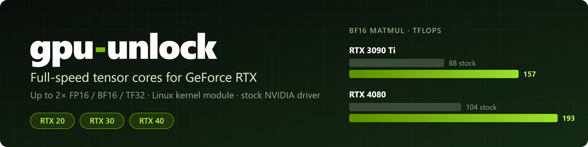
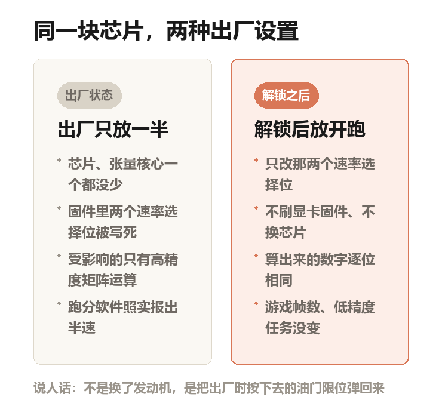
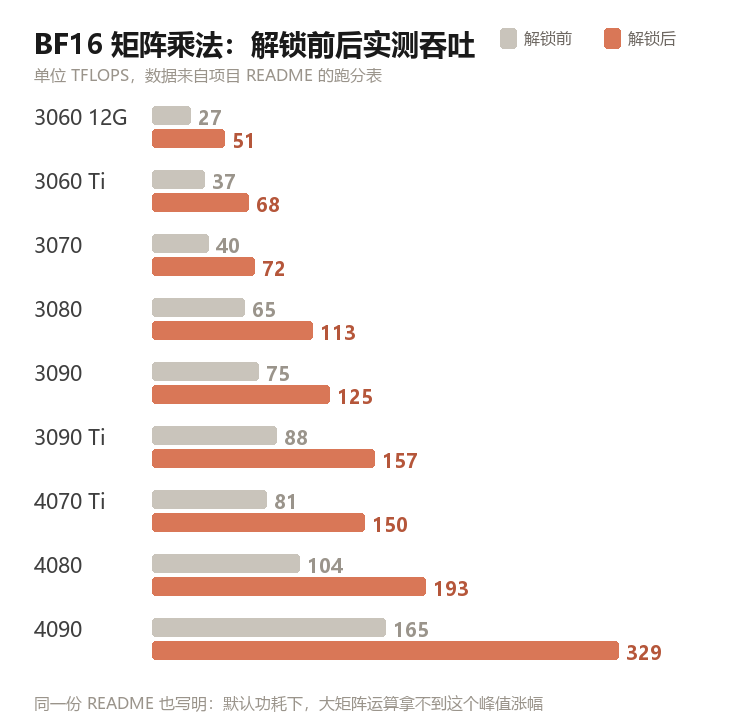
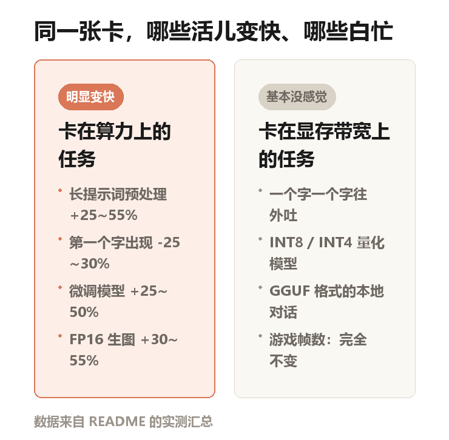
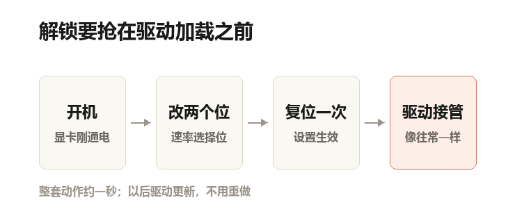

深夜，你在自己电脑上跑一个大模型。丢进去一份几十页的 PDF，敲回车，然后等。

风扇响起来，显卡占用冲到顶。你大概会觉得，它在拼命干活。

其实它只拼命了一半。

这个月 GitHub 上有个项目火了，叫 gpu-unlock。一句话说清它干的事：同一颗芯片，游戏卡出厂只给你半速，它把另一半要回来。

到 11 月 8 日，1.8 万个星标、1800 多个复刻。星标就是收藏，复刻是把别人的仓库复制一份到自己名下，两个数都算「有多少人真在动手」。

项目自带的横幅，来自仓库里的 assets/banner.svg，作者 Zagitta。图右侧那两根绿条，就是这篇要讲的半速与全速

## 被锁的不是芯片，是出厂设置

英伟达的显卡里，有一块专门算矩阵乘法的电路，叫张量核心。

矩阵乘法说人话：一大片数字，乘一遍、加一遍。AI 干的活里，大部分都是这件事。

出厂时，这条路的吞吐被压到一半。芯片、核心、显存，一个零件都没少。

压的是哪几条路？FP16、BF16、TF32，AI 算数用的「简写数字」。

FP16 说人话：用 16 位存一个数。位数少，占的地方小、算得快，精度对 AI 够用。BF16 是它的兄弟，位数一样，能表示的范围更大。TF32 是英伟达的折中版，19 位。

这三条路还有个共同点：存的时候用低精度，加的时候用高精度。高精度那位叫 FP32，说人话就是「账本记得更细」。

一长串加法，中间结果要是也被砍到 16 位，误差会越滚越大。

所以锁卡的位置很刁。不锁游戏，不锁低精度，专锁「低精度输入 + 高精度累加」这一段。而这一段，恰好是大模型训练的主路，也是没做压缩的原始模型推理的主路。

自制示意图：左边是出厂状态，右边是解锁之后。芯片没换，改的是固件里那两个速率选择位

## 厂商为什么要留这么一手

同一块晶圆切出来的芯片，装进游戏卡卖一个价，装进专业卡卖几倍。

作者在常见问题（FAQ）里被问到这事，回答只有一句：市场分层。想让企业去买贵的专业卡，就不能让游戏卡便宜又能干同样的活。

类比说人话：同一款发动机，高功率版和低功率版，硬件可能一模一样，差别写在出厂的那行程序里。

这也解释了为什么解锁只动两个位、不动芯片。被拿走的那部分，从来就不在硬件上。

## 一张诚实得反常的表

项目的说明文档（README）里有一张表：同一张卡、同一套测试代码，BF16 矩阵乘法的实测吞吐。

自制图表，数据取自项目 README 的跑分表。灰条是出厂状态，橙条是解锁之后

最扎眼的是 4090：从 165 TFLOPS 到 329 TFLOPS，正好翻倍。TFLOPS 说人话：每秒能做多少万亿次浮点运算，越大越快。

更实用的是 3090：75 涨到 125。125 是什么水平？同一张表里，4070 Ti 出厂 81，4080 出厂 104。一张解锁的老 3090，反超了下一代的新卡。

不过作者在表下补了一句：4090 是先撞功耗墙的那张卡。

功耗墙说人话：显卡有个功率上限，跑到上限就自动降频，不然会烧。算得快，就更早撞上这堵墙。纸面翻倍，实战打折。

## 为什么跑分翻倍，用起来没翻倍

大模型用显卡，分两段。

第一段叫预填充：你给的那几万字，一次性读进去，算成内部表示。这一段是纯矩阵乘法，吃算力。

第二段叫解码：一个字一个字往外蹦。每蹦一个字，都要把整个模型的权重从显存里搬一遍。

说人话：读题是脑子转得快就行，写字是纸不够快。瓶颈不在同一处。

锁只锁在读题那一段。所以长提示词预处理快 25%–55%，等到第一个字的时间少 25%–30%。

换算一下：原来等 10 秒，现在 7 秒上下。这个体感差别，看表格是看不出来的。

微调模型快 25%–50%。LoRA 说人话：不大改模型，只在旁边加一小块可训练的部分，省显存也省时间。

FP16 生图快 30%–55%，SDXL、ComfyUI 这类都在里面。

而逐字生成那一段，一个字都不快。

自制示意图：左边吃算力，解锁有效；右边卡在显存带宽上，解锁白忙。数据来自 README 的实测汇总

还有更扎心的一条。你平时在本地跑的那些模型，大多已经被量化过。

量化说人话：把模型的权重从 16 位压到 4 位、8 位存，瘦身一半以上，小显卡才跑得动。

这条路出厂就是全速，INT4、INT8 本来就不在锁的范围内，所以解锁对它没用。GGUF 说人话：本地跑模型常用的一种打包格式，默认档位多半是 4 位。

用 Ollama 聊天的人，几乎感觉不到变化。README 给的是 0–15%，主要出现在长上下文。游戏帧数、更省空间的那类低精度推理，也是 0。

这张图值得多看两眼。一半的活变快，另一半纹丝不动。这也是「翻倍」这个词最容易骗人的地方。

## 它抢在驱动加载之前动手

不是刷 VBIOS。VBIOS 是显卡自己的固件，说人话就是卡里那套出厂设置，刷坏了卡可能变砖。

也不是改驱动文件。

它做的是一个 Linux 内核模块。说人话：塞进系统最底层的一小段代码，比驱动还靠前。

开机时，NVIDIA 驱动还没加载，它先跑：改两个寄存器，说人话就是显卡内部的开关，把速率选择位写成全速。再给显卡发一次复位，让设置生效。

然后原版驱动照常进场，它看到的是一张「本来就该这么快」的卡。

自制示意图：解锁的窗口只有驱动进场前那一小段，错过了就得重启再来

时机是关键。驱动一旦绑上卡，再改就晚了。所以模块被塞进 initramfs。说人话：开机时先加载的一个迷你系统，驱动在它后面才进场。

作者的原话是：这不是新发明，是把两条旧路拼起来。一条来自矿卡解锁的积累，一条来自 UEFI 时代抢在驱动前动手的时序。UEFI 说人话：按下电源键之后、操作系统起来之前的那一层。

有个细节值得单独说：输出逐位相同。快的是速度，不是结果。

对做实验的人来说，这一条比「快三成」重要得多。

想确认自己到底成没成，作者给了两条检查：内核日志里有没有 gpu_unlock 的记录，驱动是不是照常绑上了卡。

日志里没有那一行，就等于没解锁，也别急着换驱动重试。

## 七个得先说明白的坑

**只在 Linux 上。** Windows 有个第三方移植版，作者写的是 YMMV，意思是你的运气自己负责。网上流传的 Windows 安装包，他的原话是「务必非常小心」。

**只覆盖 20/30/40 系。** 30 系算稳定，作者称收到 100 多份用户报告。40 系和 20 系标着实验性。50 系明确不支持，作者认为也不会做了。

**数据是用户自己报的。** README 写明，这些数字来自 issue 里的兼容性报告。issue 就是 GitHub 上的问题反馈区。不是同一间实验室、同一套口径跑出来的，样本、驱动版本、功耗设置各不相同。方向可信，小数点后不可信。

**笔记本会悄悄掉速。** 独显一旦断电休眠，设置就没了。关掉动态电源管理能救一部分机型，作者自己写的是「效果参差」。

**休眠不支持。** 挂起到内存会断电，唤醒后模块重新解锁一遍，多花约一秒。休眠到硬盘没有覆盖。

**它在钻一个空子。** 作者说不会伤卡，功耗和温度保护都还在，只会热一点。但这套办法本质是借 NVIDIA 自己签名的固件做文章。哪天驱动或固件更新把口子堵上，项目就得从头再来。保修怎么算、用户协议怎么看，作者没说，你也别指望他替你兜。

**山寨已经在路上。** FAQ 里专门有一条：没有官网、没有代币、没有安装器。一个 1.8 万星的项目被反复冒名，是这类工具的常见命运。

## 该不该动手

手里有 30 系、跑 Linux、主要干微调或者长文档推理，值得花一个晚上。

用 Windows 打游戏、只用 Ollama 聊聊天、或者刚买 50 系，这事和你无关，别折腾。

最后留一句：这张卡你付了全价，拿到的却是一半的节拍。知道这件事，比装不装那个模块更重要。

---

**项目信息**

- 项目：gpu-unlock，作者 Zagitta，版本 2.0.0
- 地址：github.com/Zagitta/gpu-unlock
- 建库：2026 年 10 月 18 日；1.8 万星标、1800 多个复刻（截至 2026-11-08）
- 许可：GPL-2.0-only。说人话就是代码随便看、随便改，改完还得照样开源；NVIDIA 固件另按其自身条款
- 平台：Linux；30 系（Ampere）稳定，40 系（Ada）与 20 系（Turing）实验性，50 系（Blackwell）不支持

**图片说明**：首图为项目自带横幅（作者 Zagitta，仓库内 assets/banner.svg），其余四张为本文自制，数据取自项目 README。文中 RTX 型号名称归 NVIDIA 所有。本文只做介绍，不构成安装建议。
