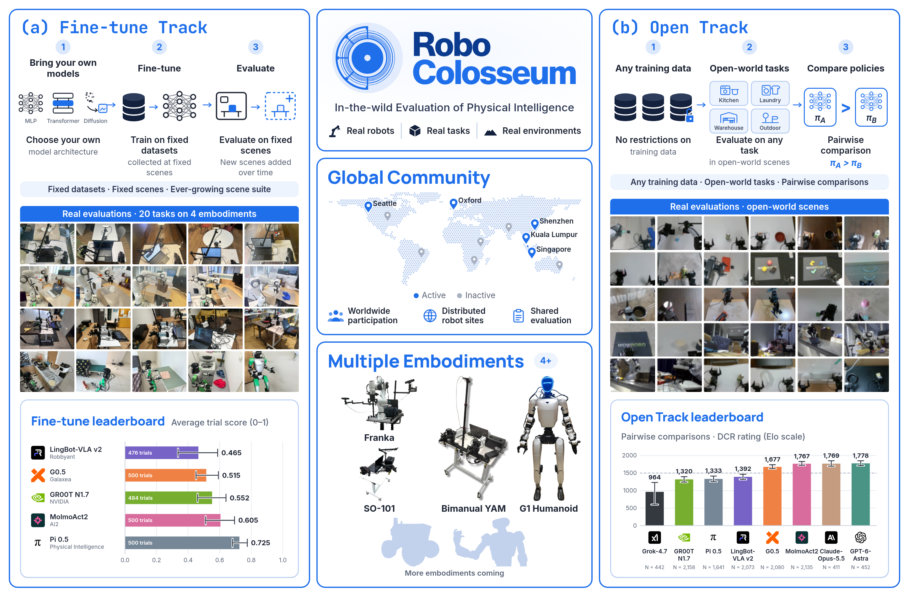
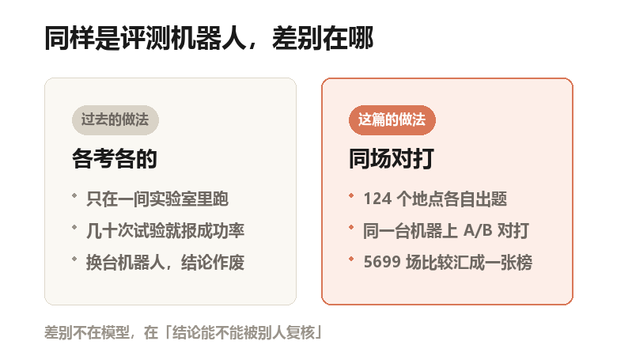
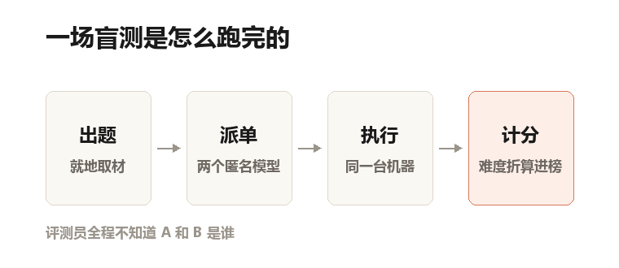
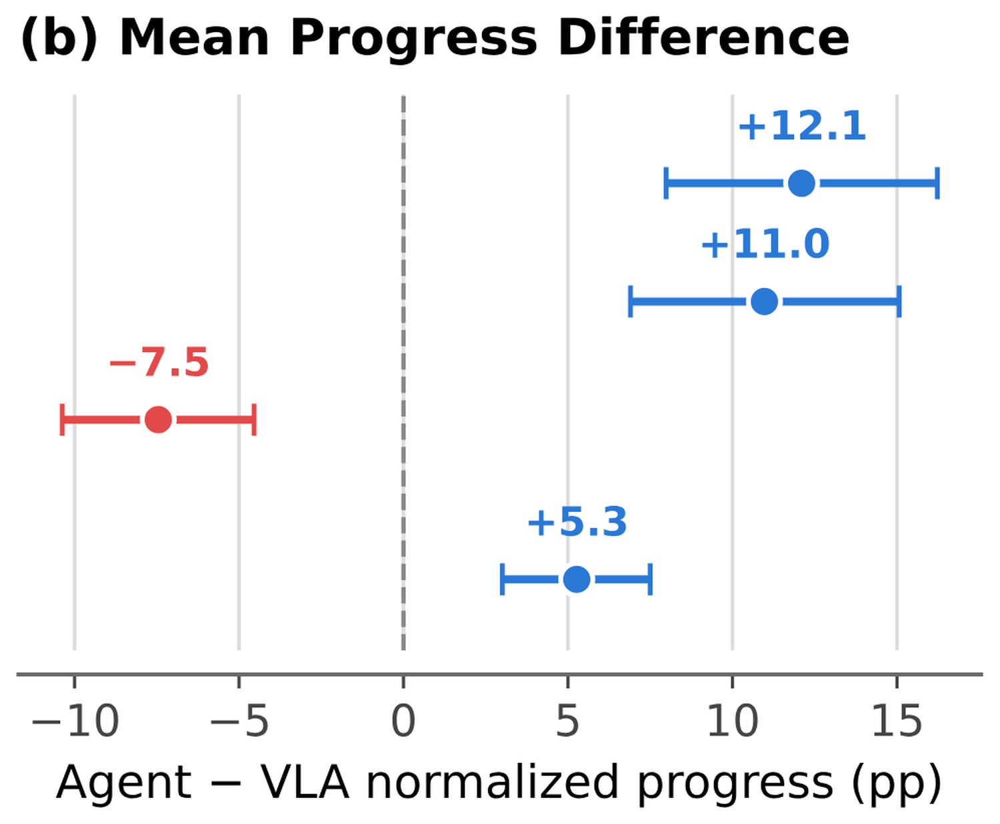
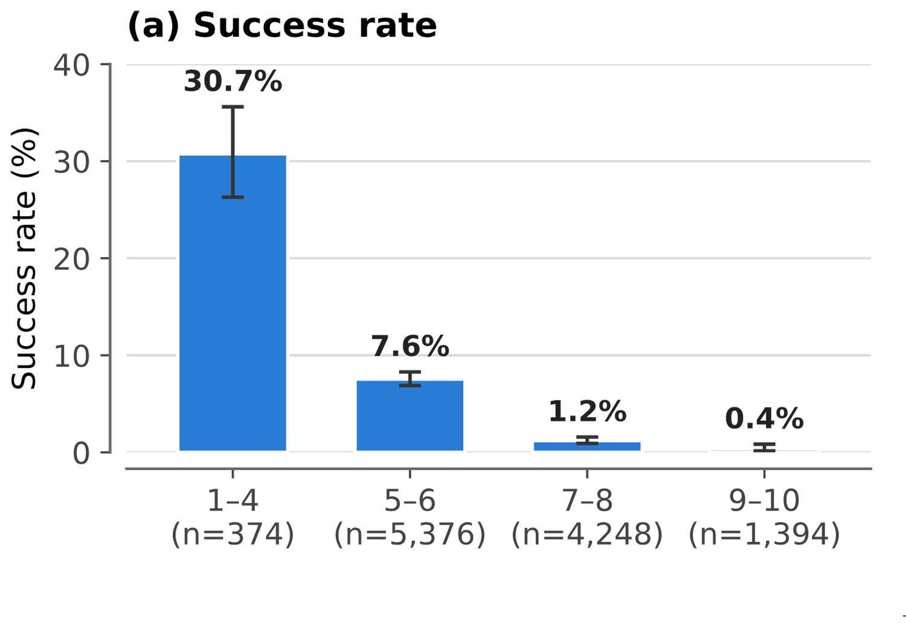
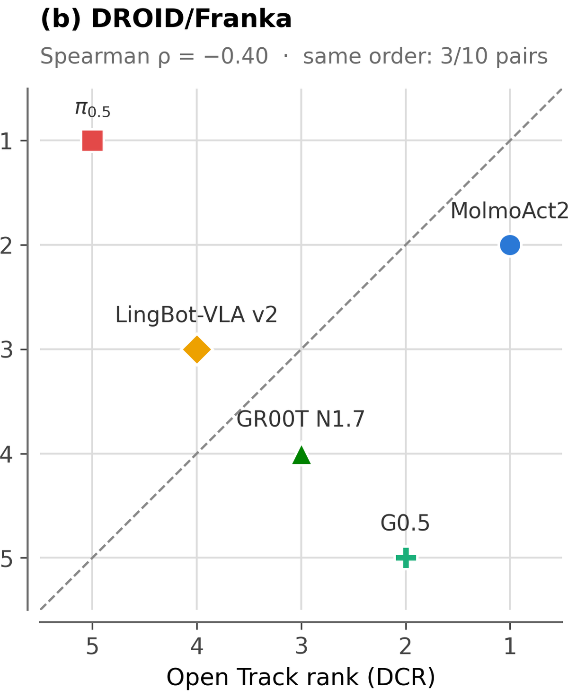

一张办公桌上，放着一支马克笔和一个笔筒。旁边是一台白色机械臂。

桌上没铺绿幕，也没画定位线。就是一张普通的桌子。

一个人对它说：把笔放进笔筒。

这是 2026 年 9 月到 10 月的事。同样的场景，出现在 124 个真实地点。
有办公室、图书馆、公园、宿舍、家里、美食广场和工厂。

41 天，5699 场对打，8 个系统，4 种机器人。
便宜的单臂 SO-101、研究级的 Franka、双臂的 YAM、人形的 G1。

论文叫 RoboColosseum，罗马斗兽场的意思。它做了一件以前没人做成的体力活：给机器人模型办一场跨城市的联考。

结论有点扫兴。考出来的名次，不太靠得住。

论文原图 Figure 1：左半是「微调赛道」，固定教材、固定场景；右半是「开放赛道」，任务和场景都放开；中间是分布在世界地图上的站点、四种机器人和两张榜

## 以前为什么没人这么干

一次真机试验，成本比想象中高。

要有人把桌子摆好，把东西放到指定位置，开机，录像，复位，打分。跑完还得再来一次。
这篇论文雇了最多 30 名全职操作员，才撑住 41 天的连续评测。

所以绝大多数论文只能跑几十次，而且只在自己那一间实验室里跑。
后果是：四个人在不同的考场上做不同的卷子，回来比分数。

仿真听起来是条出路。仿真就是电脑里造的三维假世界，有物理引擎，撞到桌子会真的被挡住。

但仿真里的光照、镜头位置、摩擦力，和真实世界差得远。在仿真里排第一，搬到真机上不一定还行。

## 他们把考场铺到了 124 个地方

做法倒不复杂：机器人留在原地，本地人操作。
统一的是两头。一头是硬件规格，同一型号的机器人，摄像头装哪、动作怎么表示，全按一个标准来。

另一头是「策略服务」。说人话：模型不搬来搬去。各地的机器人通过网络调用同一个模型，像连锁店共用中央厨房。

然后开两条赛道，问两个不同的问题。

**微调赛道，比「教了会不会」。** 微调说人话：拿现成的模型，用少量新示范再教一遍。

每个任务给所有模型同样的 100 条示范。示范是人拿着手柄、戴着头显遥控机器人做一遍，录下来给模型学。学完，每个任务跑 25 次。

**开放赛道，比「不教能不能上手」。** 评测员用手边现成的东西自己出题。

两个模型匿名上场，同一台机器人、同样的摆法、同样的时限，先后各做一遍。

自制示意图：左边是过去常见的评测方式，右边是这篇的做法。差的不是模型好坏，是结论能不能被别人复核

## 一场盲测是怎么判的

自制示意图：一场盲测的四个步骤。评测员全程不知道 A 和 B 是谁，所以没法看牌打分

关键在于「匿名」和「同一条件」。

评测员全程不知道 A 和 B 是谁。他只看到两个结果。然后记录三件事：谁更好，完成了多少，这题有多难（1 到 10 分）。

「完成了多少」是个新指标，叫进度分。说人话：把一个任务拆成几道小关卡，过了几关算几分。

比如把衣服放进洗衣机：走到跟前、开门、放进去、关门，四关。只开了门，成功率是 0，进度分是 25%。

这个区分很重要，后面会看到为什么。

排行榜用的是一个叫 DCR 的统计模型。说人话：它同时估两件事，模型有多强，题有多难。再把能力换算成游戏排位那样的分数，平均 1500。

## 结果一：会聊天的大模型，居然能打

三个前沿大模型也上了场。Claude Opus 5.5、GPT-6 Astra、Grok 4.7。

它们没为机器人训练过，也没看过任何示范。每一步，它们收到几张 640×480 的照片、一串关节角度和一句人话指令。

然后通过一个「移动」工具，告诉机械臂每个关节转多少。一场试验最多调用 30 次模型，最多 800 个控制步。

还有一个细节：它自己宣布「做完了」不算数。

对手是五个专门为机器人训练过的模型，简称 VLA。说人话：视觉—语言—动作模型，看着画面、听着人话、直接吐出动作数字。

901 场「大模型 vs VLA」的对局里，大模型赢 394 场，VLA 赢 265 场。

平局 242 场。

平均下来，大模型多走 5.3 个百分点。

论文原图 Figure 4(b)：横轴是大模型比 VLA 多完成多少个百分点。0 右边偏大模型，左边偏 VLA。三个点在右，一个点在左

个体差异很大。Claude 领先 12.1 个百分点，GPT-6 领先 11.0。

Grok 4.7 反而落后 7.5。

十个百分点是什么概念？同一个任务里，一个模型完成了七成，另一个完成六成。
差距真实，但不算碾压。

## 结果二：但谁都干不完活

这才是这份报告里最扎人的部分。

按六类操作分开看：抓放、堆叠、开关、翻转、可变形物体、工具使用。

六个类别里，没有一个系统在任何一类的成功率超过 13%。

13% 是什么水平？十次里成功一次多。在一个真需要干活的场景里，这等于不能用。

MolmoAct2 在全部六个类别里的相对得分都最高，58% 到 77%。

但那是「跟平均水平比，赢面有多大」。它的实际成功率只有 6% 到 13%。

顺手赢，和干成，是两件事。

论文原图 Figure 6(a)：横轴是人工评的任务难度分四档，纵轴是成功率。难度一过 4 分，柱子就塌到底

难度一升，曲线断崖。

人工评为 1 到 4 分的简单任务，成功率 30.7%，不到三分之一。

5 到 6 分掉到 7.6%，7 到 8 分只剩 1.2%。
9 到 10 分的最难任务，0.4%。一千次里成四次。

失败时的进度分也一起塌：从 56.6% 掉到 3.5%。

意思是，难任务上模型不是「差最后一步」，是开头就卡住了。

## 结果三：同一份教材，成绩差出天壤

微调赛道的数字好看得多，但分布极不均匀。

同一台 Franka 上，LingBot-VLA v2 开抽屉 25 次全成。

插马克笔 25 次全失败。

MolmoAct2 恰好反过来：开抽屉 0%，插笔 88%。

π0.5 是少数「什么都能干」的。Franka 上平均成功率 84%，双臂 YAM 上 93.6%。

93.6% 这个数，在这份报告里属于天花板级别。五个任务里，它四个在 96% 以上。

然后是人形机器人 G1。

五个任务：把盘子放进架子、搬箱子、叠毛巾、把衣服塞进洗衣机、挂钥匙。

没有一个模型完成过任何一个。一次都没有，所有成功率栏位都是 0.0。

但进度分不是 0。最低 13.3%，最高 23.2%。
同样全零的表格底下，藏着完全不同的失败位置。

## 结果四：榜单为什么会洗牌

这是整篇论文最值得记住的发现。
先看不同机器人之间。同一个模型在四种机器人上排下来，一致性系数 Kendall W 只有 0.24。

Kendall W 说人话：0 是完全没关系，1 是完全一致。0.24 属于弱一致。

π0.5 在 Franka 和 YAM 上都排第一，在 G1 上排第四。GR00T N1.7 在 SO-101 上第一，另外两种机械臂上都第四。

再看两条赛道之间。这个更反直觉。

论文原图 Figure 9(b)：这一台是 Franka。横轴是开放赛道的名次，纵轴是微调后的名次，1 为最好。虚线表示两边一样，离得越远，洗牌越厉害

π0.5 在 Franka 的开放赛道里，VLA 中排第五，微调之后排第一。

G0.5 从第二掉到第五。

三种两边都测了的机器人上，相关系数分别是 -0.20、-0.40、+0.20。

负相关说人话：「不教就能上手」和「教了能学多好」，经常是反着的。

十对模型里，只有 3 到 6 对名次没变。

## 这份榜单自己也不干净

先说清楚：这是预印本。

预印本说人话：先放到公开服务器上、还没经过同行评审的稿子。数字可以引，结论别当定论。

第一条，样本太薄。每个机器人只有 5 个任务，每个任务只跑 25 次。
25 次里多成功 3 次，成功率就跳 12 个百分点。表上标的误差范围常有十来个点宽，两个模型的差距经常落在里面。

第二条，模型太少。只比了 5 个 VLA，名次反转的统计意义有限。
论文自己也承认：两条赛道的任务分布、起始权重、排名指标都不一样。反转不能全算在「泛化能力」和「适应能力」头上。

第三条，题目是自己出的。开放赛道的题由各地评测员就地取材，站点自愿参与，任务难度和类型都不受控。

作者反复强调这只是 initial snapshot，一张初期快照。

第四条，比得不太对等。大模型只上了三种机械臂，没上 G1；VLA 用的是专门为这台机器人训练过的权重，大模型没有。动作频率也差得多。

这些差异论文没有拆开算。

第五条，小机器人这头最不稳。把 SO-101 的站点随机分成两半、各自排名。只有 59% 的模型对名次一致，相关系数 0.30。

换句话说，这台机器人上的名次还站不住。Franka 和 YAM 好一些，约 85% 一致。

第六条，也是最要紧的：所有系统成功率都低到这个程度，排名本身的意义就要打折。

在 6% 到 13% 的区间里比谁第一，有点像在一场多数人弃考的科目里评状元。

## 最后

回到那张办公桌。

马克笔还在桌上，笔筒还在旁边。模型换了一代又一代，这个动作依然做不稳。

这份工作真正改的不是哪个模型，而是提问的方式。

以前问：这个模型在榜上第几？

现在问：它在多少个地方考的，跟谁打的，卡在哪一步。

一张不交代这三件事的排行榜，其实只说了半句话。

---

**论文信息**

- 标题：RoboColosseum: Evaluating Physical Intelligence at Scale In-The-Wild
- 作者：Tan Sang Nguyen、Yi Ru Wang、Shailesh Shailesh 等（共同一作），通讯作者 Jiafei Duan
- 机构：新加坡国立大学、华盛顿大学、斯坦福大学、北卡罗来纳大学教堂山分校、艾伦人工智能研究所、牛津大学、Hugging Face、BitRobot、新加坡具身智能中心
- 状态：预印本。2026 年 11 月 2 日提交 arXiv v1，未见会议录用声明
- arXiv：2611.02497
- 项目页：robocolosseum.ai
- 代码：github.com/RoboColosseum

**图片版权**：Figure 1、4、6、9 来自论文原文（arXiv:2611.02497），版权归论文作者所有，此处仅作解读引用。两张示意图由本号依据论文内容绘制，不是论文原图。
