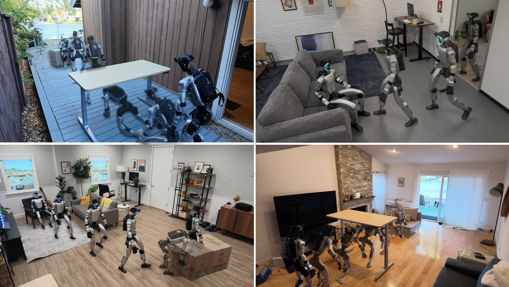
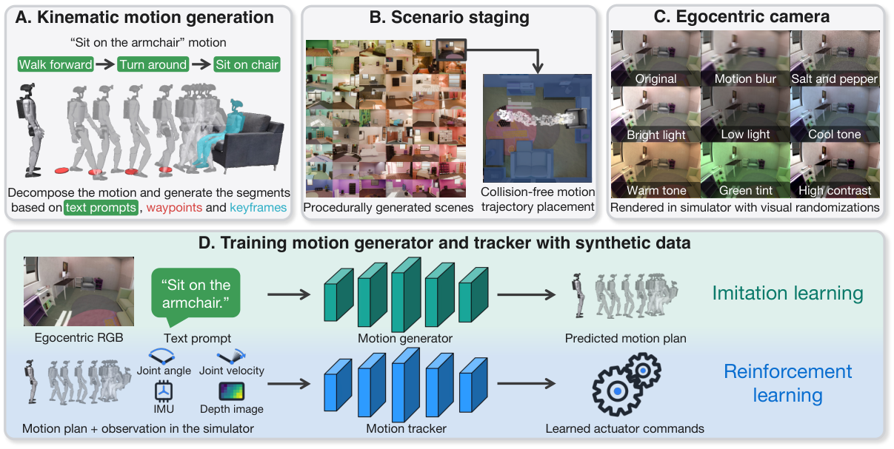
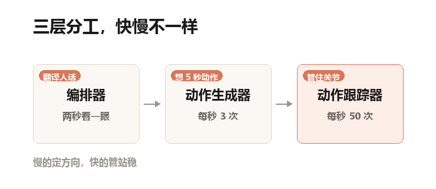
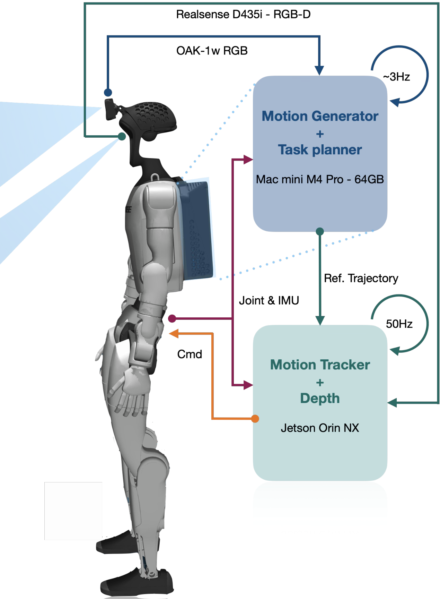
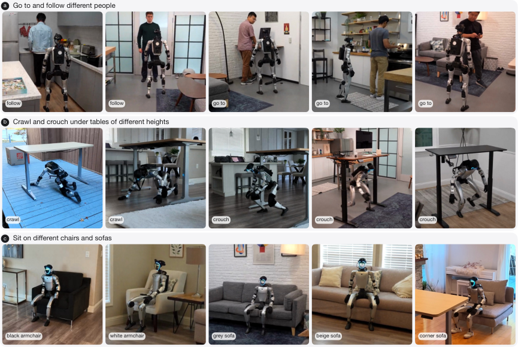

## 一间谁都没扫过的客厅

你把一台人形机器人领进朋友家的客厅。它没来过，你也没提前给它拍过照、画过地图。你说一句：坐吧。

它转半圈，找到那张米色单人椅，走过去，转身，弯腰，坐下。

2026 年 11 月 4 日，苹果的一篇论文里，机器人做到了这件事。全程没有人遥控。它头上装了一个广角摄像头，背上背了一台 Mac mini。

论文原图 Fig. 1：四个训练时从未见过的真实环境，室外木台、客厅沙发、堆着纸箱的房间。每一格都是同一台机器人在执行一句口语指令，没人给它扫过图。

## 会后空翻的机器人，其实什么都没看见

这两年你大概刷到过后空翻、跳舞、跑酷的人形机器人。视频很唬人，但它们有个共同点：动作是提前编好的，像体操运动员在熟悉的场地上闭着眼也能翻。

家里的活儿不是这样。椅子在哪、多高、软不软，得现场看；地上可能有地毯，桌子可能很矮。这些都没法提前排练。

所以「会后空翻」和「能在陌生客厅坐下」，是两种完全不同的能力。

## 难的不是动作，是没有数据

要让机器人学会「看着画面、听懂人话、直接给出关节角度」，需要海量配对数据：一张第一视角照片、一句话，加上这一秒全身该转到什么角度。29 个关节，说人话就是身上能单独转动的部位有 29 处。

这种数据现实里几乎不存在。文字和视频满网都是，因为写字拍视频是顺手的副产品；但「动作 + 画面 + 那句话」，必须有人专门去演。

过去的办法是穿动捕服、戴遥操作设备，人做一遍，机器人记一遍。论文里有个很扎心的说法：要一小时数据，就得花一小时人力。

本号自制示意图：两种数据来源的对比。左栏是过去的主流做法，右栏是 HALO 的选择。

这条路的上限，就是你能雇多少人。

## 苹果的办法：在电脑里造一千个家

HALO 换了个方向：不去现实里采，用仿真造。名字来自四个英文词：人形、自主、在仿真里学、在机器上跑。

仿真这词听着专业。说人话就是电脑里搭的三维假世界，有重力、有碰撞，机器人撞到桌子会被真的挡住。

他们用一个叫 Infinigen 的工具，程序生成了一千间屋子，客厅、办公室、卧室都有，家具尺寸和摆放全随机。再让一个叫 Kimodo 的动作生成模型，按「走到椅子前」「转身」「坐下」这样的文字指令，自己编出全身动作。

论文原图 Fig. 3：数据怎么攒出来。(A) 把「坐下」拆成走路、转身、落座，由动作模型生成；(B) 把动作放进随机生成的房间，摆到不撞家具；(C) 从头部摄像头拍第一视角，并随机改色调、亮度、噪点；(D) 一批训练生成器，一批训练跟踪器。

一条数据是这么凑出来的：动作模型编一段走路，屋子随机生成，把动作塞进屋子（不能穿家具）。再从机器人头部的位置渲染第一视角视频。灯光、亮度、噪点还会故意随机改，这叫域随机化。说人话就是故意把画面调得五花八门，防止模型死记某一种灯光。

最后攒下 162,698 段，共 296.3 小时。论文正文按 300 小时说。

生成这批数据用了 250 张 H100 显卡，跑 48 小时，全程没人盯着。同样 300 小时的动作数据，靠人演就是 300 小时人力，还不算 NG 重来。

## 电脑编出来的动作，凭什么不是瞎编的

这是最容易被忽略的一步：动作生成模型编出来的东西，物理上经常是错的。

脚会打滑，会陷进地板，会整个人飘起来。这种数据喂给机器人，等于教它作弊。

他们的处理很土但有效：每段动作生成一批候选（坐下 16 个，钻桌子 20 个），用几何检查器逐项打分。脚滑不滑、穿不穿地、该落地却在飞没有、关节超限没有。坐下这个技能上了 33 项检查，留分最高的那个。

## 三层分工：慢的想方向，快的管站稳

机器人身上的「大脑」不是一个模型，是三层流水线，速度差了一百倍。

本号自制示意图：三层分工与运行频率。图上频率的单位是赫兹（Hz），说人话就是每秒做几次。

顶层是编排器，一个现成的视觉语言模型（就是能看图说话的那种大模型）。它大约每两秒看一次画面，把「坐下」这种模糊指令翻译成一串具体子任务：走到椅子前、转身、坐下。哪张椅子？它自己从画面里认。

中层是动作生成器，每秒想 3 次。它看着当前画面和这条子任务，一次吐出未来 5 秒的全身动作：150 帧，每帧 36 个数字（29 个关节角，加上 7 个身体位置和朝向）。

底层是动作跟踪器，每秒 50 次。它只干一件事：让关节照着上面给的轨迹走，同时不摔。机器人被推一下、踩到地毯，它要在二十分之一秒内调整过来。

打个比方：编排器是包工头，说「把那个箱子推走」；生成器是设计师，画五秒的施工图；跟踪器是工人，手上有活，脚下有数。

论文里有个很实在的细节：生成器算一次要 152 毫秒。听着挺快，但机器人不能停下等这 152 毫秒，它会摔。所以他们一边执行这一段、一边算下一段。已确定要执行的前 0.5 秒会当已知条件喂回去，保证接缝不抖。

这个接缝处理值 60 个百分点：不做，成功率从 84% 掉到 24%。

## 它背上真的背了一台 Mac mini

论文原图 Fig. 8：硬件与数据流。头上是 120 度广角摄像头，背上罩子里是一台 Mac mini M4 Pro，跑编排器和动作生成器；原厂 Jetson Orin NX 跑每秒 50 次的跟踪器。

改装只有两处：头上加支架装广角摄像头，背后加罩子装 Mac mini M4 Pro，64 GB 内存。原厂那块 Jetson Orin NX（一块小算力板）没拆，专职底层控制。两台机器无线连起来，一台算「想什么」，一台管「怎么动」。

整套系统完全离线，不连云端，不是挂着线、背后一堆服务器的演示。

## 结果：六个没建图的真房子，三百六十次试验

六个真实环境，训练时没见过，也没提前扫描建图（建图就是先把房间扫一遍，做张室内地图照着走）。这种「没练过就直接上」的做法，术语叫零样本迁移。

六个技能，每个环境每个技能做 10 次，一共 360 次。单任务平均成功率 91%。

拆开看：走过去找东西 92%，坐下 85%，侧身过半开的门 93%，蹲着走 100%，爬 90%，推箱子 88%。

九成这个数字该怎么理解？这类「全身动作 + 现场感知」的任务，能到九成的公开结果很少。而且论文没有跟别的系统做同条件对比，所以这个 91% 不能直接拿去和别家的数字比大小。

论文原图 Fig. 10：同一条指令，换人、换桌子、换椅子。(a) 走到不同的人身边；(b) 在两张室外/室内桌子和三张不同高度的书桌下钻过、蹲过；(c) 五种不同的椅子和沙发。

换椅子、换房间、换人，它没有为哪个场景重训过。

## 任务一长，成功率就掉一半

单看六个技能很漂亮，连起来就露馅。

把技能连起来做，三个组合平均 70%。最长的那个「蹲下、走过去、推箱子」，真机 10 次成了 5 次。

原因很具体，也很好懂：上一段动作结束时，机器人的头可能正朝着别处。真机测试里 5 次失败有 3 次是蹲完之后脑袋背对着箱子，它压根没看见目标，被旁边的杂物吸引走了。

这不是模型笨，是「上一段怎么结束」这件事没人管。论文自己也承认：子任务之间不独立，按连乘算会算错：仿真里两个任务连乘应该是 89%，实际只有 71%。

## 拆零件测试：哪些设计真的在起作用

作者做了一组拆零件测试（术语叫消融实验：拿掉某个部件，看性能掉多少），在仿真里只测「坐下」，100 个没见过的房间，每个跑 10 次。

把训练用的房间数从 1000 降到 100，成功率 84% 变 81%，几乎没差。降到 10，64%。只剩 1 个房间，43%。

一句话：房间的多样性比动作的数量重要得多，一千个房间的价值主要在前一百个。

再把生成器里的扩散解码器换成普通回归：84% 变 19%。扩散模型是从一团噪声里一步步去噪出动作，回归是一次算完；一次算完的版本会偷懒，只学大致的路线，细节全丢，脚在地上滑。

把深度摄像头去掉，只留本体感觉（知道自己关节在哪、身体什么姿态）：84% 变 74%。

## 这套东西没解决什么

第一条最实际：代码开源了，权重和数据集没开。

仓库说明里写得很直白：没有训练好的生成器检查点，也没有数据集，请用 datagen 目录自己生成。而生成那一步要 250 张 H100 跑两天。也就是说，普通人拿到的是造它的图纸和工具，不是那个 91% 的系统本身。仓库说明里还留着 TODO(release)，意思是待发布，发布本身也没收尾。

第二条：加新技能还得靠人。省掉的只是采集数据的人工，不是设计任务的人工。每加一个动作，仍然要有人写提示词、标关键帧姿势。关键帧就是动作里那几个决定姿态的瞬间，像动画的关键画面。技能库扩得多快，取决于人能写多快。

第三条：它基本只有视觉。物体一旦离开视野或者被挡住，模型就没有「它还在那儿」的信号。论文原话是，接触密集的任务会明显退化。作者说加触觉是自然的下一步。

第四条：生成器和跟踪器之间的接口太窄。跟踪器只管照着轨迹走，不知道这条轨迹是为了干什么。箱子推到一半被人挪走，它不会主动反应。

第五条：编排器很朴素。就是一个通用大模型在循环里判断做完了没、要不要重试。技能一多，这个循环撑不住，作者说要换成更像「智能体」的设计。

## 最后说一句

我更在意的不是 91%，是这个数字背后的变化：机器人不缺身体了，缺的是数据；而数据的来源，正在从「雇人演」变成「开机等」。

这篇论文至少证明了一件事：一间它从没进过的房子，一句坐下，它自己能完成。

家里需要的正是这种本事。不是表演，是当场面没见过的时候，还能应付。

---

**论文信息**

标题：Perceptive Humanoid Motion from Simulation

作者：Siyuan Hu, Abulikemu Abuduweili, Yue Meng, Shipeng Liu, Quentin Leboutet, Chen Chen, Matthias Müller, Vladlen Koltun

机构：Apple（八位作者单位均为苹果）

状态：预印本，arXiv:2611.06908v1，2026 年 11 月 4 日提交。论文与项目页均未注明会议录用，本文按预印本介绍。

项目页：https://apple-aiml-research.github.io/ml-halo/

代码：https://github.com/apple-aiml-research/ml-halo

**图片版权**：文中标注「论文原图」的四张来自论文 HTML 版（Fig. 1、Fig. 3、Fig. 8、Fig. 10），版权归 Apple 所有，此处仅作解读引用，未裁切改色。两张示意图由本号用 make_diagram.py 绘制。
