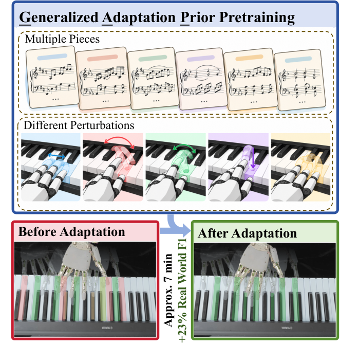
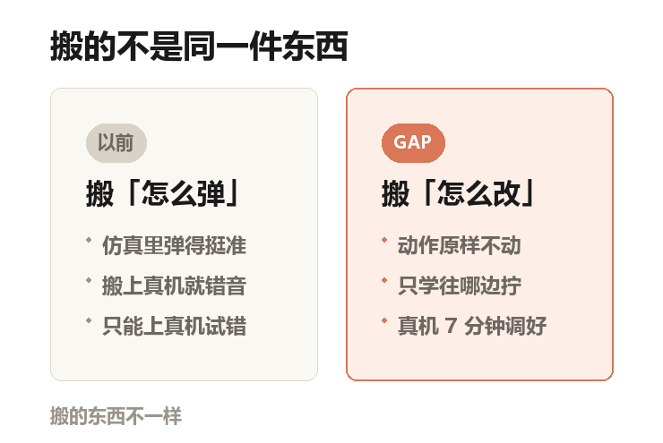
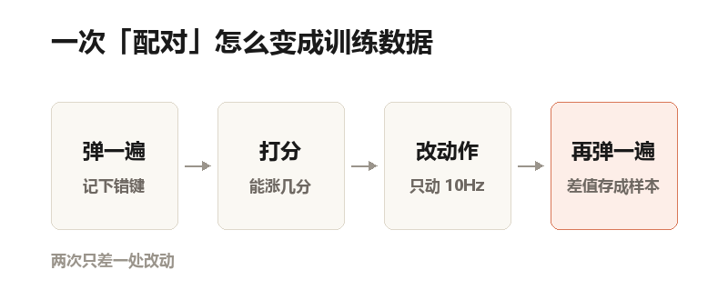
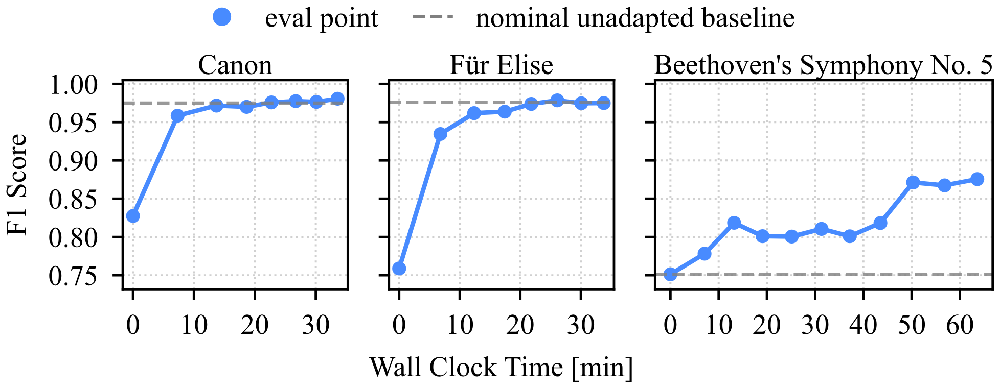
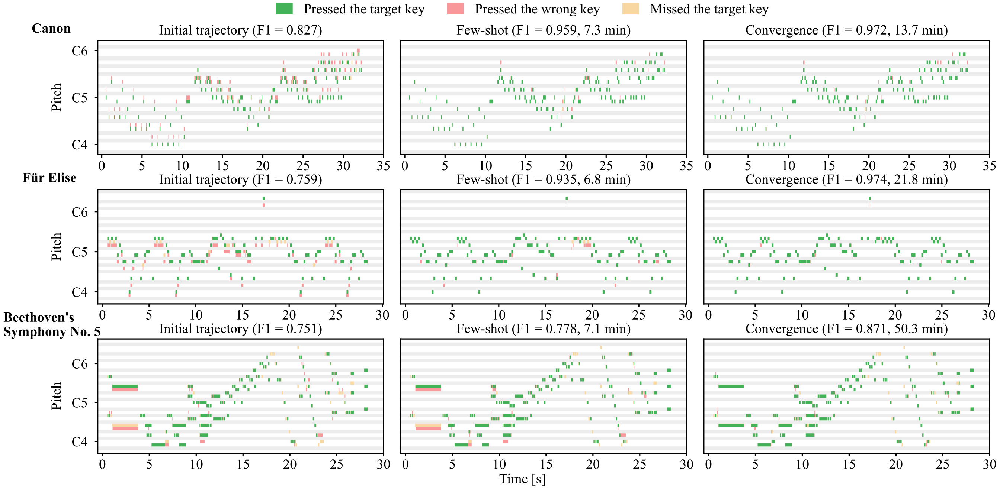

## 一只压在键缝上的手指

《致爱丽丝》弹到第三小节，无名指该落在 E 上。

指尖却压进了两个键中间的缝，两个音一起响。

桌上那台雅马哈 P48 记下了这一下。它不录音，只记谁在什么时候按了哪个键、按了多深。这种记录叫 MIDI，说人话就是电子琴的「按键流水账」。

出问题的是手。16 个能主动活动的手指关节，加上 2 个腕关节，一共 18 个能动的关节。

它装在一台 UR5 机械臂上——工厂流水线旁常见的那种橙色协作臂。这种手叫灵巧手，五根手指能分开动，不是夹娃娃机那种开合两下的爪子。

## 电脑里弹得挺好，一上真琴就露馅

上面这一幕，是论文 Fig. 7 里逐个标注的错误之一。它不罕见，也不是这只手特别笨。

奇怪的地方在于：同一段动作，在电脑里跑得好好的。

电脑里那个世界叫仿真——三维假场景，带物理引擎。手撞到琴键会被真的挡住，按下去会真的触发声音。在仿真里练一套「看到什么就输出什么动作」的规则（这套规则叫策略），成本只有电费。

但仿真里的摩擦、传动间隙、电机延迟、装配误差，全是近似值。

装琴的时候手整体偏了 1 厘米，仿真不知道。真机知道。

偏 1 厘米，对弹琴就是错音。

论文原图 Fig. 1：整篇论文的缩略图。上半部分是在仿真里练「怎么改」，几首曲子、几种不同的「手歪法」一起练；下半部分是真机上的同一只手，左边是按原动作直接弹，右边是调了 7 分钟之后。绿是按对，红是按错，橙是漏掉。

## 以前的办法：把假世界修得更像真的

一条路是把仿真调得更像真的。学名叫域随机化：把摩擦、延迟、刚度在仿真里随机乱调，让它从小在各种「不标准」的世界里长大。

另一条路是上真机试错。学名残差强化学习——在原有动作上加一点点修正，试一次，看分数涨没涨，再试下一次。强化学习说人话就是「靠打分试错」。

两条路的共同点：要让真机上的动作变好，动的都是「怎么弹」这件事。

这篇论文换了个方向。动作一行都别动，只学「往哪儿拧」。

本号自制示意图：两种思路的差别。左栏是过去的做法，右栏是 GAP。留意右边第一句「动作原样不动」。

## 它只学一件事：改一下，分数涨几分

方法叫 GAP，全称 Generalized Adaptation Prior，通用的「适应先验」。先验说人话就是事先攒下的经验，遇到新情况先拿它顶上。

核心动作是「配对执行」。

同一段曲子，先按原动作弹一遍，记下哪些键错了；然后把动作改一点点，再弹一遍。别的条件全部锁死。

两次只差这一处改动，所以两次的分数之差，就是这处改动带来的效果。像做菜只多放一勺盐，你才知道咸淡是谁带来的。

攒够这种「改一下、涨几分」的对照，就能训练一个打分网络。它的输入是一小段时间里的观测加上改动量，输出一个数：这样改，分数能涨多少。

有了打分，就能算梯度。梯度说人话：往哪个方向拧、拧多少，分数涨得最快。像蒙着眼调淋浴，手一碰水，就知道该往哪边转。

本号自制示意图：一次「配对」的四个步骤。第 2 步的打分网络不是查表，是一个小 Transformer——就是 ChatGPT 背后那类结构，这里只用来给「这次改动」估一个分数。

## 每秒只改十次

动作每秒发给电机 50 次。修正却在每秒 10 次上做，点与点之间用直线连起来，所以改法是缓慢的、整段的，不是每一帧都在抖。

论文把修正频率从每秒 2 次一路试到每秒 50 次，每秒 10 次最好。太低改不动，太高会让动作发抖。

每个修正点只做 20 步梯度上升就停手。落到真机上，这一段大约 7 分钟。

## 先在电脑里练「怎么改」

阶段一全在仿真里。三首曲子的长片段切成 4 秒的小段，扔进并行仿真里成批地跑。论文只说了「数万段」，没给环境数量。

每一段都随机换一套「不标准」：关节的零点位置偏一点、阻尼变大变小。

执行会慢上 2.5 到 30 毫秒，传感器读数也会加噪声。

它在这里学的不是某首曲子怎么弹，而是「手歪了以后，往哪边改能把音救回来」。

阶段二把同一套网络参数搬到真机，每首曲子各自微调——在已有参数上接着调，不从零重练。

## 仿真里 20 分钟，涨的是别人的两倍多

同样 20 分钟的仿真交互时间（只算执行，不算训练）：

直接弹是 0.761。

老办法 HandelBot（一个已有的弹琴适应方法）涨到 0.807，涨了 0.046。

GAP 涨到 0.873，涨了 0.112。

2.4 倍，就是这么来的。

另一组对照更能说明仿真里那点经验值多少钱。把「先在仿真里练」这一步整个去掉、从零开始，要追上 GAP 在 5.3 分钟就达到的分数，得花 23.2 分钟。4.4 倍的时间。

0.76 这个分怎么读？F1 同时看两件事：按下的键里有多少是该按的（别乱碰），该按的键里有多少真按到了（别漏）。换个说法，0.76 大约是每四个瞬间里，就有一个瞬间手上不干净。

还有个更硬的检验：把目标曲子从预训练里拿掉，它压根没见过。结果 0.843，跟见过的 0.855 只差一点。

## 真机上：故意把手挪歪一厘米

真机测试前有个尴尬。《卡农》和《致爱丽丝》直接弹就有 0.975，没什么提升空间。

于是作者把机械臂整体挪了一下——《卡农》右移 11 毫米，《致爱丽丝》左移 9 毫米，模拟「装歪了」。分数掉到 0.827 和 0.759。

贝多芬第五交响曲不挪，直接弹是 0.751。

然后开始调。第一次迭代约 7 分钟，这 7 分钟里网络参数一次都没用真机数据更新过，全靠仿真里学的那套「改法」。

三首分别涨了 16%、23%、3.6%。

这三个数要说清：论文写的是相对提升，不是涨了多少个点。0.759 涨 23%，是到 0.935；换成点数，是 17.6 个点。别按点数读成 0.98。

论文原图 Fig. 5：三首曲子在真机上的分数曲线。横轴是累计用时（分钟，含执行、训练、调度），纵轴是按对键的综合分。灰色虚线是「不改动作直接弹」的水平。曲线上第二个点，就是第一次迭代之后，约 7 分钟。

## 弹到 0.98，比原来还高

继续跑，《卡农》和《致爱丽丝》都稳到 0.98 附近——比它们「没被挪歪之前」的 0.975 还高一点。

也就是说，它不光把偏移补回来了，还顺手把原来的小毛病也一起修了。

0.98 有多干净？绝大多数瞬间的按键都是对的，错音只剩零星几个。人手弹琴也会错，但错一个音，听的人立刻就听出来。

论文原图 Fig. 6：三首曲子、三个阶段。绿是按对的键，红是按错的，橙是漏掉的，灰条是黑键。每行从左到右是原始动作、7 分钟后、收敛后；标题里的 F1 和分钟数就是当时的成绩。

## 最难的那首，反而涨得最少

贝五只涨 3.6%，要到第 8 次迭代、约 50 分钟才爬到 0.871。

原因不神秘。它要跨八度、同时按下几个键，而 GAP 的修正是整段缓慢地微调，补不了「手指分配错了」这种错。

论文自己也承认：预训练的先验不足以消掉它的错误，剩下的只能靠真机数据继续微调。

还有一个反直觉的结果。把「沿梯度改」换成「随机乱试」，同样 20 分钟只有 0.785。

同样一组修正点，同样反复弹，只是不再问「往哪边改」。分数立刻掉回去。值钱的是那个方向，不是反复弹这件事。

## 这套办法现在还做不到的事

先说最硬的一条：它只会修，不会从零学。

前提是那条初始动作已经把大部分键弹对了——论文里的起点是 0.75。从零学会一首曲子，不是它的活。

第二条更难绕。改动作发生在两次演奏之间，演奏过程中没有任何实时修正。

弹到一半手被碰了一下、琴凳滑了一点，这一遍它救不了。论文明确把「边弹边改」写进了未来工作。

第三，只做了右手，只做了三首曲子的 30 秒片段。左手、双手、完整曲子都没测。

第四，评分只看「键按对没按对」，不看力度和音色。所以它现在弹出来是每个音都对，但没有表情——该弱的地方一样响。论文把力度和音色也列进了未来工作。

第五，换一只结构不同的手还行不行，论文未提及。

最后一条：论文只挂了一个演示视频，没有公开代码，也没有公开数据。

## 值钱的不是那个 0.87

仿真里 0.873，真机上 0.98，数字都好看。但新的东西不是分数。

是它把「我哪里歪了」变成了一件可以算的事。不用重训模型，不用采一堆数据，只要弹两遍，比一比，就知道往哪儿拧。

会弹琴的机器人不缺。缺的是这种知道自己错在哪、还能自己拧回来的自觉。

## 论文信息

- 标题：GAP: Generalized Adaptation Prior for Dexterous Piano Playing
- 作者：Jinyi Chen、Hongyi Li、Lei Jiang、Xianwei Liu、Yanhong Liang、Yulin Chen、Yucheng Tao、Yongbin Jin、Hongtao Wang
- 机构：浙江大学交叉力学中心（Center for X-Mechanics）、上海镜识科技（Mirrorme Technology）、浙大杭州国际科创中心
- 状态：预印本，arXiv 2611.12111v1（cs.RO），2026 年 11 月 9 日提交；论文正文自称 letter（短篇快报），未标注会议录用
- 演示视频：bilibili.com/video/BV1hbWx6QE9u（arXiv 页面 comments 里给的 video 链接）
- 图片：Fig. 1 / 5 / 6 为论文原图，版权归论文作者；两张示意图由本号依据论文正文绘制
