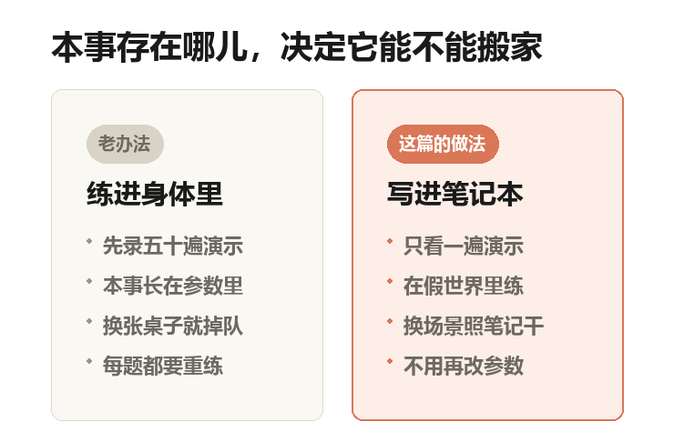
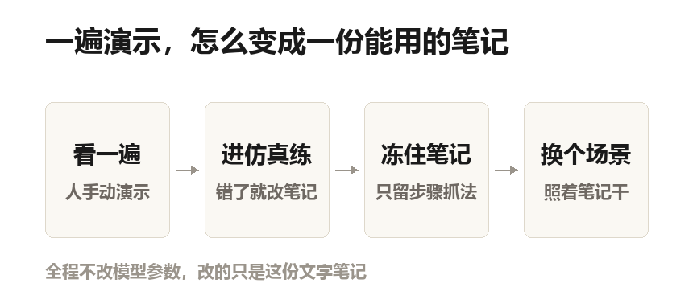
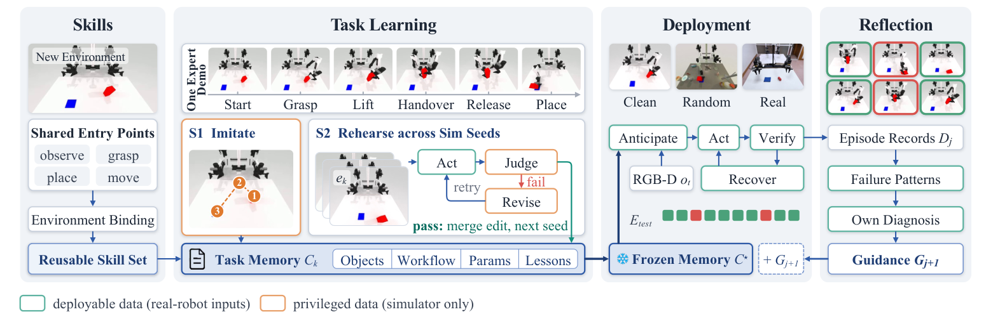
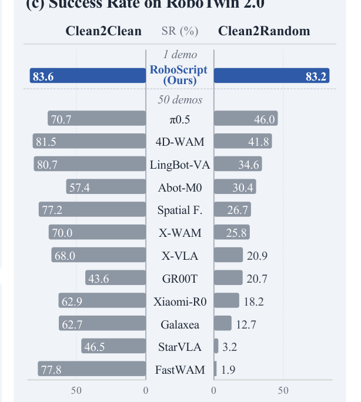
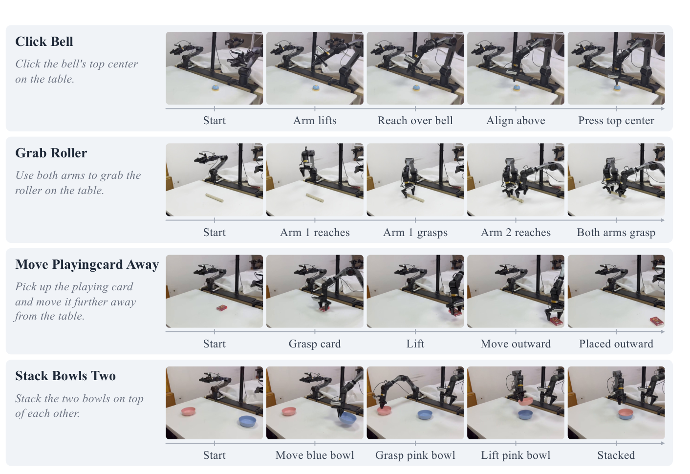
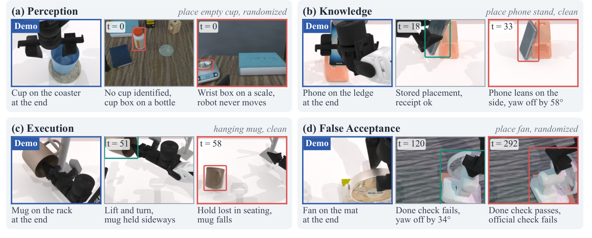

## 杯子没换，桌子换了

一张桌子，一只马克杯，一块杯垫。
人握住机械臂的手腕，把杯子端起来，挪到杯垫上方，松手。十几秒的事。

这段录像，就是教机器人干活最常见的办法：演示。人做一遍给它看，它照着学。

现在换一张桌子：杯垫挪到右边，桌布从灰的变成木纹，旁边还立着一只瓶子。
杯子还是那只杯子，任务还是那个任务。机器臂刚才还会的动作，突然就不成立了。

不是它笨。是它学的那套东西，一开始就和那张桌子焊在了一起。

## 本事练进身体里，就搬不走了

过去的做法，是把演示一遍遍喂给模型，让它练到「会」为止。练出来的东西存在模型的参数里。

参数说人话就是模型的肌肉记忆——一堆数字，调对了，动作就顺了。代价是：这份本事和练习时的屋子绑死。

论文里有一组刺眼的对照。有个叫 FastWAM 的模型，在干净桌面上的成功率是 77.8%。一百次能成七十八次。把桌布、灯光、桌子高度随机换一遍，掉到 1.9%。

一百次里不到两次。同一套参数，同一个任务，只是屋子换了。

这类模型叫 VLA——视觉、语言、动作三个词的首字母。说人话就是：看着画面、听着人话、直接吐出动作数字。它是现在的主流。

## 它把答案写在了卷子旁边

还有一条路：不练参数，只把演示塞进模型的「上下文」。

上下文说人话，就是模型这一次任务里能摊在眼前看的那几页纸。纸上的东西它随时能翻，纸外的一概不知。

这么干的叫上下文学习，英文缩写 ICL。类比一下：考试时你其实不会做这道题，但旁边放了一道例题，你照着例题的解法往下套。能套出来，也能做对几道，但它一直干不过真练过的模型。

原因不玄：例题是别人在另一间教室做的。它不会告诉你，这张桌子上的杯垫偏了五厘米，旁边还立着一只瓶子。演示能告诉你「怎么做」，告诉不了你「这里会发生什么」。

本号自制示意图：同一份本事，存在哪儿，决定了它能不能搬家。左栏是过去的主流做法，右栏是这篇论文的做法。留意右栏最后一句——参数一次都没动。

## 于是有人把「世界」塞进了这个循环

这篇论文的做法，一句话：让模型在一个「世界」里练，把练出来的反馈写回上下文。

世界在这里是模拟器。说人话就是电脑里搭的三维假桌子，带物理引擎。手撞到杯子会被真的挡住，杯子滑了会真的掉下去。

流程是这样的：
先给它看一遍演示，它照着写一份初稿；
然后进模拟器里做，做砸了就看反馈、改初稿，再做；
反复到它能连着做对；
最后把这份稿子冻住，拿去新场景用。

全程不动模型的参数。改了几十轮，参数一个都没变，变的是那份稿子。

本号自制示意图：一遍演示到一份能用的笔记，中间隔着一个会还嘴的世界。这是全文最关键的一步——过去缺的就是这声「还嘴」。

这份稿子有个正式名字，叫任务记忆（Task Memory）。它其实就是一份 Markdown 文档。带井号标题、带短横线列表的纯文本，记事本就能打开。

写什么：每样东西扮演什么角色、怎么找到、分几步做、怎么抓、放哪儿，还有踩过的坑。

## 它记的是角色，不是长相

演示里那只杯子是白的，摆在左边。笔记里不会写「左边那只白杯子」。它写的是「要被端走的那个容器」，抓法写成「从左边靠近把手，抓在中点」。

这就是差别：长相会变，角色不会。论文的说法是，模型在上下文里学到的是语义——任务步骤和物体角色，不是视觉外观。所以经验能跨世界搬。

他们还加了一道闸。笔记里凡出现坐标、标准答案里的说法、「第几个样本」这类编号，一律打回。这三样在真机上都拿不到。

还有数据隔离。练的时候，动手的那个角色只能看摄像头画面，和真机视野一模一样。模拟器里的「上帝视角」只用来给评审打分，进不了笔记。

论文原图 Fig. 4：四个阶段——建技能、学任务记忆（S1 照演示模仿，S2 换场景反复练）、部署、复盘。绿框是「真机上也拿得到」的信息，橙框是「只有模拟器才有」的信息，两种颜色被刻意分开，这是它能上真机的前提。

## 八成三，是个什么水平

RoboTwin 2.0 是一份公开考卷，50 个双臂桌面任务。按铃、抓滚筒、挪卡片、叠两个碗，都是这类活。

每个任务只给一遍演示，模型不许改参数。结果：平均 83.4%，干净场景 83.6%，随机场景 83.2%。

八成三是什么水平，得有个参照系。同一张考卷，最强的传统方法平均 61.7%。而它是每题 50 遍演示、专门训练过的。所以 83.4% 不是「还行」，是这批任务上公开的最高一档。

论文原图 Fig. 1(c)：50 个任务的成绩单。每行一个方法，左边是干净场景，右边是随机换过桌布、灯光、桌高的场景。最上面蓝色那行是本篇，只用了 1 遍演示；下面灰色那批每题 50 遍演示。看右半边就知道差在哪：越往下掉得越狠。

更值得看的是两个场景的差：83.6 到 83.2，几乎没掉。传统方法最强的那一个，81.5 掉到 41.8，掉了一半。

论文里管这个叫保留率——换个场景还剩原来几成。训练出来的策略最多剩 65.1%，这套办法剩 95.2% 到 100.8%。练的时候只用了干净场景，随机场景一次都没见过。

还有一个不显眼的结果：换模型也能跑。代码和提示词一字不改，换三个通用大模型：83.4%、77.9%、78.1%。最轻的那个也超过了所有训练过的策略。要是本事长在参数里，换个模型就该崩。

## 拆开看，哪些零件非有不可

论文做了拆零件测试，术语叫消融——一次拿掉一个部件，看性能掉多少。都在 10 个任务上跑，同一批种子。

把演示交给它、但不让它进模拟器练：69.0%；
只给一句任务指令、演示和练习都没有：68.0%；
把演示直接放进上下文、也不练：67.5%。
三者只差一点五个点——光有演示，几乎等于没有。

反过来，给它世界、但不给演示，从空笔记开始练：56.5%。对照是 86.0%，掉了快三十个点，是整篇最大的一处落差。

演示给起点，世界给反馈，缺一个都不行。
另外，去掉「失败了还能接着干」，从 78.5% 掉到 69.0%。真机上第一下没抓稳就宣告失败，基本等于不能用。

## 让机器人自己写复盘

记忆冻住之后还能继续长。拿一批没见过的题去跑，跑完只给它看录像和「成没成」，不给原因。它自己找规律，写一条经验挂到下一批的指导里。下一批又是全新的题，所以这是在考「学到的东西能不能用」，不是背答案。

跑了三轮，50 个任务上净增 +18、+7、+1 次成功。单看 17 个难题，净增 +18、+8、+4。经验条从 74 条长到 97 条、112 条。注意最后那个 +1——收益在快速缩水。

## 贵，而且慢

学完 50 个任务、再评 1000 个回合，账单是这样。最强那个模型 1911 美元，中档 308 美元，最轻那个 739 美元。它每次回话的输出长得多，单价便宜但总量上去了。

一个回合平均要调 54.7 次模型。一个回合是 149 个仿真步，等于每走三步就要问一次模型。机器人每动一下都得等模型回话。训练好的策略是毫秒级的条件反射，这套办法是「想一下，动一下」。

这笔钱买的是不录演示、不重训练：省人工和时间，不省电费。

## 换一台机器人，笔记还能用

仿真里用的是一台叫 ALOHA 的双臂机器人。真机上换成了另一台，叫 PiPER，两条臂各有六个关节，结构不一样。

做法是加一层薄适配：换掉坐标系、臂的运动学（臂多长、关节怎么转）、夹爪尺寸。任务流程、物体角色、抓放规格，一个字不改。演示不重录，练习不重来。

四个任务，各跑 10 次。按铃 10 次全中，抓滚筒 7 次，挪卡片 7 次，叠两个碗 6 次。失败的原因很朴素：夹爪没对准，深度估计错了。

它能用，靠的就是笔记里全是角色和相对位置，没有一句「只在仿真里成立」的事实。

论文原图 Fig. 11：真机上的四个任务，每行是一次的连续画面。左边小字是任务指令，下面一行标这一步在干什么。这份记忆是在仿真里、对着另一台机器人练出来的。

## 这篇没解决的事

先说最实在的：仓库里的真机部署代码，待办清单还没打勾。论文有真机实验和执行画面，但开源的是框架、三种学习方法和视觉服务。想复现那 10 次全中，目前做不到。另一个叫 BEHAVIOR 的考卷，标着「集成中」。

第二条是慢。一个回合 54.7 次模型调用，机器人得站着等。一遍演示就能干活的场景可以接受，需要实时反应的场景不行。

第三条是依赖外部服务。论文自己写：接口质量会随时间波动，前后两次跑，成功率能差出几个点。所以别人复现不出 83.4%，不一定是代码问题。

第四条是复盘的天花板。三轮的净增是 +18、+7、+1，掉得很快。论文的解释是：容易改的错先被改掉了，剩下的失败样本太少，因果说不清。

第五条在能力边界上。测的全是不变形的东西（术语叫刚体）和带铰链的——抽屉、合页门这类。布、线缆这种会变形的，还有需要两条臂紧密配合的交接，论文明确说还不行。

最后，这是篇预印本。11 月 9 日传到 arXiv（公开的论文预印本网站），没有录用信息。83.4% 是作者自己报的数，第三方还没复现。

论文原图 Fig. 6：四类失败的现场。蓝框是演示里该有的结果，红框是它干出来的。(a) 杯子没找到；(b) 存的放法让手机歪靠在边上；(c) 拿起时没卡稳，杯子掉了；(d) 它自己判「做完了」，裁判判没做完——这一类占失败的近三成。

## 最后

这十几年我们习惯了一个说法：模型的能力长在参数里，参数越大越强。这篇给了另一个答案——本事也可以长在一份能读、能改、能带走的文字里。

参数是黑箱里的数字，改一次要重训。笔记是白纸黑字，改一行就改一处行为，还能抄给另一台机器。

它现在的成绩，是靠一堆模型调用堆出来的，贵，也慢。但它指的方向值得记住。一个系统能读懂自己的失败，把教训写下来，就不必再靠重训变强。

---

## 论文信息

- 标题：World In-Context Learning for Agentic Robot Manipulation
- 作者：Heng Fang、Zehui Guo、Yuehan Zhang、Mingyang Du、Dingkang Liang、Xiang Bai
- 机构：华中科技大学（Huazhong University of Science and Technology）、ArcheOne AI
- 会议：无。预印本，arXiv 2611.12885（cs.CV / cs.RO），2026 年 11 月 9 日提交，未标注录用
- 项目页：https://ArcheOne-AI.github.io/RoboScript
- 代码：https://github.com/ArcheOne-AI/RoboScript（Apache-2.0）
- 图片：Fig. 1(c) / 4 / 6 / 11 为论文原图，从论文 PDF 提取，版权归论文作者；两张示意图由本号绘制。文中数字均引自论文正文、表格与仓库 README。
