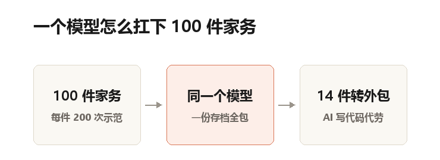
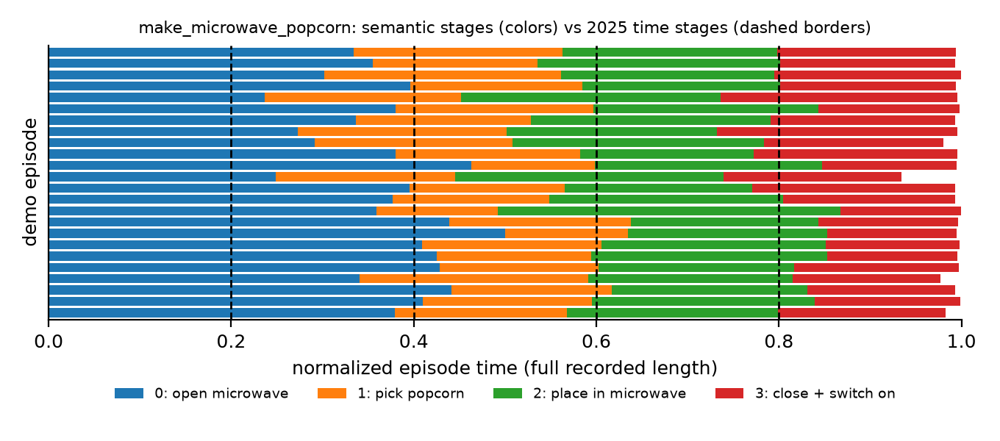
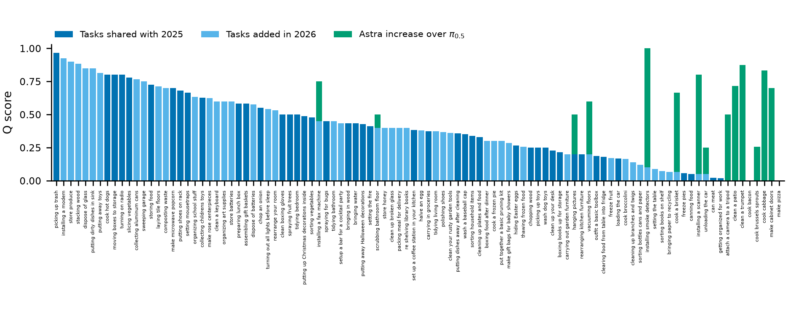
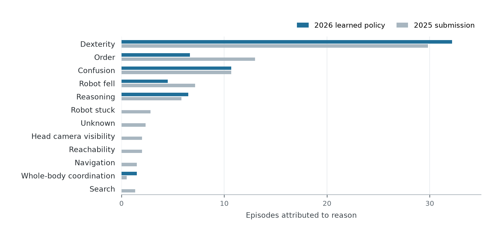
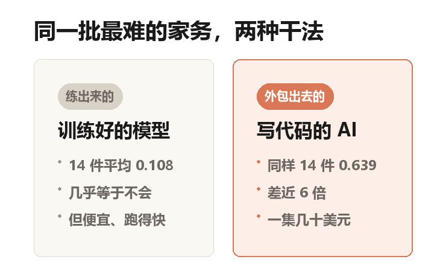
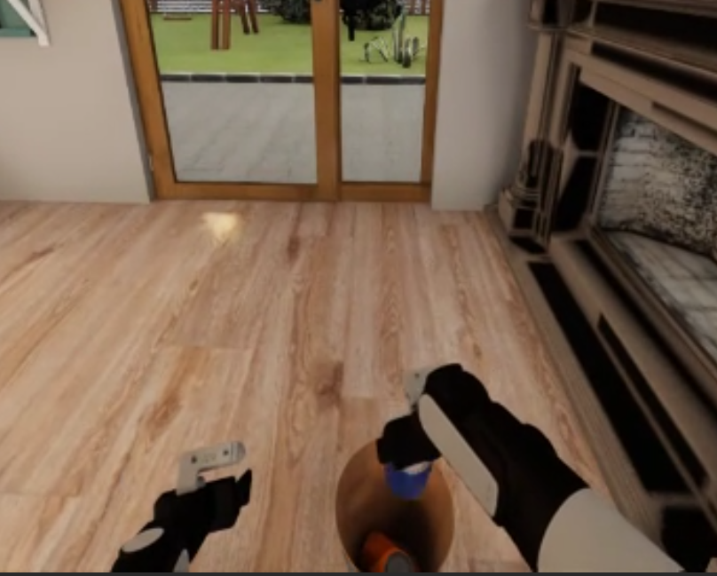

## 微波炉那袋爆米花

微波炉门关着。机器人得先拉开它，抓起台面上的那袋爆米花，塞进去，关门，按下启动键。

四步。顺序错一步，或者中途掉了袋子，这袋爆米花就不算爆好。

在 2026 年的 BEHAVIOR 挑战赛里，这只是 100 件家务中的一件。

比赛在电脑里的一栋假房子里进行。房子有厨房、客厅、卧室、浴室，冰箱能开，抽屉能拉。

说人话就是：一个带物理引擎的三维游戏世界。杯子掉了会碎，门推过去会被真的挡住。

一共 100 件家务，从「打开收音机」到「烤一整条牛腩」。

教它的办法是人做给它看。每件家务，人隔着设备操作 200 遍，全程录下来。

加起来是 2 万条录像、2.11 亿帧画面，折合约 1950 小时。不眠不休地看，要 81 天。

评分不看动作漂不漂亮，只看检查项打勾了几个。

比如「爆米花在微波炉里」算一项，「微波炉门是关的」算一项，「微波炉正在运转」再算一项。

全勾上得 1 分，勾了三个就是 0.6 分。这个分数在论文里叫 Q。

## 卫冕的那支队，今年排第九

这篇论文的作者是七个人，队名 Robot Learning Collective，论文里没有挂任何机构。

去年这个比赛的第一名，就是他们。

今年他们排第九。

但有个细节很怪：同样那 50 件家务，他们今年的 Q 是 0.371，去年夺冠时是 0.260。

题目没变，分数涨了四成多。

名次却掉了。整体题目从 50 件翻到了 100 件，前十名里只有他们一支独立小队。

## 他们只干了一件事：多练

去年交卷的时候，模型其实还没练完。

论文里的原话是：截止日期到了，损失还在往下掉。

损失说人话，就是模型给出的答案离标准答案还有多远。这个数还在降，说明再练一会儿还会更好。

更直接的证据是：去年他们把 50 件家务分给了 4 个模型，一个模型管一摊。

今年的做法朴素得有点意外。一个模型，扛下 100 件。

练了 20 万步，差不多正好把 2.11 亿帧素材从头到尾过一遍。

本号自制示意图：100 件家务里，其余 86 件都归同一个模型，只有最难的 14 件走了另一条路（后文细说）。

训练用的机器也换了。前 13 万步用一张 B300 显卡，每步 10.5 秒；后 7 万步换成 8 张 H200，每步 11.9 秒。

步子慢了，但一步能塞进四倍多的数据。

## 多加 50 件，麻烦在「步骤对不齐」

新任务不能从零教，得接着去年那份存档往下练。

存档说人话，就是训练到某一刻存下来的一个文件，里面装着模型当时学到的全部数字。

麻烦在于，新任务得先被拆成步骤，模型才知道自己走到哪了。

去年是按时间硬切：一条演示平均切成 5 段。

今年改成按动作切。以爆米花为例，切出来是四段：开炉门、拿袋子、放进去、关门并启动。

差别在哪？时间切法切出来的段落是「第 0 到 72 秒」，这种段落本身没有含义。

同一段里，可能前半截在开门，后半截在抓袋子。

论文统计了去年那 1093 段，超过一半的段落里，没有任何一个动作覆盖过半数的帧。

今年换成 413 段，平均一件家务四段出头。

论文原图（Figure 3）。每一条横线是一次示范，颜色是今年按动作切出的四个阶段，竖虚线是去年按时间等分的五段。虚线经常横穿在颜色中间，这就是「对不齐」。注意不同示范里每段的长短差别很大。

## 成绩单：13 件算会了，8 件零分

100 件家务，只用这个模型，平均分是 0.392。

参照系是这样：检查项全勾满才算 1 分，四成意味着平均每件家务还有一大半没做到。

再加上后面要讲的那 14 件外包，公开提交的分数是 0.446，整件做完的成功率是 27.3%——大约四件里成一件。

13 件拿到 0.75 以上，基本算会了。8 件是 0 分，一个检查项都没勾上。

最刺眼的是煎培根。去年 0.757，今年 0 分。

原因很具体：它把培根托盘放进了冰箱下层，比 200 条示范里 199 条的高度低了 41 厘米。

四十一厘米，差不多是从桌面到膝盖的距离。它没搞错任务，只是把一个动作做在了错误的高度。

论文原图（Figure 11）。100 件家务从左到右按分数排开，深蓝色是去年就有的 50 件，浅蓝色是今年新增的 50 件，绿色柱是被 AI 接管的 14 件。左边一长串接近满分，右边一截几乎贴地。任务名太小，点开能看清。

## 失败的原因变了

他们把 10 件共同任务的失败录像人工标了原因，同一集有多个原因就均摊。

「顺序搞错」从 13 降到 6.7，「机器人摔倒」从 7.2 降到 4.5，「卡住不动」从 2.8 降到 0——彻底消失了。

但「手不够巧」从 29.8 涨到 32.2，仍然是最大的一项。

还冒出两类去年是 0 的失败：「搞不清状况」11 次，「推理出错」7.8 次。

论文自己点了一处：有个整理书的任务，它明明知道当前该干什么，还是先去搬书、后挪箱子。

作者的原话是：策略没有照着阶段信号行动。

论文原图（Figure 13）。深色是今年的模型，浅灰是去年那份冠军方案。最上面一条「手不够巧」几乎没动，而「顺序搞错」砍掉了一半。

## 全篇最反直觉的一段

他们把 14 件最难的、模型几乎做不动的家务，外包给了一个会写代码的 AI。

论文里叫它 GPT-6 Astra。

它不直接输出关节角度。它手上有三个工具。

看一眼，返回三路摄像头画面和机器人当前状态。
问坐标，返回画面上任意一点在空间里的位置。
动一下，给一个目标位置，底层控制器自己规划路径。

然后它写代码，把这些工具串起来，一边看一边改。

结果是：同样这 14 件家务，专门训练的动作模型平均 0.108 分，会写代码的 AI 是 0.639 分。

差了近 6 倍。

代价也很硬。一集要跑 0.63 小时，是真实时间的 17 倍；调用它，每集要花几十美元的接口费。

而那个动作模型，一张显卡上能同时开六个模拟器，跑得比真实时间还快。

为什么贵还值得？因为它不用练。

装烟雾报警器这件任务，模型 0.10 分，Astra 是 1.0 分——检查项全过。

本号自制示意图：同一批 14 件家务，两条路的差距。左边是练出来的手感，快而便宜，但这几件它基本不会；右边是现场写代码，慢且贵，分数高近 6 倍。

## 它甚至会临场改主意

论文里有张图我看了好几遍。

任务是收拾客厅的垃圾。它把垃圾桶放到地上，放早了。

按流程，这时候该把桶重新拿起来，再把易拉罐丢进去。

它没有。它直接把易拉罐丢进了地上的桶里，跳过了一整步。

论文把这类行为叫「涌现」——训练数据里没写过，也没人给它加过这条规则。

论文原图（Figure 14b）。机器人视角：桶已经躺在地上，它没有去扶，直接把罐子往下丢。这是从机器人头顶摄像头拍到的画面。

## 这份方案没解决的事

先说要紧的：这个分数是他们自己报的。

官方只复评了排名最靠前的几份提交，他们不在其中。0.446 和 27.3% 是他们用官方评测器、在自己抽的实例上跑出来的。

第二，涨分不能全归给「多练」。

这一年他们同时加了 50 件新任务的示范、改了模型、修了 bug。原文承认：没法把功劳单独分给训练时长。

第三，一个模型扛 100 件，不是不想多训几个，是没算力。原文写得很直接：没有资源去微调多个存档。

第四，那些「补救」的办法，最后大多没做成。

失败恢复数据、人工纠正、把 AI 的轨迹蒸馏回模型，三条路都试过。

人工纠正那一项，Q 从 0.267 到 0.367。但论文标了 p=0.131，意思是这点差距可能是运气，不能算数。

作者的原话是：没有找到能扩展到 100 件家务的收集办法。

第五，外包那条路贵得离谱。14 件是他们的上限，不是起点。

## 一年后，他们改了结论

这篇论文最值钱的，不是一个新架构，是一句很朴素的复盘。

去年他们以为模型不够聪明，今年发现只是练得不够。

对刷视频的人来说，这也解释了一件事。那些一镜到底的演示，多半只证明了某一步能做；而一整件家务的完成率，还在四分之一上下。

## 论文信息

- 标题：One Policy for 100 Household Tasks: Our Solution for the 2026 BEHAVIOR Challenge
- 作者：Ilia Larchenko、Gleb Zarin、Atindra Nair、Keerti Manney、Vitaly Kleban、Mirko Kiefer、Anjana Yodaiken
- 机构：论文未标注机构，七人为独立小队（队名 Robot Learning Collective）
- 性质：2026 BEHAVIOR 挑战赛（与 CoRL 2026 同期）参赛技术报告，预印本 v1，2026-11-10 提交，暂无会议录用信息
- arXiv：2611.14432
- 项目页：https://robot-learning-collective.github.io/behavior-1k-2026/
- 代码：https://github.com/Robot-Learning-Collective/behavior-1k-solution-2026
- 权重：https://huggingface.co/IliaLarchenko/BEHAVIOR2026VLA
- 图片：标注「论文原图」的为论文 Figure 3、11、13、14(b)，版权归论文作者；标注「本号自制」的由本号绘制。
