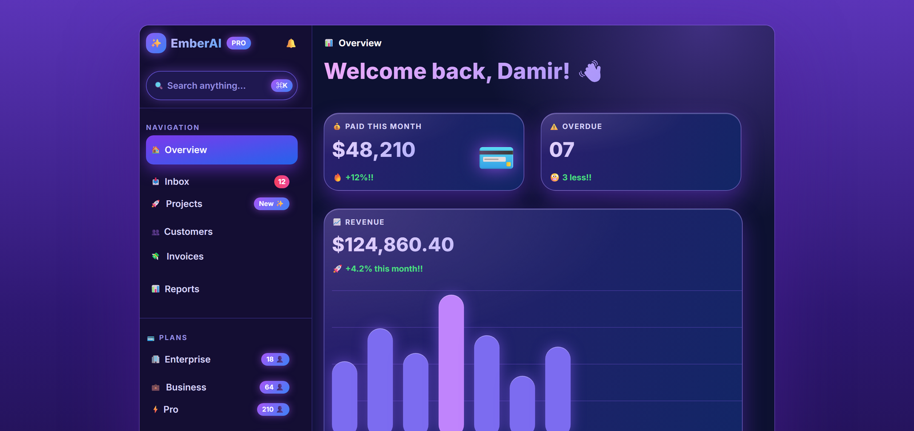
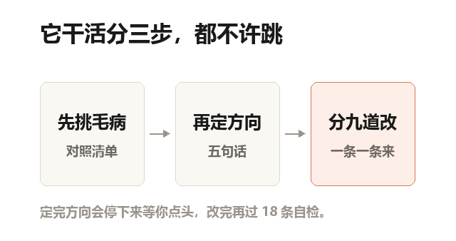
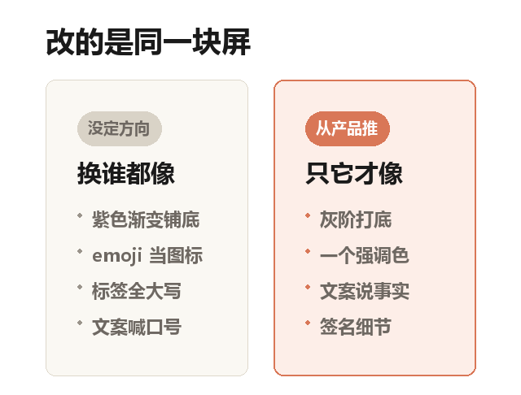
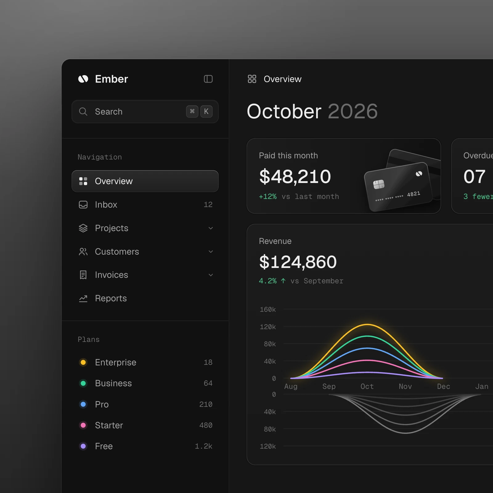
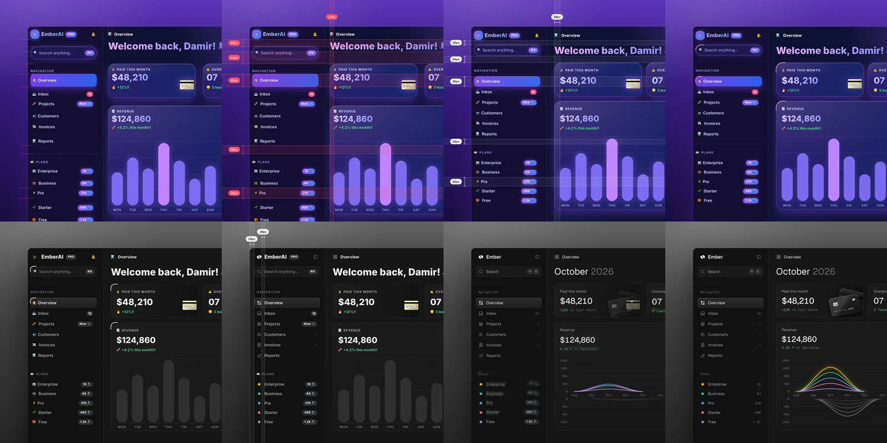

## 你把链接发到群里，朋友说「挺 AI 的」

上周你让 AI 写了个落地页。半小时出活，你挺满意。
链接发进群里，朋友回一句：挺好看的，就是有点 AI。

你想反驳，又说不清哪里不对。
背景是紫的，标题上浮着一层渐变，每个菜单前面顶一个小图标，按钮外面套着一圈光。

说人话就是：每一处都在使劲，所以哪儿都不显眼。

10 月 29 日，一个设计师把这股「味儿」拆开了。

他列了 78 条症状，做成一个开源项目，名字叫 unslop。
slop 原本指喂猪的泔水。现在英文网络里用它指「AI 批量做出来的、看着像回事的东西」。

所以 unslop 就是：去 AI 味。

## AI 味其实是一张能勾的清单

项目里有一份文件，专门列症状，78 条，分 11 组。
它不写「要有设计感」这种话。它写具体动作。

标题写成「Welcome back, Damir! 👋」，原文直接判为问题。
理由是：标题该说清这是什么页面，不该跟你打招呼。改成「October 2026」就对了。

数字旁边写「+12%!!」，也不行。必须交代跟谁比：+12% 比上个月。
还有「Trusted by 10,000+ teams」。原文要求先问一句真的假的。真的就写小声点，假的直接删。

全大写的标签，比如「NAVIGATION」「PAID THIS MONTH」。一律改成「Navigation」「Paid this month」。
emoji 当图标也不行。🏠 📥 🚀 💰 ⚠️ 📈 🔥，清单里排成一列，正是它要抓的东西。

这些不是审美口味，是能一条条勾掉的东西。

项目仓库自带的示例页面，我们按原样渲染出来的「改之前」。紫色渐变、发光按钮、「Welcome back, Damir! 👋」、$48,210 旁边的「+12%!!」，清单上的症状几乎一条不落。

这些症状里，最显眼的一条是配图。
落地页需要一张图衬底，AI 的第一反应几乎都是：一团会发光的紫色球体。

原文把这类东西叫装饰性填充物。光球、星云、悬浮的方块、发光的网格、全息的脑袋和机器人。
它一个都不留。它要的是这个产品真实的样子。

项目仓库 examples 目录里自带的配图 blob.webp，就是它自己要清理的那类「发光球」。留在这里当反面样本，不是本号生成。

## 做这个东西的人，本职是设计师

作者是 Damir Sokolovsky。他在 X 上连载一个叫 Unslopping 的系列。
做法很土：拿一块 AI 生成的界面，一层层把 AI 味褪掉，录下来。

视频传开之后，他把整套流程写成了文件，10 月 29 日开源。
到 11 月 15 日，17 天，16,233 颗星。另外还有 951 个人把它复制了一份到自己账号下。

参照系：在开源圈，一个项目一年能攒到一万星，已经算很成功。
星标你可以理解成收藏加点赞。这是程序员判断「值不值得看」的公共计数器。

更要紧的是它给谁用。
它不是插件，也不是网站。它是一份写给 AI 的工作手册。

你在 Claude Code 或者 Codex 里说一句「/unslop 这个页面」。AI 先读这份手册，再动手改你的代码。

这两个都是能自己打开文件、改代码、把页面跑起来的 AI，不是聊天框。

## 它不先改颜色，先量间距

手册把活分成九道工序，顺序是死的。
间距、颜色、图标、文案、字体、布局、细节、配图、动效。

本号自制示意图：三步走完一轮。九道工序在第三步里，换名测试是最后的验收。

为什么间距排第一？
原文的理由是：节奏对了，别的东西读起来才不一样。

为什么文案排在字体前面？因为标题多长，决定它该多大。
为什么配图和动效放最后？因为一个好页面，拿掉动效也该站得住。

间距的规矩硬得有点意外。所有边距、间隙、固定高度，都得落在 4 的倍数上。
说人话：像铺地砖。砖是 4 厘米见方，你不能切一条 13 厘米的塞进去，缝就对不齐了。

侧边栏宽度定在 240 到 280 像素。内容区最宽 1440 到 1600 像素。
这些数字不是拍脑袋，是桌面软件用了几十年的比例。

## 最难的一步，是决定它该长什么样

删掉紫色不难。难的是删完之后放什么。
所以第二步是写五句话。产品、性格、世界、时刻、签名。

产品：一句话说清给谁做什么。
性格：两三个具体的词。这里有一条禁令。clean、modern、sleek、minimal、premium 这几个词不许用。

理由是这些词能形容所有模板，等于没说。要写「安静、精确、有点暖」这种。
世界：这个产品天生属于什么地方。

记事应用靠近纸和墨。监控工具靠近仪器和夜班。旅行应用靠近地图和窗口的光。

时刻：整屏只留一两个地方热闹。
可以是一张画得很好的图、一张有主次的图表、一个真实的物件。其余位置全部安静。

签名：一个小细节，只有这个产品才有。
监控工具用一个会呼吸的状态点。开发者工具用键帽。外卖应用用一条路线。

本号自制示意图：同一块屏幕，两种走法。右边那栏的每一条，都是从「这个产品属于什么地方」推出来的，不是从流行趋势抄的。

五句话写完，它会停下来，把结果给你看，等你点头。
原文的理由很实在：方向改晚了，前面全白做。

## 最狠的一条，是把产品名换掉

手册最后有一项，叫模板检查。
做法是：把你页面上的产品名，换成另一个产品的名字，画面还成立吗？

如果还成立，说明你没做决定，你做的是模板。
这条规矩对写公众号、做 PPT、写简历都成立。

把简历上的公司名换成另一家，还读得通，那多半是废话。

## 较真到像素

颜色：一套灰阶打底，三个文字层级，一个强调色，用得很少。

强调色上面压字，对比度要到 4.5 比 1。

说人话：字和底色得差得够远，近视眼加一部旧手机也看得清。

数字：一套等宽数字，全屏一个格式。

原文举的例子是 $48,210 和 $124,860.40 不能同时出现。
说人话：每个数字占一样宽，上下两行的数字才对得齐。

图标：一个尺寸，16 或 18 像素。一种笔画，1.5。

圆角要算数：内圆角等于外圆角减去中间的间距，最小 4。

动效：循环播放的呼吸光、卡片悬停变大、所有元素从四面八方飞进来，全删。
留下的只有能解释事情的动效。悬停变个色，按下缩一点，数字变化时滚一下。

仓库原图，改完之后的特写。同为那块「Ember」仪表板：底色收成灰，全大写标签变成首字母大写，emoji 换成线性图标，图表只留一个主角，付款那张卡是真的立体卡片而不是贴图。手机上字偏小，点开能看清。

## 那个 10 秒视频，一帧没剪

视频里没有转场。只有一块屏幕，在十秒内把自己改好。
做法是不换页面，只改样式。

间距、颜色、圆角都从旧值滚到新值，你能看见紫色一点点褪掉、缝隙一格格松开。
元素从左上往右下错开几十毫秒启动，看上去像一道波浪扫过去。

要换文字的地方最多八处。超过八处，人会看成两张图在对切。

红色标注框先亮起来，把间距一条条量给你看。改完，标注变白。

这就是它传开的原因。你看见的不是结论，是过程。

仓库原图：官方视频里的八帧，按顺序从左到右、从上到下。手机上看不清字，但能看出紫气在退、间距在松、红色标注尺在量。想看清就点开。

## 它管不了的事

第一，没有证据证明改完更好看。

项目首页那份说明（README）和说明书里，没有任何用户测试，也没有任何对比评测。

1.6 万颗星衡量的是热闹，不是效果。

也有独立评论点到同一处：这是一套可执行的评分标准，不是「这样更好用」的证明。

第二，它是一个人的审美。

规则越细，越容易把所有人带到同一个方向。

手册自己也知道，所以专门写了一条：不要每个产品都用同一套。

可「不要一样」这句话本身，也是一条规则。

第三，它只改外观，不改对错。

手册里写「不要编造功能、不要编造数据」。这句话靠的是模型自觉。

AI 想编，还是会编，只是编得好看一点。

第四，上手有门槛。

官方只支持三家工具：Claude Code、Codex、Google Antigravity。

录那段视频要另装 Playwright 和 ffmpeg。Playwright 负责自动开浏览器，ffmpeg 负责拼视频。

想让它生成配图，还得接一个付费的图片服务。

说明书本身 3.2 万字符、五千多个英文单词。这个字数差不多是一篇本科毕业论文，AI 每次动手前都得先读一遍。

## 最后一件事

AI 味不是技术问题。

是没人做决定。

你把紫色删了，它还会长回来，长成另一种紫色。

真正让一块屏幕有性格的，是那句「这个产品属于什么地方」。

## 项目信息

- 项目：unslop
- 作者：Damir Sokolovsky（[@heydamir](https://x.com/heydamir)）
- 建库：2026-10-29，截至 2026-11-15 有 16,233 星、951 次复刻
- 许可证：CC BY 4.0，可商用，需署名并回链仓库
- 仓库：https://github.com/heydamir/unslop
- 适用：Claude Code、Codex、Google Antigravity；网页那边的框架基本都认，Next.js、React、Vue、Svelte、Tailwind 与纯 HTML/CSS 都行
- 作者的设计服务页：https://heydamir.design/unslop（他接单改一块屏，3 天交付）
- 图片：图 1 为仓库 `examples/dashboard.html` 原样渲染；图 2、5、6 为仓库自带原图（`examples/assets/blob.webp`、`references/refs/unslop-dashboard-after.webp`、`references/refs/story-dashboard-frames.webp`）；图 3、4 为本号自制示意图。项目素材版权归 Damir Sokolovsky，CC BY 4.0。
