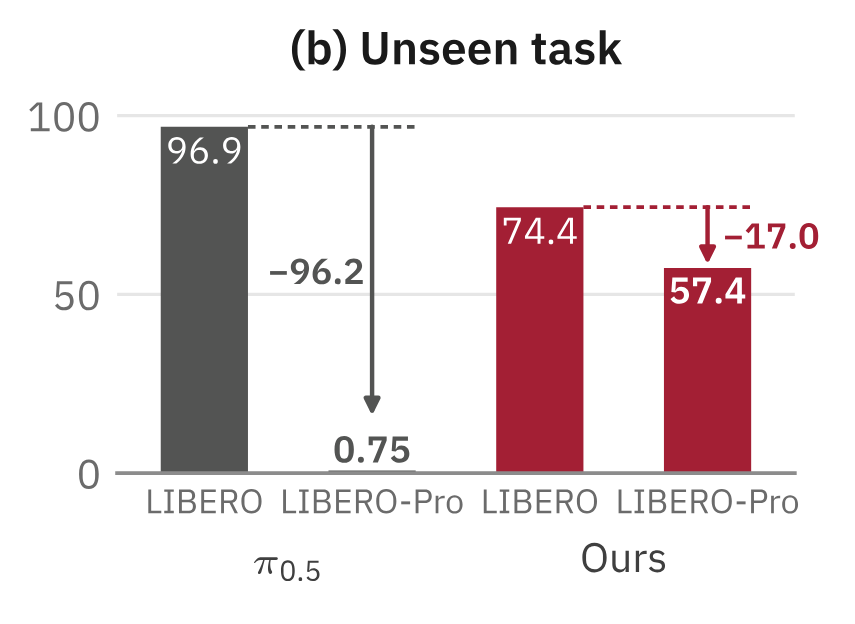
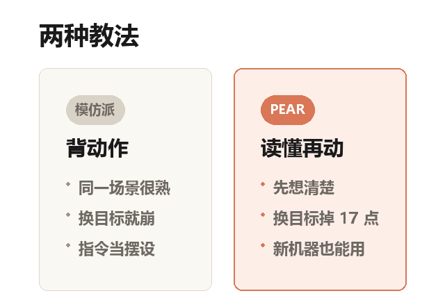
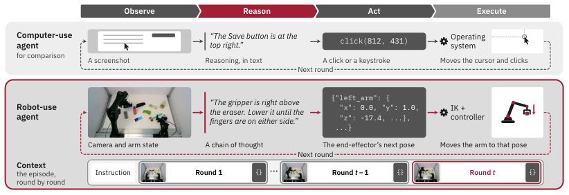
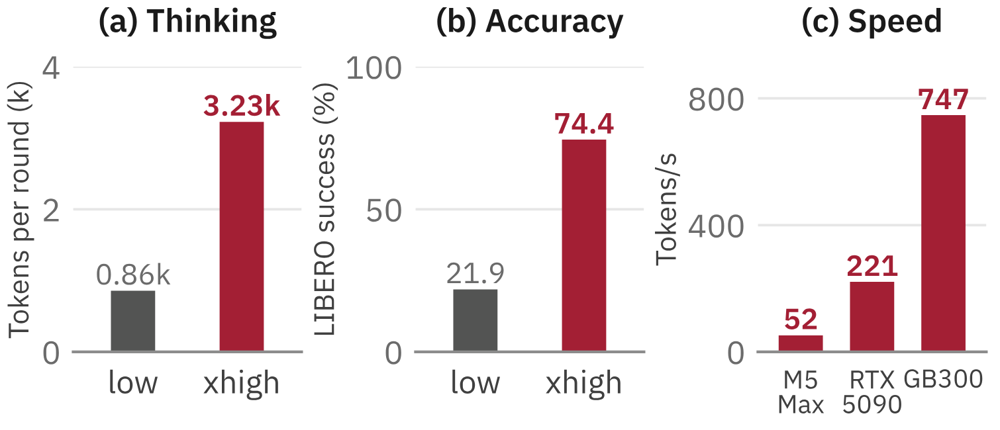
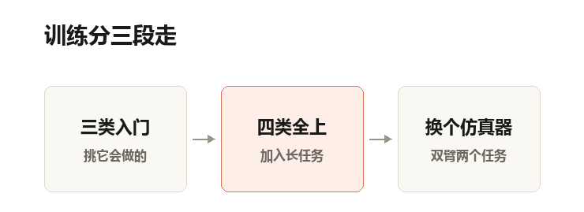
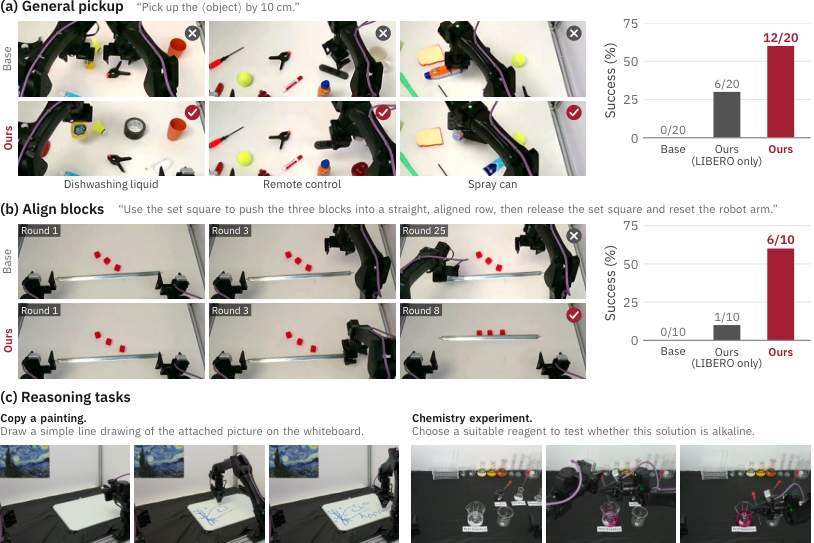

## 先看这张桌子

一张桌子，桌上摆着几样东西。桌边站着一台机器人，得伸手去动它们。

这个场景它练过很多遍，只练一件事。

九成七成功。

然后把指令换成另一件事。屋子没动，摆位没动，桌子还是那张桌子。

它的成功率变成 0.75%。一百次里不到一次。

不是退步，是基本不会了。

这个模型叫 π0.5，靠人类演示练出来的，是目前这类任务上最强的一档做法。
它掉下去的样子，是这整篇论文的起点。

论文来自 MIT 韩松团队，名字叫 PEAR。他们想解决的是一个很朴素的问题：为什么一个能九成七成功的机器人，听不懂一句人话。

## 它背下来的是动作，不是句子

先给这类模型一个名字：VLA，视觉-语言-动作模型。
说人话：看着画面、听着人话、直接吐出一串动作数字。

听起来三样都学了。但怎么练，决定了它真正依赖哪一样。

主流做法是给人操作机器人的录像，让它照着模仿。一帧画面配一段动作，反复练。

练完之后，画面进来，动作出去。中间那个「语言」，很多时候只是挂在那里。

同一张桌子上，「做这件事」和「做那件事」的画面几乎一样，动作却完全不同。

它没学过这个动作，只能把最像的那段搬出来。

论文里做了两个测试。第一个：同一间屋子、同一个摆位，只把指令换成另一件事。

它掉 96 个点，从 96.9% 掉到 0.75%。就是开头那个数。

第二个更狠：指令不变，只把两个物件的位置对调。人看一眼就懂，路径换一条走。

它掉 76 个点，从 96.9% 掉到 20.8%。

论文原图（Figure 4b，已裁切）。左边灰柱是 π0.5，右边红柱是这篇论文的模型。每组左边是原版任务，右边是「同一场景、只把指令换成另一件事」。灰柱 96.9 掉到 0.75，箭头标着 −96.2。红柱 74.4 掉到 57.4，只掉 17 个点。

本号自制。左边是主流做法的逻辑，右边是这篇论文的逻辑。

## 换个教法：别教动作，教它「用」

用电脑的 AI 你大概见过。它看一张截图，在脑子里想「保存按钮在右上角」，然后吐出一个坐标，鼠标就过去了。

没人教它「保存文件的动作要领」。它学的是：看屏幕、想清楚、点一下。

这篇论文说：机械臂可以照这个来。
每一轮，模型收到三样东西：几路相机画面、机械臂当前的状态、还有之前的每一轮。

它先在思维链里想一遍（说人话：先自己嘀咕一遍再动手）。然后吐出一段机器能直接读的文本。

这段文本里写的是：手下一步要去的位置，三个坐标加三个角度，单位是厘米和弧度。

后面交给逆运动学。这个词听着吓人，说人话就是：我知道手要去的坐标，反推每个关节该转多少度。

论文原图（Figure 2）。上半是操作电脑的 AI，下半是操作机械臂的模型。四步一一对应：看、想、给一个数、交给执行器。最下面一行是上下文，每一轮都往回堆。图里英文小字点开能看清。

关键在最后一句：整条链路里没有识别模块、没有抓取规划器、没有技能库。

说人话：没有谁事先告诉它「东西在哪」「该从上面抓」。物件在哪、怎么绕过去、上一步是不是搞砸了，全靠它自己从画面里判断。

这也是它敢换机器人的原因。它只输出「手去哪」，剩下的由每台机器人自己的控制器去做。
换成双臂、换成真机，接口没变。

## 一次只挪一步，所以它得想得够久

代价很直接：一次只给一个位姿（位置加朝向），挪一小步，再拍一张，再想。

真机上跑一个任务，成功的那些用了 7 到 24 轮。上限是 25 轮。

于是「想多久」直接决定「成不成」。

同一个模型，档位调到 low。每轮想 0.86k 个 token，成功率 21.9%。

调到 xhigh，每轮 3.23k 个 token。成功率 74.4%。

token 是模型读写文字的最小单位，一个大约半个到一个汉字。

三分之一的思考量，换来三分之一的成绩。这个比例整齐得有点可怕。

论文原图（Figure 9，已裁切）。左：每轮思考量。中：对应成功率。右：三种硬件的解码速度，单位 token/秒。M5 Max 52，单张 RTX 5090 221，单张 GB300 747。

速度也列在这儿。笔记本芯片每秒 52 个 token。一张消费级显卡 221 个。一张 GB300 是 747 个。
换算成动作：GB300 上一轮 xhigh 思考约 4.3 秒。低档约 1.1 秒。

4.3 秒动一下手。这就是现在的真实节奏。

## 训练从它会做的题开始

强化学习的奖励只有一个：任务成没成，1 或 0。中间没有分。

这里有个死结。如果一道题它八次全败，八次都是 0 分，比不出谁好，模型就学不到东西。

而刚开始，它几乎什么都做不到。入门任务上约 2%，五十次里成一次。长任务上 0.4%，两百五十次里成一次。
所以训练得挑它偶尔能蒙对的题，一段一段往前挪。

本号自制。三步的顺序：先三类入门任务，再加最长的那组，最后换仿真器、换双臂机器人。

第一步，只练三类入门任务，148 步。训练时的成功率爬到七成左右。

第二步，把最难的那组长任务也加进来，练到第 225 步。完整榜单这时是 74.4%。

第三步，换一个完全不同的仿真器。
仿真器就是电脑里造的三维假世界。有物理引擎，撞到桌子会真的被挡住。

再换成双臂机器人，练 115 步。

每一次更新都是「同一道题做八遍，比这八遍谁做得好，好的加分」。这套算法叫 GRPO，说人话：不给标准答案，只在一组尝试里分高下。

## 成绩单：第二梯队，但方向换了

原版榜单叫 LIBERO，40 个桌面任务，每个跑 50 次，一共 2000 次。
在这套题上，它从 1.6% 练到 74.4%。

参照系：闭源的 GPT-6 Astra 在同一套题上，中等思考档 49.3%。最高档 80.6%。
GPT-6.1 Sol 是 48.1% 和 76.2%。

所以 74.4% 的位置是：超过两个旗舰模型的普通档。
离 Astra 的全力档差 6 个点，离 Sol 的全力档差不到 2 个点。

别忘了，这是 270 亿参数的开源模型，不是闭源旗舰。

但同一个榜单上，前面那个 π0.5 是 96.9%。这篇论文没藏这件事，正文直接承认：原版上它比我们强。

它的说法是：题目一变，领先就翻过来。四个扰动类型里它赢两个、输两个。

输的那两个是「改措辞」和「换外观」——动作路径没变，照着背反而有效。

真机上的证据更硬。
一台双臂机器人，训练里一次都没出现过，真机数据一条没用。

30 次试验，成 18 次。同一个模型训练之前，30 次成 0 次。

论文原图（Figure 7）。(a) 抓起十种物品各试两次，共 20 次。(b) 用三角尺把三块积木推成一条直线，五个场景各两次，共 10 次。(c) 两件没有对应训练动作的事：照着《星空》画线稿，从三瓶试剂里挑能验碱的那瓶。灰柱是原模型，浅红是只练过入门任务的版本，深红是最终版。

中间那一档更有意思：只用入门任务练过的版本，在这台机器上也能成 7 次。
它既没见过这台机器，也没练过这两个任务。

口径要说清：这 18 次里的两个任务，在仿真里练过，只是换了仿真器、换了机器人。真正没见过的是这台真机、这间屋子、这些光照。

## 它还会画画，这件事比分数有意思

论文另给了两个任务，没有任何对应的训练动作。

一个：给它一张梵高《星空》，让它在白板上画一张简单线稿。它画出来了。

另一个：桌上三瓶试剂，碘水、酚酞、乙醇。问它怎么验证溶液是不是碱性。
它挑了酚酞，因为酚酞遇碱变粉。滴进去，溶液变粉。

这两件事不是练出来的。它靠的是底座模型本来就有的世界知识。

顺带一个数字。练完机器人之后，它在九个通用测试上和原模型没有可测出的差别。

数学、科学、代码都在这九个里。
数学竞赛 AIME 2026 拿 98.5 分，和它练机器人之前一样。研究生级科学题 GPQA 89.7。写代码的 LiveCodeBench 88.4。

同一个模型，现在能推理、写代码、看图答题，也能开机械臂。

## 该说的不足

第一，规模很小。作者自己写：GPU 不够，练到两个仿真器的两个任务就停了。
全部训练 340 步，覆盖两个仿真器、两类任务、一台真机。作者说，这远没到规模上限。

第二，慢。4.3 秒一轮，一次抓取要七八轮。

而且它还没有「动作块」——不能一次给出一整段连续轨迹，只能一个位姿一个位姿地挪。
本来一步能做完的动作，现在被拆成好几步。极端情况下单轮思考能到 3.2 万 token，动一下超过半分钟。

第三，有些东西就是拿不起来。

12 次失败里，6 次是回合用完了还没做完。3 次积木没推齐。2 次把东西碰倒。1 次网球滚走了。

有两个物品全场零成功：气泵，6 次全被撞倒；刷子，6 次里 5 次回合用完。
细长、会滚、一碰就倒的东西，还是难点。

第四，吃提示词。

270 亿参数的底座，对「自己这副身体」了解不够。机器人的尺寸、相机位置、动作单位，都得写进提示词。
写得含糊，成绩就掉。写详细，才到得了最好水平。

第五，它一帧人类演示都没用。

作者的理由是拿不到高质量的同分布数据，也怕微调伤到通用能力。代价是所有本事都得从 0/1 的奖励里自己摸出来。

## 最后一句

过去两年，机器人领域的进步主要靠「更多演示」。人做一遍，模型学一遍，数据越多越强。

这篇论文提示了另一条路：把动作数据换成「想清楚再动」的本事。

它现在很慢，六成成功率，只会在两张桌子上干活。

但一个从没碰过真机器人的模型，第一次上手就成了一半以上。

这件事本身，可能比 74.4 这个数字更值得记住。

## 论文信息

- 标题：Training Reasoning Models in Simulation to Natively Use Real Robots
- 作者：Jiaming Tang、Zhuoyang Zhang、Junxian Guo、Fangzhou Zhao、Yilong Zhao、Zekai Li、Xingyang Li、Yuyang Zhao、Song Bian、Zhijian Liu、Song Han
- 机构：MIT、Inco AI、UC Berkeley、UCSD、NVIDIA
- 会议：无。预印本 v1，2026-11-13 提交，暂无录用信息
- arXiv：2611.18562
- 代码：https://github.com/mit-han-lab/pear
- 项目页：https://mit-han-lab.github.io/pear-blog/
- 图片：标注「论文原图」的为论文 Figure 2、4b、7、9，版权归论文作者；标注「本号自制」的由本号绘制。
