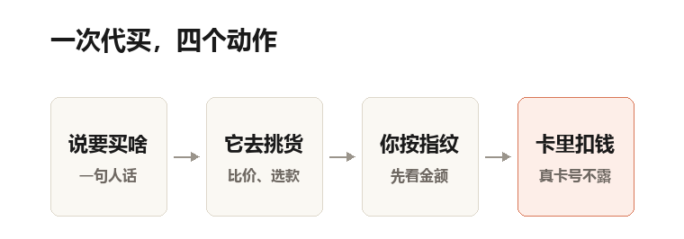
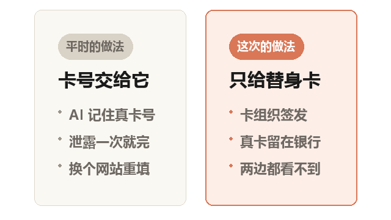
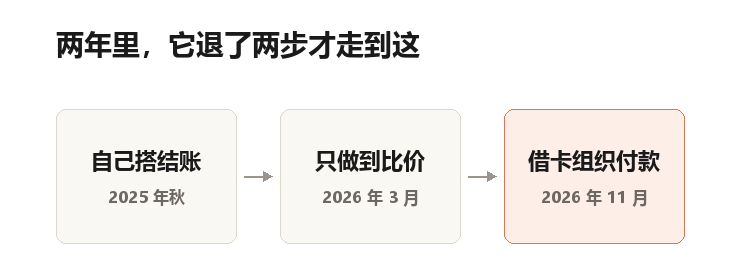
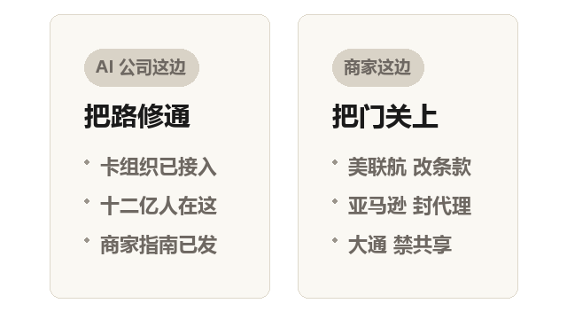

:::lead 写在前面
晚上十一点，你躺着跟 ChatGPT 说：那双鞋，42 码，买吧。
它找货、比价、下单，最后弹一个确认框，你按一下指纹，钱付了。
这是 11 月 13 日 OpenAI 上线的功能。
可两天前，美联航刚改了条款，把 AI 挡在门外。
:::

## 十一点的那句话

那个功能叫 ChatGPT 钱包。

名字叫钱包，但它不开银行账户，不能存钱，也不能借钱。它只干一件事：让 AI 替你付钱。

现在能用的人很少。

只有美国的 ChatGPT Pro 付费用户能用。Pro 是 ChatGPT 最贵的那档订阅。用的人还要满 18 岁，要绑一张美国发行的银行卡，卡得是美国运通、大通、万事达、Visa 这四家里的。

入口在 dots 上。dots 是 OpenAI 今年推出的智能体平台。

智能体，说人话就是「会自己动手的 AI」。普通聊天机器人只回话，它能点开网页、点按钮、填表、提交。

这件事跟你有什么关系？

现在直接的关系是没有——它在国外，还要付费。

但它在试的问题，跟每个人都有关系。以后你在对话框里买东西，钱走哪条路？卡号还要不要每家都存一遍？

## 它凭什么敢替你付钱

对 OpenAI 来说，这一步非走不可。

代理帮你找到商品、比好价格，最后却要你自己跳出 App 去结账，它干的活就等于白干。

一个只会推荐、不会买单的助手，价值停在广告位那一层。

一次代买，只有四个动作。

:::caption 本号自制
四个动作里，第三个是「它停下来」。这一步是整个设计的地基。
:::

第一步，你说。不是填表，是一句人话：「那双跑鞋，42 码，别超过 800 块。」

第二步，它去挑。开网页、翻商品、比价、选款。这一步它早就会了。

第三步，它停下来。把挑中的东西、总价、用哪张卡，摆在你面前。

第四步，你按指纹。人脸或者指纹过一道，确认了才算授权。

关键就在第三步：它不能自己决定付钱。

官方写得很死：每一次购买都要过一次安全验证。不是第一次，是每一次。

每一次确认还会留一条记录，写明这单是本人授权的。以后吵架，有据可查。

这套流程你其实见过。

Apple Pay、谷歌钱包付钱也是这么干的：真卡号换一张令牌，按指纹确认。

差别在时间差。那是你站在收银台前自己按，这里是 AI 先替你跑完全程，最后才拉你一把。

## 你的卡号，它一次也没见过

这是整件事里最值得看的一处设计。

平时在网上买东西，你把 16 位卡号、有效期、背面三位数填进去，商家存下来。存的地方越多，泄露的机会越多。

这次不一样。

你按完指纹，卡组织会签发一张替身卡。卡组织就是 Visa、万事达这些管卡的组织。

替身卡有自己的卡号、安全码、有效期。

真卡号留在银行那边。AI 拿不到，商家也拿不到。

:::caption 本号自制
左边是今天大多数网购的样子，右边是这次的走法。区别不在 AI 有多聪明，在「钥匙给不给」。
:::

说人话：真钥匙还在你兜里，它手上只有一张临时门禁卡。

还有一句被埋在括号里，但挺重要：你原来的返现、积分、争议退款都还在。买的东西坏了，该找商家还是找商家。

## 为什么是这周，不是去年

因为这条路它走过两次，两次都退回来了。

据财联社报道，2025 年秋天 OpenAI 做过「即时结账」，想在聊天框里把结账流程整个建起来，很快改了方向。

2026 年 3 月，重心退回一步：只帮你找、帮你比，不碰最后那一按。

:::caption 本号自制
三次尝试，前两次都往后退。这次的关键差别是：它不再自己搭结账，改用卡组织现成的轨道。
:::

这次不退的理由，是它不再自己造路了。

三个条件刚好凑齐。

一是卡组织愿意接。这次是美国运通、万事达、Visa 一起做，三家高管都在公告里署了名。

二是人已经在那儿了。每周 12 亿人用 ChatGPT。全球约 80 亿人，等于每 7 个人里有 1 个每周来一次。

三是钱漏在最后一步。问了、比了、想买了，然后得跳出对话框去别处下单。这一跳，单子就丢了。

## 门正在关

上线前两天，11 月 11 日，美联航改了条款。

新规矩是：未经授权的第三方 AI 代理，不能访问它的系统，也不能替旅客完成交易。代理可以给你看航班和价格，但不能在它网站上把票买了。

美联航的 CEO 斯科特·柯比说了句很直的话：「坦白说，我不想再创造一个中间商。」

顾虑不止是钱。办值机时，按规定要由人确认行李里没有违禁品。这一步交给 AI，合规上过不去。

再往深一层，是客户关系。

今天你订票，是打开美联航的 App。它知道你是谁、坐过几次、爱靠窗还是靠走道。

这一步要是换成对话框，它就变成一个供货的，客人攥在别人手里。

不止它一家。

亚马逊今年早些时候就把 Meta 的 AI 代理 Muse 挡在门外。Meta 是脸书的母公司。它给的理由是，未授权代理持续访问违反了平台条款。

大通银行 10 月 27 日生效的协议里写明，不许第三方 AI 用客户账号密码登录。

嘉信理财的 CEO 说，他们正在拦想代客户操作资金的代理，还反问了一句：AI 弄错了，谁负责。

:::caption 本号自制
这一侧在修路，那一侧在关门。两边都不算错——一边想省事，一边怕失去控制权。
:::

也有开门的。西南航空 10 月 6 日上了 ChatGPT 插件，但只让你查航班，不让你订。

达美航空放得松一点：经过身份验证的 AI 助手可以完成订票。只有无成人陪伴儿童这类敏感单子，才要额外把关。

## 3.2 亿单里的 504 单

数字最诚实。

据财联社报道，Uber 披露过一组数：万圣节那一周，它的网约车加外卖一共约 3.2 亿单。

其中 AI 代理下了 500 单外卖，4 单叫车。

换算一下，每 63 万单里有一单是 AI 下的。

这就是现在的真实水位：路修好了，车还没上来。

还得说明白，这 504 单是全部 AI 代理的账，不只 ChatGPT 钱包，而且钱包 11 月 13 日才上线，根本赶不上那一周。

## 对你我，变的是三件小事

第一件，卡号不用每家都留。

今天你在十个网站买过东西，卡号就躺在十个地方。这套走法里，商家手上没有卡号，只有一张替身卡。少一个地方存，就少一次泄露。

第二件，「付钱」被拆成了两半。

以前是挑、点、付，你一个人干完。现在前半段归 AI，后半段归你。省下的是时间，交出去的是判断。

第三件，入口的位置挪了。

今天你买东西，是打开某个 App 去搜。这套东西的入口是一句话。入口一挪，货架的位置也跟着挪。

也别高估。它现在只在美国、只给付费用户。国内能代买的，还停在「帮你找」这一步。

## 还没确认的部分

**「不抽成」只说到了初期。** 这是 OpenAI 商业化与支付业务负责人对媒体讲的，官方公告里没有这句。什么时候开始抽，没有时间表。

**钱包上线后的用量，官方一个数都没公布。** 上面那 504 单是上一周、全部代理的账，不能算到它头上。

**「首个」是它自己说的。** 公告原话是「第一个让代理付款、又不需要接触真实卡信息的钱包」。这个「第一个」没有第三方核过。

**商家会不会真接，现在只能看姿态。** OpenAI 自己的指南里就承认：有些网站会误拦，风控还可能把合法的代理购买当成欺诈。指南让商家去改防火墙、认领商家身份、上传价格和库存——这些活得商家自己干。

**限制的是「未授权代理」，没点名。** 美联航和亚马逊的条款针对的是一类工具，不是某一家公司。钱包能不能在它们那儿用，官方没给答案。

**中国没有时间表。** 公告只提美国，下一批是哪些国家，没写。

## 最后

手机能付钱这件事，我们花了十年才习惯。背后是二维码、是收单、是银行改了一堆系统。

AI 付钱也一样。门槛不在指纹识别，也不在那张替身卡。

门槛在美联航 CEO 那句话里。

技术把路修到了门口。开不开门，是另一回事。

:::meta 事件档案
时间：2026 年 11 月 13 日钱包上线；11 月 11 日美联航改条款
当事方：OpenAI；美国运通、大通银行、万事达、Visa；美联航、亚马逊
信源数：3 个（OpenAI 官方公告、The Verge、财联社）
:::

:::links
**官方公告：** https://openai.com/index/introducing-chatgpt-wallet
**The Verge：** https://www.theverge.com/ai-artificial-intelligence/1033425/openai-chatgpt-wallet
**财联社：** https://www.cls.cn/detail/2534281
:::

图片版权：本篇全部示意图由本号绘制，依据 OpenAI 官方公告、The Verge 与财联社报道整理；文中不含厂商发布图与媒体转载图。
