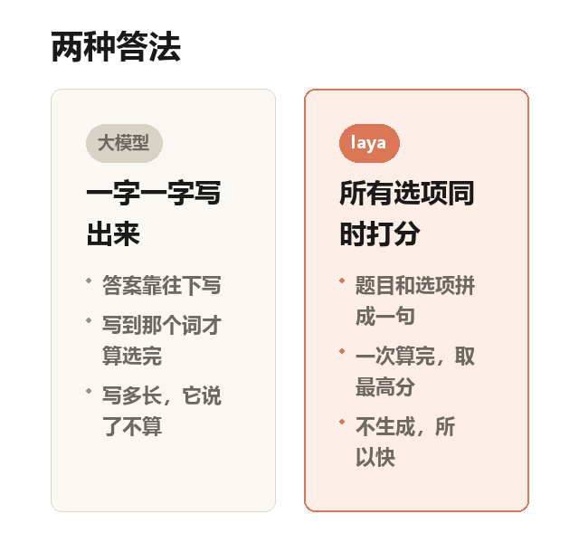
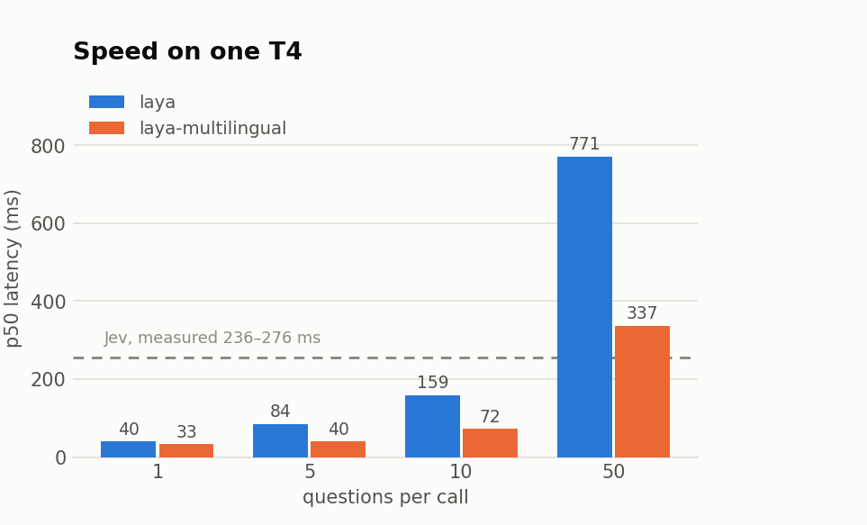
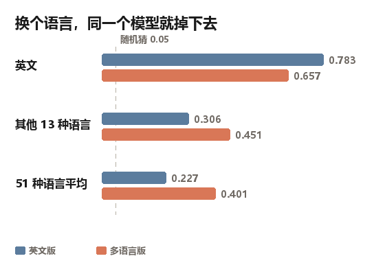

:::lead 写在前面
一封客服邮件进系统，先要分给「账单、技术、其他」。
大模型的做法是一个字一个字把答案写出来，写完才算答完。
这个项目把「写」删掉，直接给选项打分，33 毫秒出结果。
快是快，可没人喂数据的时候，它的准确率和瞎猜差不多。
:::

## 一封邮件，先放进哪个抽屉

客服后台最常见的活不是「回答」，是「分拣」。

一千封邮件进来，先得知道哪封归账单、哪封归技术、哪封该转主管。

这些都是选择题。选项就那几个，答案就一个词。

用大模型做这件事，效果你已经见过。把邮件和选项一起丢过去，它输出「billing」。

准是准，就是慢。

一问一答几百毫秒起。听起来还行，但一封邮件要问三个问题，一千封就是三千次。

排队排下来，一分钟只够处理几十封。

今天说的这个项目叫 laya，它把单次回答压到了 33 毫秒。测的是一张 T4 显卡，几年前的主流推理卡，不是旗舰。

## 大模型答一个词，为什么要先写一整句

因为它的「答」，本身就是一个字一个字往外蹦。

这类模型叫自回归（说人话：一个词一个词往下接）。它读进问题，预测下一个词，把那个词接回去，再预测下一个。

「billing」这三个字，是它连着预测三次得到的。

每预测一次要等一次计算，所以答案越长越慢。你让它答「是」和答「两百字分析」，耗时差一个数量级。

这也是为什么大模型的输出像流水：它不是想好了才说，是边说边定。

laya 走的是另一条路——一次算完，不往下接。

学界管这叫非自回归（说人话：所有答案同时算，不分先后）。

:::caption 本号自制
左边是逐字生成，右边是同时打分。差别不在模型大小，在「答」这个动作本身。
:::

## 把「写答案」改成「给选项打分」

拆开看只有四步。

第一步，把题目和选项拼成一段话：「这封邮件该给哪个组？账单——发票、付款、退款；技术——故障、报错；其他——剩下的。」

第二步，用一个小模型把这段话读一遍，变成一串数字。这套权重是 1.5 亿到 4.2 亿参数。

参数是模型的「脑细胞」数量。1.5 亿这个量级，大致是能塞进手机和笔记本的那一档；旗舰大模型是它的几千倍。

第三步，给这道题接一个小零件，专门学「这道题该怎么判」。它把这串数字变成每个选项的一个分数。

第四步，分数归一化成概率，最高的那个就是答案。

:::caption 本号自制
一次前向（数据从输入到输出只走一遍网络）走完四步。第三步那个小零件是关键：它不改变模型本身，只在上面接一个只认你这道题的判断器。
:::

整条链路没有「生成」这个动作，所以没有循环，也就没有「答案多长」这回事。

同一批问五个问题，多语言版总耗时 40 毫秒。平均一个 8 毫秒——五道题共用同一次读取。

## 33 毫秒是什么概念

人眨一次眼，100 到 400 毫秒。它答一个问题，比你眨一下眼还快。

跟同类比：另一款做同样事情的商业服务叫 Jev，TypeSafe 出品。第三方测出来的延迟是 236 到 276 毫秒。

laya 是 33 毫秒，快七八倍。

:::caption 仓库原图（README，Speed on one T4）
横轴是一次问几个问题。蓝柱是英文版，橙柱是多语言版。虚线是 Jev 的实测区间。注意 1 个和 5 个几乎一样高——题目是同时算的，不是排队算的。
:::

## 它还会说「我不确定」

这一点比速度更值得看。

普通大模型给你一个答案，再附一个「置信度」。可那个数字经常是编的。

有个指标专门量这件事，叫 ECE。说人话：「它报出的把握」和「它实际的正确率」平均差多少。这个项目校准前是 0.466——它说九成五把握的时候，实际正确率可能只有五成。

校准之后，0.081。差距缩到了八个点。

laya 的做法是把「把握」拆成三个出口。

第一个叫预测集。它不只给一个答案，给一组「还可能是这几个」。这组的大小按覆盖率算：设成 90%，意思是真答案落进这组的概率不低于九成。

第二个叫弃权。集合太大、或者它觉得没见过这类输入，就直接说「这题我不答」，交给人。

第三个叫路由。短英文走小模型，长文、图片、录音、非英文走一个 0.8B（80 亿参数）的「读者」模型。

为什么要提前定走哪条路？因为模型自己的置信度靠不住。

README 里有个例子。面对高棉语，英文版的准确率是 0。而它给出的置信度是 95.2%。

它不知道自己不会。

后来把温度系数夹紧，这项回到 70.5%。但那是配置层的事后修正，不是它自己发现了问题。

:::caption 本号自制
柱长是准确率，虚线是随机猜（0.05）。英文版只在自己练过的英文上站得住，换语言掉到 0.306；多语言版更均衡，英文也退了一截。数字全部来自 README 的多语言基准。
:::

## 成绩单：赢了哪里，输了哪里

主榜叫 typed-decisions，2000 道决策题，四个业务场景。

laya 微调版 0.766，Jev 0.727。

参照系：随机猜 0.318。全押最常见那个答案 0.461。出题的「老师模型」自己重答一遍，一致率 0.735。

所以 0.766 的位置是：比老师自己重答一遍还稳一点。

但有两处输得很干净。

一是选项多的题。77 个选项的银行意图分类，Jev 0.870，laya 0.425。原因是所有选项要挤进同一段预算。77 个选项，每个只分到三四个 token，长得分不清。

token 是模型读文字的最小单位，一个词大约一个。

口径不完全一样：Jev 那边 72 个标签，laya 是 77 个。但差 45 个点，不是这几个标签能解释的。

二是「像不像」。它的第一名更准，但整套概率分布和老师差得远。这个指标叫软准确率，看的是分布像不像。0.471 对 0.580。

## 但是，它自己一个人基本是瞎猜

这是全文最该记住的一句。

上面那个 0.766，是在榜单自己的训练集上微调过的版本。

原始权重零样本做这套题，两个基础版分别是 0.362 和 0.352。

对照一下：不管问什么都答同一个，是 0.461。

也就是说，不喂数据，它比「全押同一个答案」还差。

作者自己在 README 里写得很直白。它是一个「适合被专门化的快速底座」，不是开箱即用的决策引擎。

那怎么专门化？不是微调，是一个叫 fit 的动作。

给它几十行标注好的例子，一行是一段文字加标准答案。它不动模型本身，只在上面拟合那个小零件。

拟合，说人话：按你的例子把那几根旋钮调一调，模型一个字不改。

README 里的例子：60 行邮件，留 20 行做考试。

不喂的时候，团队分类 0.600，20 条里有 12 条它直接弃权。

用 40 行 fit 完，0.900。整个过程 9 秒，没有梯度、没有训练。

更值得看的是它拒绝的那部分。

同一批数据里，「紧急程度」这道题的小零件考了 0.400，和原来的引擎打平。系统就没接管这道题，原样留给引擎，一个字没改。

而团队分类被接管之后，20 条全被标成「要复核」。因为只有 10 行用来校准，太少，它不敢保证九成五的精确率。

它没装作自己很确定。这一点比 0.900 更有价值。

## 一句「不要取消」，它读成了「取消」

现在说它不行的地方。以下都是 README 自己列的，我只是翻译。

第一，读不懂否定。

仓库里有个 issue：五个「我要取消账户」的变体，其中四个是否定句。比如「不要取消」「先别取消」。

英文版把四个全判成了「取消账户」，多语言版错了两个。

其中一个还给了 0.9998 的概率。

这不是「有点飘」，是「非常有把握地搞反」。合同、医嘱、退款这类否定句常见的业务，上线前必须自己验。

第二，「打几分」这一类最弱。五级情感分类只有 0.372，五选一瞎猜是 0.20，好不了多少。

第三，布尔词标签会带偏。选项写成 true/false、yes/no 时，模型会跟着标签走，不看内容。

## 还缺什么

作者在 README 里单开了一节叫 Honest limits。其中几条不是「已知缺陷」，是「还没做完」。

- 「是或否」那道题要等重新训练的权重才能修，现在只能让用户自己改标签绕开。新权重还没发。
- 有个叫 act_probability 的字段，本意是「这次动作靠不靠谱」。现在对几乎任何输入都读出 1.0。AUROC 是衡量「打分能不能分出对错」的指标，它只有 0.30，抛硬币是 0.5——比抛硬币还差。作者直接写了「还没有可用信号」。
- 多语言版的「打几分」有位置偏好：很少选第一个档位，而且跟语种有关，得自己验。
- 配套的训练服务是商业的，开源的是推理代码和权重。想批量做自己的决策模型，要么自己写训练脚本，要么用它的付费服务。

一句话：它是一把很快的刀，但刀柄还没装完，而且只在你磨过的那块料上顺手。

## 最后一句

过去两年，大家习惯了一个方向：模型越大、越通用、越会写。

laya 反着走：更小、更窄、不写，只选。

它的天花板肉眼可见。77 个选项就崩，一句「不要」就骗过去，没人喂数据时连瞎猜都不如。

但它把一件被忽略的事做对了：不是所有问题都需要一段话。有些问题只需要一个词，加一句「我有多确定」。

:::meta 项目档案
仓库：NandhaKishorM/laya
Star：35,610（2026-09-18 创建，两个月）
许可证：Apache-2.0
语言：Python（另有 TypeScript 客户端）
模型规模：1.5 亿–4.2 亿参数，可选 0.8B 读者模型
论文：From Laya to Vega: Open Non-Autoregressive Decision Models with Calibrated Probabilities（Preprints 2026）
:::

:::links
**仓库：** https://github.com/NandhaKishorM/laya
**论文：** https://doi.org/10.20944/preprints202611.0781.v1
**模型权重：** https://huggingface.co/convaiinnovations/laya
:::

图片版权：标注「仓库原图」的图来自 laya 仓库 README，版权归原作者所有；标注「本号自制」的由本号绘制。
