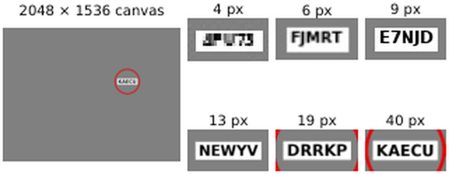
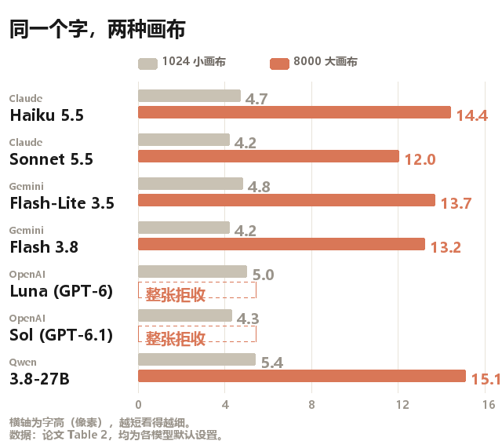
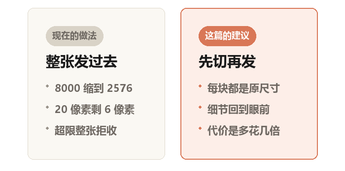
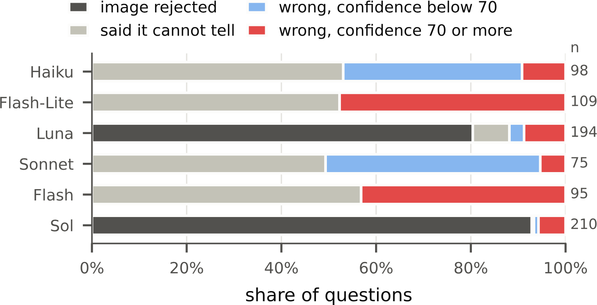
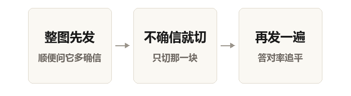

:::lead 写在前面
你把一张大照片发给 AI，它收到的常常是一张缩小版。
一辆 20 像素宽的车，到它眼前只剩 6 个像素。
这篇论文给七个模型做了张视力表，量出它们能看多细，也量出了「看不清还硬答」的比例。
:::

## 一辆车，20 个像素

无人机悬在停车场正上方，拍一张照片，8000 乘 6000 像素。

你在图上找到一辆车，指着它问 AI：这辆是什么颜色。

你看到的是车。深蓝色，车顶有一道反光。

它看到的，可能只是一小团糊掉的色块。

论文开头给的就是这个例子。那辆车在原图里 20 像素宽。

送到 Claude 眼前，它大约 6 个像素宽。

6 个像素是什么概念：屏幕上正常大小的一个汉字，大约 16 像素宽。6 个像素，不到半个字。

换成 OpenAI，默认设置更干脆：这张图直接被拒收。模型一次都没看到。

所以那道题它不是答错，是没机会答。

这类看着图、听着话、直接给答案的模型，叫视觉语言模型。

说人话：你发一张图配一句话，它把图和话一起读，然后回你一段话。

## 图在见到模型之前，已经被动过手脚

这里要说清一件事：AI 看图，不是按像素看的。

它按「小块」看。每块是一小片正方形像素，比如 28 乘 28。

一块叫一个 token。
说人话：token 是模型读图的最小单位，像把照片切成很多小方格，一格一格读。

厂商为了省钱省时间，会给一张图的小块数量设上限。超了，就先把图缩小。

四家的规矩不一样。
Claude 把长边压到最多 2576 像素，最多 4784 块。

Gemini 按档位压到 280 到 2240 块。不设档位时相当于 1120。

OpenAI 默认不缩，但超过 30000 块就整张拒收。一张 7680 乘 4320 的照片要 32400 块，超了。

开源的 Qwen 最宽松，16384 块，收到的像素比前三家多得多。

同一张照片发出去，四家收到的不是同一张照片。

## 给模型做一张视力表

要量「能看多细」，得先有个刻度。
作者的办法直接抄了眼镜店：一张灰底图，中间一个小白标签，上面印五个字符。

字符从 22 个字母和数字里随机挑，故意去掉 O 和 0 这种容易看混的。

字号十档，最小的字高 4 像素，最大 128 像素。

判据是「读对一半的那一档」：字大到某个尺寸，模型能读对一半，这个尺寸就算它的视力。

为什么用字符，不用「图里有几只猫」：字符读对就是读对，读错就是读错。

五个字符全靠蒙对，概率大约五百一十五万分之一。

:::caption 论文原图（Figure 1）
左：一张 2048 乘 1536 的灰底测试图，红圈里就是那个小白标签。右：同样的字符印在六种字高上，从 4 像素到 40 像素。4 像素那档，你自己也读不出来。
:::

同一批字印在四张画布上，从 1024 一直印到 8000。
画布越大，厂商缩得越狠。四张一比，缩水吃掉多少细节就显出来了。

## 小图上四个像素够用，8K 图上要十三个

结果很清楚。

1024 的画布上，所有模型都能读 6 像素以内的字。有的只要 4.2。

同一批字印到 8000 的画布上，需要的字号全都变大。

Sonnet 从 4.2 涨到 12.0。Flash 从 4.2 涨到 13.2。Haiku 是 14.4，Qwen 是 15.1。

Luna 和 Sol 在默认设置下，这张画布根本没收到。

:::caption 本号自制，数据来自论文表 2
横轴是能读对一半的字高，越短表示看得越细。灰条是小画布，橙条是 8000 画布。最后两行是 OpenAI 的默认设置：图太大，直接拒收。
:::

原因不复杂：图被缩了三倍多，字也跟着缩三倍多。想读到同样的东西，字就得更粗更大。

换算到真实的 8K 照片，7680 乘 4320。
8K 指长边八千像素左右，手机随手拍一般是 4000 乘 3000。
Sonnet 要 11 像素，Haiku 和 Flash 要 13。

Qwen 估出来是 10，但作者自己说这个数不太准。

参照系：13 像素，比手机里正常正文小一档。你还认得出，但得凑近。

## 切成九块，或者让它自己说要哪块

作者拿了 601 道题，全是「大图里的小东西」。

三个公开题库凑的，其中 260 道是遥感和监控画面。
遥感就是卫星或飞机从高空拍的地面照片。

每道题都加了一个选项：「这张图细节不够，看不出来」。选了算错。

原样发，七个模型的成绩是 38.6% 到 72.4%。

切成九块发，图小的切四块，每块都是原尺寸：

Haiku 涨 14.5 个点，Sonnet 涨 11.1。
Flash-Lite 涨 12.0，Flash 涨 12.5。

遥感那组最明显，Sonnet 从 60.0% 到 80.8%。

而把 Gemini 拨到最高档，只涨了 5.5 和 3.7 个点。

说明问题不在「不够清晰」，在细节压根没送到。

OpenAI 这边最戏剧。601 道题里，默认设置拒了 215 道。

其中高分辨率那组 150 道，拒了 144 道。

在它肯收的 386 道上，Sol 其实能答到 79.0%。

所以总分 50.7% 这么难看，主要不是眼力差，是图没进去。

切成块就不拒了，总分从 50.7% 到 83.7%。

另一个办法更省：两步放大。
第一步，只发缩小的全景，问它「你要看哪一块」，让它自己报一个框。

第二步，把那个框从原图里裁出来，按原尺寸，连同一张全景一起发。

这套只用切块 40% 的图片量。
在 Gemini 上还赢了。
Flash-Lite 是 72.2%，切块 70.5%。
Flash 是 83.0%，切块 80.5%。

在 Claude 上差一点点。
Haiku 73.5 对 73.7，Sonnet 81.0 对 83.5。

:::caption 本号自制
左边是默认路径，右边是两条补救路线：先切块，或者让它自己说要哪块。
:::

## 细节丢了的时候，它有两种反应

这一段是全文最该记住的。
作者挑出那些「切块答对、整张答错」的题。这些题的细节确实在原图上，只是整张发的时候丢了。

然后看模型当时说了什么。
Claude 和 Gemini 都有一半左右老实说「看不出」。
Haiku 53%，Sonnet 49%。
Flash-Lite 52%，Flash 57%。

差别在剩下那一半。
置信度是模型自己报的 0 到 100 的数，表示它有多确定。

Claude 给的错答案，多数置信度低于 70。真正「很有把握地答错」只占 5% 到 9%。

Gemini 给的全部在 70 以上。所以它有 43% 到 48% 是自信地答错。

说人话：一个会说「我看不清」，一个会编一个给你。

:::caption 论文原图（Figure 5）
横轴是这些题里各种回答的占比。浅灰是「老实说看不出」，浅蓝是答错但不自信，红色是答错还很自信，深灰是被拒收。右侧 n 是这类题的数量。字小，点开能看清。
:::

Sol 和 Luna 那两行深灰特别长，因为它们的图在默认设置下被拒了。

## 事前算一遍，几乎没用

作者的第一个想法很工程师：既然知道各家的压缩规则，发之前算一下不就行了。
算这个细节缩完还剩几像素，不够就放大。

他们真做了这个检查，门槛设在 16 像素，大约是小号正文的高度。

结果在 Claude 和 Gemini 上，96% 的题都被判成「看得清」。
于是原样发了。

成绩比无脑切块低 11 到 14 个点。

门槛降到 8 像素，能捞回一半收益。

为什么算不准。
V*Bench 那道题里，目标物的中位宽度是 36 像素，远高于 16。
但切块照样涨 8 到 18 个点。

也就是说，「能读对一半」这个标准，对回答一道题来说远远不够。

真正好用的信号，是模型自己的回答。
在 Claude 上，先原样发一次。它说「看不出」，或者置信度低于 70，再补一次切块。

这样做，Haiku 72.4%，Sonnet 82.9%。
离「每张都切」只差 1.4 个点。

图片量只用 62% 到 70%。

:::caption 本号自制
整图先发一次，用它的回答当信号。只在它不确信的时候补切块。
:::

论文最后把这套整理成五条规则。核心就两句：Claude 看回答，Gemini 直接两步放大。

## 这篇论文没说的地方

第一，每个设置只问了一次。所以误差范围覆盖的是「换了哪些题」，不是「同一个模型多问几遍会不会变」。

第二，所有模型都跑在最低推理档。换到高档会怎样，没测。

第三，Qwen 只按原样发过。它是唯一收到更多像素的模型，但切块对它还有多少用，论文答不了。

第四，没测医学图和雷达图。而这两类恰恰最需要看清小东西。

第五，规则会变。Claude 早先的版本压到 1568 像素，现在是 2576。作者的对策是把视力表也开源了，谁都能重测。

第六，规模不大。七个模型、601 道题。
会议是 WACV 2027 的一个 workshop，不是主会。

第七，那个 16 像素的门槛是他们自己推翻的。这说明「事前估算」这条路还没走通。

## 最后一句

过去我们说 AI 会「幻觉」，指的是它编了不存在的东西。

这篇论文讲的是另一种：东西是真的，图也是真的，只是没送到它眼前。

这两种错，从回答里看不出区别。

所以下次它在图上答得很肯定，你可以多问一句：你是看见了，还是猜的。

:::meta 论文档案
标题：Know When to Zoom: How Small Is Too Small for Vision-Language Models?
作者：Siddharth Vohra、Min Xu
机构：卡内基梅隆大学；Vohra 同时在 AWS AI Native
会议：WACV 2027 SENSE workshop 录用，2027 年 1 月报告
arXiv：2611.22709
:::

:::links
**论文链接：** https://arxiv.org/abs/2611.22709
**代码与数据：** https://github.com/siddvoh/know-when-to-zoom
**项目页：** https://siddvoh.com/know-when-to-zoom/
:::

图片版权：标注「论文原图」的图来自论文原文，版权归作者所有；标注「本号自制」的由本号绘制。
