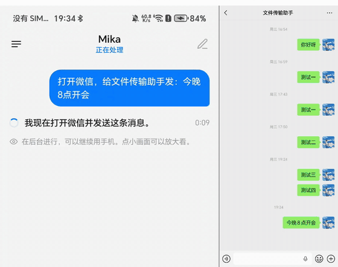
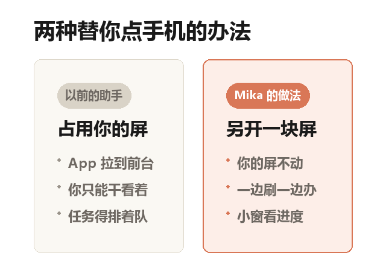
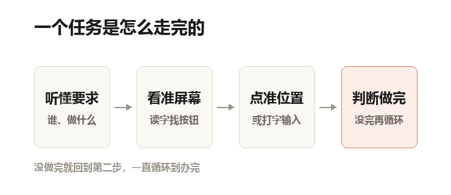
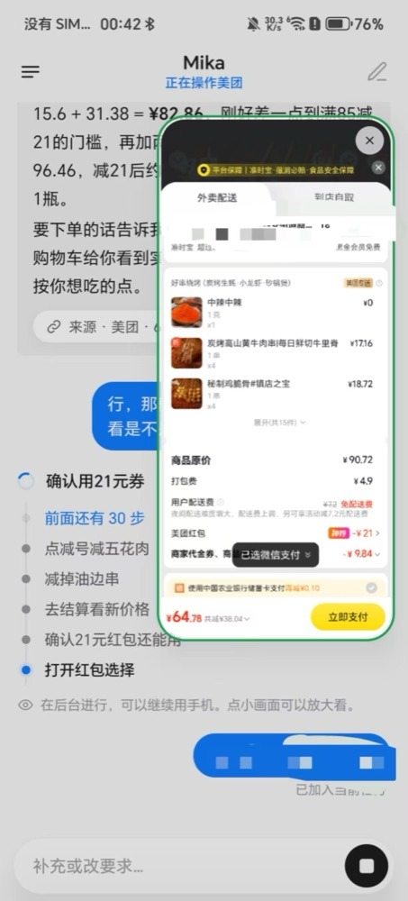
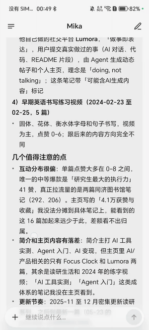

:::lead 写在前面
手机里装个 AI 助手不稀奇，稀奇的是它干活的时候不占你的屏幕。
它借安卓自带的调试通道，另开一块你看不见的屏，把 App 在那块屏上打开、点完。
它不认识任何 App 的接口，只会像人一样看屏幕、找按钮。
代价是：装它的那一步，比用它难得多。
:::

## 你的手机停在这一页，它已经发出去了

晚上八点，你在路上，想给微信的「文件传输助手」发一句「今晚 8 点开会」。

平时你得切出去、打开微信、找到那个对话框、打字、点发送，五六下。

这次你只在 Mika 的对话框里打一句：打开微信，给文件传输助手发：今晚 8 点开会。然后继续看你的东西。

:::caption 仓库演示：左边是你的手机，右边是它在后台屏上干活
左边那个蓝色气泡是你打的字，下面一行是它的回应：「我现在打开微信并发送这条消息」。
右边那块窄屏，是它真在微信里点进去、找到对话框、把「今晚 8 点开会」发了出去。
整段里你的手机一直停在左边这一页，没被切走。动图截自仓库 docs/media/wechat-send-side.gif。
:::

这张图是作者自己录的。我没有真机可复现，下面所有说法都对着仓库代码、官方文档和这些演示来核。

顺便交代它有多热：10 月 29 日建库，到今天二十一天，9,155 星。

Trendshift（一个追踪 GitHub 热榜的网站）的 Kotlin 日榜和周榜都拿过第一，总榜单日进过前五。国内也有一家安全自媒体写了长评，关注点落在「权限边界」上。

## 它没抢你的屏，它另开了一块

前几年那些能在手机上替你点 App 的助手，做法基本一样：把 App 拉到前台，然后自己在屏幕上点。

屏幕被你占着，任务就跑不了；任务跑着，你就得干看着。

Mika 换了思路。它借安卓自带的「无线调试」启动一个内置小助手，由这个助手另开一块看不见的屏。App 在那块屏上被打开、被点、被输入，你的主屏该干嘛干嘛。

「无线调试」说人话就是：给工程师从电脑遥控手机用的那条通道。

平时是工程师插着数据线、从电脑上调试手机用的那条道，这里被拿来让手机自己连自己。

所以本质不是让 AI 抢你的手机，是给它配了一台副机：屏幕共用，操作分开。

:::caption 本号自制：两种替人点手机的办法
左边是主流做法，App 必须到前台；右边是 Mika 的做法，另开一块后台屏。
差别不在模型聪明多少，而在「屏幕归谁」这件小事上。
:::

这块屏不是白来的。安卓默认只让一个前台 App 拿到焦点，所以 Mika 要求安卓 12 起才能操作 App，14 起才推荐。

原因很具体：14 开始，后台屏有自己的焦点，你在主屏打字不受影响。你现在用 12 或 13 的手机也能跑，就是可能一边打字一边被它打断。

## 它不认识任何 App 的接口

这里有个容易误会的地方：它不是「适配了微信」「适配了美团」。

微信没给它接口，美团也没给。它做的事很笨——看屏幕上有什么字、有什么按钮，然后点。

三种看法，从省事到费事：

- 界面本身读得出来：直接读到「发送」这个按钮叫什么。
- 界面是自己画的、按钮没有名字：用随 App 自带的那套文字识别，把屏上的字认出来。
- 你配的模型能看图：干脆把这一屏截图发过去，让它自己找按钮在哪。

:::caption 本号自制：一个任务是怎么走完的
一句话进来，剩下就是一个循环：看屏、找位置、动手、判断做完没有。没做完就回到第二步。
演示里那句「前面还有 30 步」，说的就是这个循环还要转三十圈。
:::

官方文档里还给了一个数：36 个 App、29 个网站另外写了「使用知识」——入口在哪、常见做法是什么、要注意什么。

这是笔记，不是接口。没写到的 App 照样能用，只是多试几次。微信、美团、小红书、BOSS 直聘这些常用的，都已经有笔记了。

还有一层：做过的任务可以存成「技能」，你告诉过它的偏好它会记住。所以同一个活干第二遍，通常比第一遍顺。

## 它怎么知道「做完了」

这是这类产品最不好糊弄的地方。

它收不到微信说「消息已送达」，只能看屏幕：气泡出现了、按钮变灰了、页面跳走了。

文档自己承认了一句：完成判定依赖模型，不能保证外部 App 上的操作绝对只发生一次。

所以它给自己留了三个刹车，踩下去就把手机还给你：

- 要登录、要验证码、要付款密码——这些页面禁止截屏，它看不到，也不去认上面的字。
- 碰到两个同名的人，该发给谁——它不猜。
- 要花钱——默认模式下，只有这一步会先问你。

顺带说个反直觉的：默认的「询问」模式，只拦花钱那一步。

发消息、发帖、提交表单、删除内容、改设置，它都不问，直接做完。想连付款都不问，设置里有个「自主模式」。这个开关的位置，值得你先想清楚再打开。

## 连凑满减都替你想过了

:::caption 仓库演示：在美团里凑满减
这一单：商品原价 90.72 元，打包费 4.9 元，红包减 21，商家代金券减 9.84，实付 64.78 元。
左边那列是它的思路：「前面还有 30 步」「点减号减五花肉」「确认用 21 元券」「去结算看新价格」。
到「立即支付」它停住了，等你按。图截自仓库 docs/media/food-order.jpg。
:::

三十步是什么概念：它把每一次点按都算一步，这一单要转三十圈。

每一步都得把当前屏幕交给模型看一遍。

所以它费的不只是时间，还有 token——就是模型按量计费的那个单位，一个词、一张图都算钱。

issue 里（就是开源项目里给作者提问题的地方）有人提过一句「有一点点耗 token」。这不是抱怨，是这类做法绕不开的成本。

:::caption 仓库演示：让它把一位博主最近的内容读完再总结
注意总结里的数字：单篇点赞大多在 0 到 8 之间，最高的一篇 41 个赞，两篇长笔记 292 和 206。
这些数不是编的，是一页页翻出来、记下来的。图截自仓库 docs/media/xhs-summary.gif。
:::

这类「读长列表」的活反而是它最稳的场景：不用点错、不用付款，做坏了也只是一段文字。

## 装它，比用它难

先说清楚：它开源、免费，但只有安卓版，苹果手机上装不了。

而真正劝退人的也不是 AI，是安卓。

想让它替你点 App，得先在手机上走一遍设置。

开发者选项、USB 调试、无线调试、六位配对码、自动连接，一步都不能少。

官方那份设置指南里，「遇到问题」是一张二十行的表。

找不到「版本号」、配对码过期、配对窗口被关掉、换个 Wi-Fi 又要重新允许。

这不是作者偷懒，是安卓的门槛。系统本来就不愿意让一个 App 自己给自己开权限，所以这条路必须由你亲手走一遍。

走完之后它会自己维持：无线调试被系统关掉，它会在你允许的前提下重新打开。

## 还缺什么，什么场景先别用

它是测试版，而且是很早的测试版。

官方免责声明写得很直白：目前主要在一台安卓 14 手机上测试过，别的机型可能遇到没见过的问题。

数字上也看得出来：10 月 29 日建库，到今天二十一天，发了 50 个版本，平均一天两个多。这种节奏意味着你今天学会的界面，下周可能就变了。

真实故障在 issue 里能翻到：

- 荣耀 Magic7 上，锁屏那一页识别不出来，远程解锁一直报 unsupported_keyguard，大意是系统不认这个锁屏界面。
- 微信小程序里，自带的那套文字识别读不到字；同一张截图交给能看图的模型，反而全认出来了。
- 手机锁屏之后，定时任务起不来。
- 执行过程中，偶发误开别的 App。

还有三件事得你自己判断。

一是没有第三方实测。仓库里的演示全是作者自己录的，也没公开成功率——它到底十次里能成几次，现在没人给得出数。

二是封号风险。用自动化方式操作第三方 App 可能违反它们的用户协议，官方免责声明里写明了这一点，风险自担。所以主号、工作号上的批量操作，比如招聘 App 里一口气给几十个人打招呼，别拿它去试。

三是别把它当全自动。默认模式下它会自己发消息、自己提交表单、自己删东西，只有花钱才问你。你要的是「它替我点」，不是「它替我做主」。

可以先试的是只读的活：把群聊读完总结一段、在购物 App 里挑好放购物车但不下单。等你看过它十几次的过程记录，再决定要不要放开。

它真正证明的不是「AI 会点手机」。

是「系统愿意借一块屏出来」。

手机上的 AI 助手喊了两年「我帮你办」，一直卡在同一个地方：模型早就会说这句话，但它没有手。现在有人把手做出来了。剩下的问题不在模型，在权限。

你愿意把哪一块屏、哪些 App、多少钱的额度，借给它。

所以真正值得看的是：哪家手机系统会先在设置里，留一块「给 AI 用的屏」。这比再多一个助手重要。

:::meta 项目档案
仓库：wangzan101/Mika
star：9,155 个收藏（2026-11-19 查），21 天涨到，平均一天四百多
许可证：Apache-2.0，允许修改和商用
语言：Kotlin，界面用 Jetpack Compose
:::

:::links
**仓库：** https://github.com/wangzan101/Mika
**下载：** https://github.com/wangzan101/Mika/releases/latest
**设置指南：** https://github.com/wangzan101/Mika/blob/main/docs/setup-guide.md
:::

图片版权：标注「仓库演示」的截图来自 wangzan101/Mika 仓库 docs/media 目录，版权归项目作者所有；标注「本号自制」的由本号绘制。
