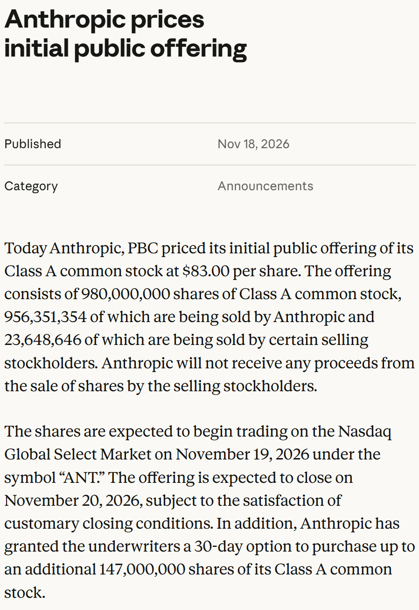
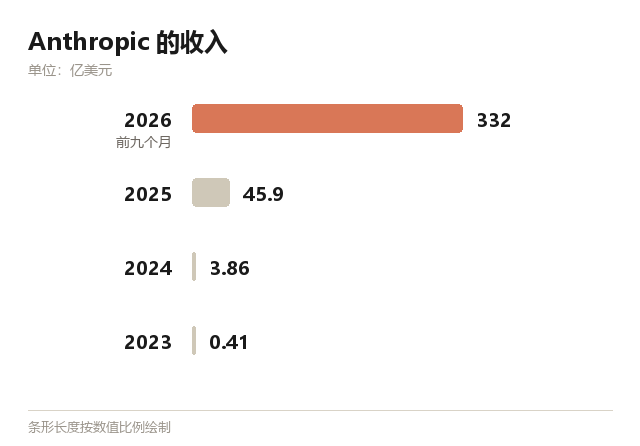
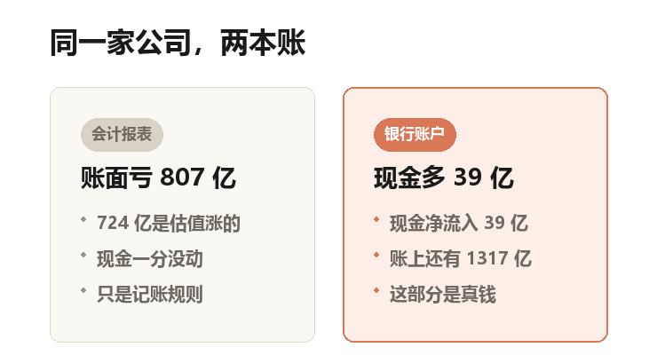
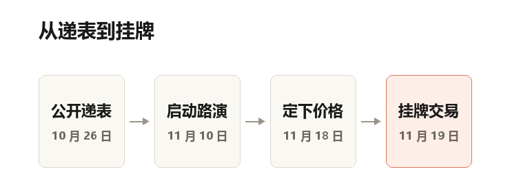

:::lead 写在前面
做 Claude 的那家公司，今天在纳斯达克挂牌了。
它是第一家上市的前沿 AI 公司，从此每三个月都要交一次公开账本。
账本翻开第一页就是反直觉的画面：亏损数字大得吓人，口袋里的钱反而变多了。
:::

## 11 月 19 日，纳斯达克多了一个代码

纽约时报广场，纳斯达克大楼的电子屏上，当天多了一行新代码：ANT。

开盘那一刻，价格跳出来：111.50 美元。

前一天定下的发行价是 83 美元。开盘价比它高 34%。

到收盘，价格回到 97.17 美元。涨幅从 34% 收窄到 17%。

这两个价格不是一回事。发行价是公司卖给第一批投资者的价，普通人买不到。开盘价才是股票第一次能在市场上自由买卖的价。

这家公司叫 Anthropic，2021 年由七位联合创始人创办，其中几位是从 OpenAI 出来的。

它做的产品叫 Claude，一个能读长文档、也能自己写代码的聊天助手。

:::caption 官方公告截图
anthropic.com 上 11 月 18 日的定价公告，白纸黑字写着 83.00 美元、9.8 亿股、代码 ANT。第二段说，这些股票 11 月 19 日开始在纳斯达克交易。
:::

## 为什么这条新闻轮不到你旁观

很多人用过 Claude。就算没用过，也可能用过接它的编程工具。

但这还不是重点。重点是：AI 到底赚不赚钱，第一次有了公开答案。

上市，说人话就是把公司的股票第一次卖给普通人。在这之前，Anthropic 的账本只有投资人和投行看得见。

上市之后，它每个季度都得交一份公开的成绩单。赚了多少、花了多少、欠了多少，全要写清楚。

顺便说一句为什么是它第一个。体量比它更大的 OpenAI 还没上市，据报道在准备 2027 年。

所以这份账本不只是 Anthropic 的。往后整个行业都会被拿来跟它比。

「AI 是不是泡沫」这个问题吵了三年吵不出结果，原因很简单：没人见过真账本。

现在有了。

## 从 4100 万，到 332 亿

上市前要交一份「招股书」，相当于一份写满数字的自我介绍。里面的收入长这样：

2023 年，全年 4100 万美元。
2024 年，3.86 亿美元。
2025 年，45.85 亿美元。
2026 年前九个月，332 亿美元。

:::caption 本号自制：四级台阶
四个数字按同一比例画，前两根柱子短到只剩一条线。不是画错了，是 4100 万和 332 亿差 800 倍，小数字在同一条尺子上就看不见了。2026 是前九个月，不是全年。
:::

800 倍是什么概念？你 2023 年月薪 5000 块，按同样的速度，2026 年一个月拿 400 万。

前九个月比去年同期涨了 12 倍。单看第三季度，收入 169.56 亿美元，是 2025 年一整年的 3.7 倍。

增速确实在放缓，第三季度环比 47%，比上一季慢。但基数已经大到这个份上。

## 亏了 807 亿，现金反而多了 39 亿

翻到利润那一页，画风突变：2026 年上半年，净亏损 807.48 亿美元。

同一份文件里还有另一行：上半年经营活动现金流，正 39.3 亿美元。

怎么可能一边亏 807 亿，一边账户里多进 39 亿？

因为这两个数字量的不是同一件事。

净亏损是会计口径，按规则算出来的账面结果。经营现金流是银行账户，真正进来和出去的钱。

要理解那 807 亿，得先知道它早年的融资方式。它拿到的很多钱不是普通借款，而是一种「将来按当时股价换成股票」的欠条。

公司越值钱，这张欠条就越值钱。会计上每期都要按最新估值重算一遍，重算出来的差额直接记成一笔损失。

它估值一路上涨，这张欠条就跟着涨。上半年这一项记了 723.88 亿美元损失。

一分钱都没转出去。

把它拿掉，上半年的经营亏损只剩 6.93 亿美元。

:::caption 本号自制：两本账
左边是会计报表，右边是银行账户。同一家公司、同一个半年，两个方向相反的数字。这也是看科技公司不能只看「亏了多少」的原因。
:::

它自己另算了一个口径：把发给员工的股票这类不花现金的项目剔掉。这样算，上半年调整后经营利润 16.18 亿美元，利润率约 10%。

这是招股书里第一次出现半年度盈利。

还有个数字容易被忽略：截至 6 月 30 日，它账上的现金加短期投资是 1317 亿美元，比这次募到的 813 亿还多六成。

换句话说，它上市首先要解决的不是钱的问题。

更直接的效果是：给早期投资人和员工一个能卖出股票的地方，也给整个行业定了一个公开的价。

## 付钱的是公司，不是个人

Claude 有个人订阅，但收入主力不是它。

截至 9 月 30 日，过去一年付了 100 万美元以上的客户有 1900 家。一年前是 950 家，翻了一倍。

付了 10 万美元以上的，有 1.19 万家。

老客户也更舍得花了：同一批客户今年花的钱，大约是去年的九倍。

风险也写在同一页：上半年有 23% 的收入来自两个客户。是谁，招股书没写。

两个客户撑起近四分之一收入，在任何生意里都算集中。哪天其中一个换了供应商，财报会立刻难看。

## 每收 100 块，55 块变成显卡时间

钱主要花在算力上。

算力就是显卡的工作时间。训练一个大模型，相当于让几万张显卡连轴转好几个月。

2026 年上半年，它在算力和基础设施上花了近 90 亿美元。2025 年一整年是 73 亿，半年就花掉了过去一年的 1.2 倍。

90 亿相当于同期收入的 55%。每收 100 块，55 块立刻换成显卡时间。

更远的一笔账写在承诺里：它签下的算力采购协议接近 9000 亿美元，最晚排到 2045 年。

粗算一下，相当于它现在一年收入的二十倍。

## 你买了股票，也管不了这家公司

这次卖给公众的是 A 类普通股，每股一票。

七位联合创始人通过一个信托持有一股 F 类股。就这一股，握着 50.1% 的投票权。

结果是：公众出钱，但选董事会、定战略都插不上手。这条被写进了招股书的风险提示。

它还是一家 PBC，公益公司。章程写明要兼顾公共利益，不只是股东回报。5% 的股份放进了一个公益基金。

七位创始人也承诺，把个人持股的 80% 捐给慈善。

## 为什么偏偏是这周

10 月 26 日公开递表。11 月 10 日启动路演，当时给的区间是 70 到 78 美元，准备卖 8.25 亿股。

11 月 18 日定价，两个数字都变了：价格定在 83 美元，高过区间上限；股数加到 9.8 亿股，一夜多卖 1.55 亿股。

:::caption 本号自制：24 天
从公开递表到挂牌交易一共 24 天。定价和挂牌之间只隔一天，路演只跑了一周多。
:::

路演期间，媒体引述未具名人士说，认购需求约为发行量的六倍。这个数字官方没有确认。

背景值得说清楚：那一周 AI 股票在跌，市场正在怀疑天量算力投入能不能收回来。

在那种气氛里把价格定在区间之上、还临时多卖 1.55 亿股，本身就是一条信息。

一家基金公司的资本市场主管在上市前说，他把这一周看成对 AI 的一次公投。

## 还没确认的部分

**估值没有官方数字。** 公告只写价格和股数。媒体是按招股书里的股本推算的，麻烦在于股本有好几种算法。

按「完全稀释」口径，公司已经答应、但还没发到员工手里的股票也要算进总股数。这样算，83 美元对应约 1.5 万亿美元。

路透按同一口径算，首日最高约 2 万亿美元。

而按已发行股份算，当天市值最高只有 1.5 万亿，跟发行价那个数撞了。不是笔误，差的是那批还没发出去的股票，两边能差三成。

看这类报道，第一件事是看它用的是哪个口径。

**「史上最大 IPO」要看怎么算。** 这次公开发行募资 813 亿美元。6 月 SpaceX 上市募了 750 亿；如果承销的投行把额外那部分股票也卖掉，是 862 亿。

再算上同时另外卖给几家芯片和云厂商的 260 亿美元，Anthropic 这边合计超过 1070 亿。官方通稿里没有「史上最大」这几个字，那是媒体的说法。

**算力承诺有三个版本。** 9000 亿含租赁、6570 亿只算算力合同、5180 亿只算基础设施，都出自对同一份招股书的解读，口径没统一。

**两个大客户是谁，招股书没披露。** 只知道合计占 23%。

**财务数字是公司自己编的。** 招股书受法律约束，也经审计，但它仍然是一份由公司主导叙述的文件。

**首日之后股价怎么走，本文不猜。**

## 收尾

上市没改变它的技术，改变的是它的处境。

以前它只需要说服投资人。现在它每三个月要向所有人交一次账，包括那些正在怀疑 AI 是泡沫的人。

「AI 是不是泡沫」这个问题，从今天起可以被查证，不用再靠吵。

:::meta 事件档案
时间：2026 年 11 月 18 日定价，11 月 19 日挂牌交易
当事方：Anthropic, PBC，纳斯达克代码 ANT
发行：9.8 亿股，每股 83 美元，募资 813 亿美元
信源：官方定价公告 1 份，路透社等独立媒体 3 家
:::

:::links
**官方公告：** https://www.anthropic.com/news/anthropic-prices-initial-public-offering
**纳斯达克上市通知：** https://www.nasdaqtrader.com/TraderNews.aspx?id=DTN2026-28
:::

图片版权：图 1 为 anthropic.com 官方公告截图（2026-11-18）；其余三张图表由本号自制，数据来自 Anthropic 招股书与官方定价公告。
