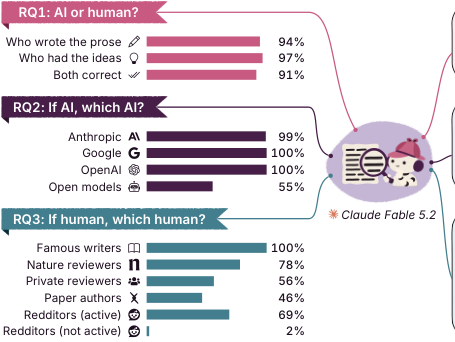
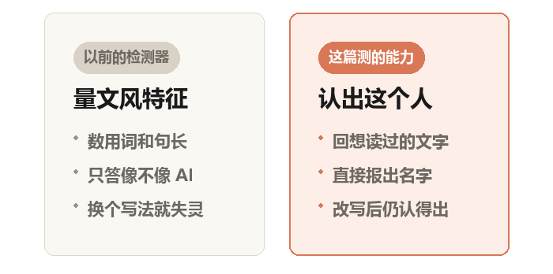
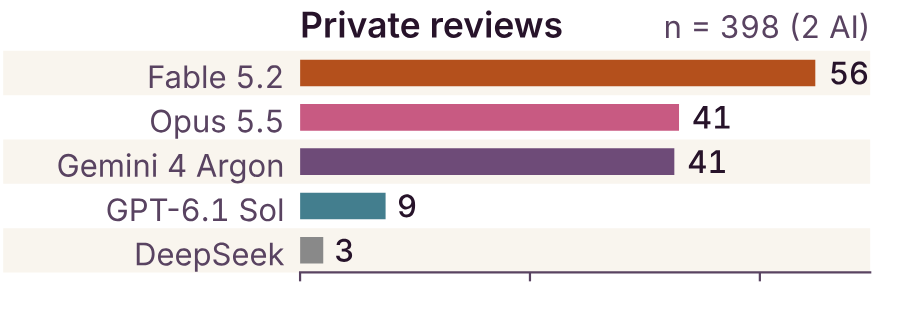
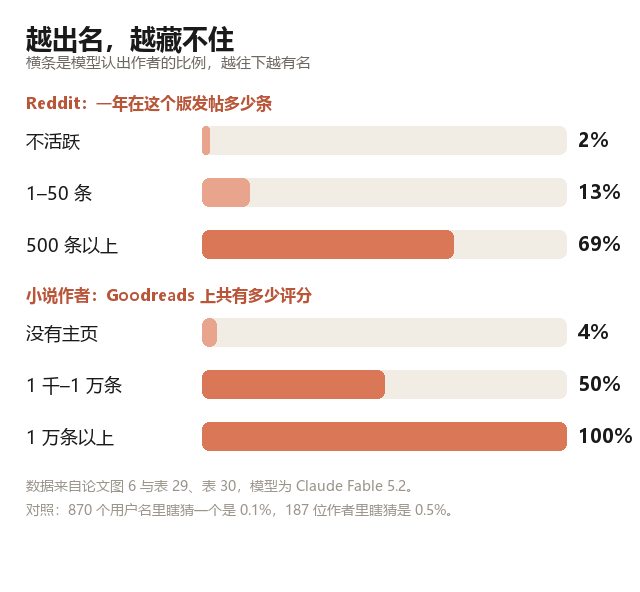

:::lead 写在前面
一篇从没公开过的审稿意见，作者名字被删得干干净净。
丢给 Claude，过半的稿子它报出了写的人。
不是查水印，也不联网：它只是读过你写的字，现在认出了笔迹。
:::

## 一条没有署名的意见

设想你投了篇论文，收到三条评审意见。

系统只给正文，不告诉你谁审的。这就是「双盲」：作者不知道审稿人是谁，审稿人也不知道作者是谁。

现在把那条意见复制出来，删掉名字和单位，粘进对话框，问一句「这是谁写的」。

几秒后它给出一个名字，后面跟着几条理由：某个词偏爱的用法、括号里的破折号、一句话的结构。

这不是假设。11 月 19 日挂上 arXiv（一个论文预印本网站）的一篇论文，做的就是这件事。

12 位作者，分别来自马里兰大学、西蒙弗雷泽大学、不列颠哥伦比亚大学，以及做 AI 文本检测的 Pangram Labs 和 Google DeepMind。

他们测了五个前沿模型，最强的是 Claude Fable 5.2，11 月 9 日刚发布。

给一段正文，不给候选名单，不许联网，它能答三个层次的问题：这段是人写的还是 AI 写的？如果是 AI，哪家的？如果是人，又是谁？

:::caption 论文原图（Figure 1，裁掉右侧的举例面板）
同一段文字、一句提示词，三个层次的问题一起问。
上面：是人还是 AI（判断文字 94%、判断想法 97%）。
中间：AI 出自哪家（三大厂 99%–100%，开源模型 55%）。
下面：是谁写的（知名作家 100%、Nature 审稿人 78%、内部评审 56%、论文作者 46%、活跃 Reddit 用户 69%、不活跃用户 2%）。
:::

## 它不是在查重，它是在认人

先分清两件事。

市面上成熟的 AI 文本检测器，比如 Pangram，判断的是「这段像不像机器写的」。它们数词频、量句长、看标点习惯，最后给一个概率。

这篇论文问的是另一个问题：**这段话像不像某个人写的。**

说人话：前者像查重软件，比对的是特征库。后者像你认出老同学的笔迹，靠的是「我以前读过他写的东西」。

这里有个词要解释：预训练。

模型上岗之前，会把网上能抓到的文字读一遍——博客、论文、论坛长帖、小说。你写过的那些，很可能就在里面。

读完之后，这些文字被压进「权重」里。权重就是模型记住东西的方式，一堆数字，谁也读不懂，但它确实记着。

换句话说，**它记得你，只是不记得在哪读的你。**

所以这篇论文最核心的结论很别扭：能不能认出你，不看文字有多独特，看模型读过你多少。

:::caption 本号自制
左边是过去那类检测器在干的事：量特征，回答「像不像 AI」。右边是这篇测的能力：从记忆里认人，回答「这是谁」。
:::

## 实验：把能认出人的线索全删掉

五个圈子，3,541 篇：

- 实验室内部评审 398 篇，2015 到 2026 年，投给 26 个双盲会议
- 公开同行评审 1,559 篇，来自 47 本开放评审期刊，含 90 篇 Nature 系
- arXiv 论文 120 篇，10 月 19 到 22 日上传的，属于「计算语言学」这个分类（编号 cs.CL）
- 小说 206 篇，来自 187 位作者
- Reddit 评论 1,258 条，870 个用户名，32 个版（Reddit 相当于美国版贴吧）

清洗做得很狠。删掉作者名、单位、邮箱、致谢、个人主页；论文连参考文献也删；Reddit 删掉引用块和任何提到用户名的句子。

模型拿到的只有正文，不联网，没有候选名单，没有写作样本。

还有一条：公开数据全部取自 2026 年 9 月 22 日之后。那天 Opus 5.5 发布，之后写的东西不可能进训练集。这是为了堵住「它其实背过这一篇」的质疑。

一句话，它只能靠文风。

## 六个人写的稿子，它认对一半多

最狠的是那 398 篇内部评审。

它们从没公开过，只在这六个人和投稿系统之间流转。模型不可能背过原文。

瞎猜的成功率是六分之一，约 17%。Fable 5.2 是 56%。

:::caption 论文原图（Figure 4 左上）
398 篇从未公开的评审意见，五款模型各自认出作者的比例。条端数字就是百分比，DeepSeek 那 3% 不是笔误。
:::

公开的那 1,559 篇数字低一些。这里有个口径要交代。

其中 770 篇被判成 AI 参与写作，模型在那批里只有 1% 到 4% 认出人。它被要求报「人」的名字，而 AI 润过的句子把个人风格洗掉了。

排除这些，剩下的 789 篇是 39%。Nature 系那 90 篇最高，78%。

参照系：这 789 篇背后是几千名审稿人，蒙对一个的概率不到千分之一。

论文 120 篇里，57% 能认对至少一位作者；小说 206 篇是 35%。

## 越出名，越藏不住

Reddit 那组最能说明机制。

1,258 条评论、870 个用户名，整体认出 31%。听着不高，拆开看就不一样了：

一年在同一个版发帖不到 50 条的，13%；超过 500 条的，69%。完全不活跃的，2%。

小说作者更极端。Goodreads 上没有作者主页的，认出 4%；评分总数过万的，100%。Goodreads 是英文世界的豆瓣读书。

:::caption 本号自制，数据来自论文图 6 与表 29、表 30
横条是模型认出作者的比例。两组的共同点：越往下，模型读过这个人越多，认出的比例就越高。
:::

这正是前面那个说法的证据：模型认得出谁，取决于它读过谁。

论文还找到一个更好用的代理指标——直接问模型「你有多熟悉这个人」，0 到 3 分。

打 0 分的作者，认出率 1.3% 到 4.2%；打 3 分的，57.7% 到 60.8%。这个自评分还能跨模型用：一个模型给的熟悉度，能预测另一个模型的准确率。

还有个老线索：自引。1,559 篇公开评审里，106 篇引了审稿人自己的论文。有自引的，80% 被认出；没有的，17%。

## 顺带，它连 AI 是哪家做的都认得出

同一条思路用在 AI 身上：34 个模型、11 家实验室写的稿子。

Anthropic、OpenAI、Google 这三家，认出率 98% 到 100%。其他八家最多 35%。

参照系：11 家里蒙一家，瞎猜是 9%。

Kimi K3 的稿子几乎全被判成 Claude，Qwen3.8 被判成 GPT。

作者给了两个解释，说得很谨慎。一是蒸馏——小学徒照着老师的答案练，风格会带过去。二是新一代模型的文风本来就趋同。他们用文风距离做了交叉验证，相关性 0.85，但明说「别的解释也有」。

这段跟普通人关系不大，但它印证了同一个结论：模型认的不是水印，是习惯。

## 改写一遍，只挡住一半

研究者试了最直觉的防御：让 AI 把文字重写一遍，要求「保留意思，抹掉风格」。

结果按圈子分化：

- 从没公开的内部评审：41% 掉到 15%
- 公开评审：22% 掉到 15%
- Reddit 评论：17% 掉到 10%
- 小说：18.6% 掉到 15.8%
- 论文：34.7% 掉到 31.4%

熟人最挡不住。34 篇被模型评为「非常熟」的小说，改写前认出 32 篇，改写后平均还有 27.5 篇。

另一道防线是让模型拒答。这道防线真实存在，但看入口。

走 API（程序调用的接口）时，Fable 5.2 有 6.9% 的文档不给名字。走 Claude Code（在命令行里写代码的工具）时，1,258 条 Reddit 评论里它拒了 323 条。

同一批评论走 API，它只拒了 14 条。

同一个模型，换个门进来，态度就不一样。

## 它报的把握，比自己实际低

这段对普通人最有用。

Fable 5.2 平均只敢说自己 17% 确定，实际对了 27%——它偏保守。

它一旦说「我有 25% 以上把握」，正确率是 87%。

而「报了 80% 以上把握、却认错人」的情况，只占它全部回答的 0.3%。

Gemini 是 3.3%，DeepSeek 是 5.1%——后者平均报 43% 的把握，实际只对 5%，属于嘴上很稳。

这条可以当尺子用：模型很少「很确定地认错人」。它说确定的时候，基本可以当真。

## 这篇论文没说的地方

第一，样本小。内部评审只有 6 个人写的 398 篇。作者自己在博客里说，正在扩到几千篇，结果还没出来。所以 56% 别当定论。

第二，只测了五个模型，全是最新旗舰。老模型、小模型、国产开源模型能到多少，论文没答。唯一的开源模型 DeepSeek V4.1 Flash 各领域都是个位数，但它连「有多确定」都报不准。

第三，认错的代价没测。论文只算对与错，没算错得有多离谱。一个错名字可能八竿子打不着，也可能正好指向同行的死对头——后者才是现实里的麻烦。

第四，「对」的标准五类不一样。论文算任意一位作者，Reddit 要用户名一字不差，小说认笔名。跨圈子比大小要留余地。

第五，防御只测了两种：改写、拒答。拼接多人文本、故意模仿别人写法这类对抗手段，没测。

第六，尺子是自己人做的。作者之一来自 Pangram Labs，而 Pangram 既是拿来对比的检测器，也是用来筛「哪些稿子算 AI 参与」的工具。论文把这点写在署名里，但没有做第三方复现。

第七，作者写了伦理评估。受影响最大的是靠匿名保护的人：审稿人、匿名论坛用户、吹哨人、家暴幸存者。他们仍然选择公开，理由是「这个能力已经存在，任何人粘一段文字就能试」。

## 最后一句

匿名一直是个制度约定：删掉名字，就当你没写过。

这篇论文把这句话量了出来。不是彻底失效，是失效得很不均匀——你写得越多、越有名、越在一个小圈子里活跃，就越藏不住。

所以下次你打算靠「不署名」保护自己，可以先想一下：这件事，我在网上写过多少回？

:::meta 论文档案
标题：Frontier models need only one text to unmask its human or AI author
作者：Atrey Desai、Deniz Bölöni-Turgut、Ty Brassington、Minjoon Choi、Jenna Russell、Rishanth Rajendhran、Bradley Emi、Hila Gonen、Hal Daumé III、John Wieting、Marzena Karpinska、Mohit Iyyer
机构：马里兰大学、西蒙弗雷泽大学、不列颠哥伦比亚大学、Pangram Labs、Google DeepMind
会议：无，预印本 v1，2026-11-19 提交
arXiv：2611.26216
:::

:::links
**论文链接：** https://arxiv.org/abs/2611.26216
**代码：** https://github.com/denizbt/unmasking_authors
**作者博客：** https://atreydesai.com/blog/who-wrote-this/
:::

图片版权：标注「论文原图」的图来自论文原文，版权归作者所有；标注「本号自制」的由本号绘制，数据取自论文。
