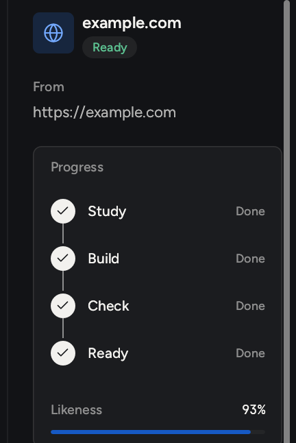
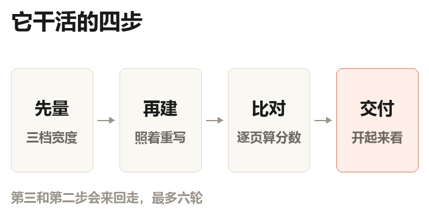
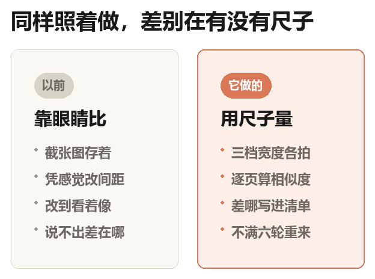
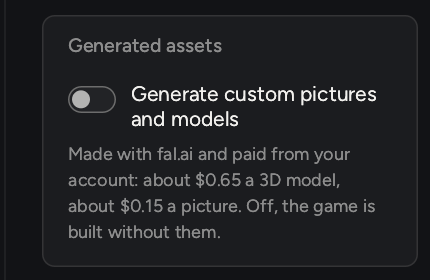

:::lead 写在前面
你想做一个像某个网站那样的东西，做出来总觉得哪里不对。
这个三周涨到四万星的开源工具，第一步不是让 AI 写代码，是拿尺子把原版量一遍。
量完再写，写完逐页打分，像不到九成就返工。
它默认连对方的源码都不看，只看你能看见的东西。
:::

## 先说那个「哪里不对」

周六下午，你想给社团做一个报名页。

找到一个喜欢的网站，打开，跟 AI 说：照这个做一个。

它给你一个能跑的东西。一打开，气质不对。卡片之间挤了一点，标题细了一点，按钮的圆角小了一点。

你改了三轮，每轮都更像，可你没法回答一个问题：改到哪算完。

Craft Anything 干的第一件事，是把「哪里不对」变成一张清单。
清单上每一项都带分数。

这个项目 10 月 31 日开源，到今天三周，40,465 个收藏。收藏就是别人点的那颗星，是开源圈最直接的投票。

8,065 次复制（fork），过去七天涨了 7,766 星。

:::caption 仓库截图：做完一个示例项目之后，右边这一栏就是它的成绩单
上面写着目标 example.com，标签是 Ready，意思是做完了。中间的 Progress 四步全打了勾。最底下一行写着 Likeness 93%，意思是「看起来像到九成三」。
图来自仓库 README，是作者为演示做的示例项目。
:::

## 四步里，只有一步是 AI 的活

:::caption 本号自制：它跑的一圈是四步
第一步先量，第二步再建，第三步比对，第四步交付。第三和第二步之间会来回走，最多六轮。
:::

第一步，先量。它打开原版网站，在 1440、768、390 三个宽度各截一遍图。

这三个数大致对应台式机、平板、手机三种屏宽。公众号排版会在手机上塌掉，就是这一步没做。

除了截图，文字、位置、颜色、字体、间距，它一样样量下来。
菜单也点开看一遍。

第二步，再建。它把量到的东西整理成一份说明，交给一个会写代码的 AI，让它从零做一个新项目。

第三步，比对。把新做的和原版放进同一套尺子，逐页算分。

第四步，交付。分数够了就开给你看，不够就退回第二步，最多六轮。

写代码那一步不归它管。它自己不带模型，用的是你电脑上已经装好、已经登录的 Claude Code。

说人话：Claude Code 是一个在命令行里干活的 AI。
你说一句「把这个文件夹改成这样」，它自己改文件、自己跑命令。
报错了它自己看。Craft Anything 不替它写，只负责给它量好尺寸、验好结果。

这个设计有个直接好处：它不碰你的账号，也不额外收你模型的钱。

## 它默认一个字节都不看

名字叫「看懂任何软件」，听起来像个拆包工具。默认模式恰恰相反。

默认那个模式叫 clean room，干净房间。

这个说法来自芯片行业。
一队人研究别人的芯片，写成一份说明书。
另一队人只照说明书做，不碰那块芯片。这样能做出能用的兼容产品，又不算抄。

Craft Anything 把这个规矩搬了过来。
默认不读对方的源码，不读页面 HTML（网页的原始代码），不解包程序文件。

它能用的只有三样——你能看见的页面、你自己截的图、它自己量的尺寸。

想拆开看，得手动切到 Deep 模式。那时候它会读网站的 JavaScript（网页里跑的那层程序），会解包安卓安装包。
还会用 Ghidra 这类工具，把编译好的程序还原成可读的代码。

说人话：clean room 是站在画前面临摹，Deep 是把画拆下来翻到背面。

:::caption 本号自制：同样照着做，差的是中间那把尺子
左边是多数人的做法：截张图，凭感觉改，改到「看着像」为止。右边是它替你跑的那一圈：量三档宽度、逐页算分、把差在哪写进清单。
差别不在 AI 聪明多少，在于有没有一个能说出「还差七分」的东西。
:::

## 93 分，量的是像不像，不是能不能用

分数是这么来的。

它把新做的页面和原版，放在同一个宽度下叠起来比。
一路比布局：元素在哪、间距多少、每行放几个。
另一路比像素结构。

后者叫 SSIM，结构相似度。说人话就是：两张图叠在一起，能对上多少。

连「自己会变的部分」也先剔掉。
办法是对原版连拍三张照片，动过的轮播、跳动的数字都不计分。
剩下两路分数平均，再对所有页面平均一次。

所以这个数字只回答一个问题：看起来像不像。

登录之后的页面、付款流程、后台、数据库，一样都不在打分项里。README 没许诺这些，也没假装测过。

打个比方：这是照着照片捏的蜡像。像不像，照片说了算；能不能走路，是另一回事。

一个 93% 的项目，可能点一下按钮就报错。一个 60% 的项目，也可能只是原版的广告位没加载出来。

## 它自己记的账，比宣传页诚实

仓库里有一份 docs/STATUS.md。

它不是功能介绍，是一张 471 行的表。
471 行，等于把工具拆成 471 个角落，一个一个交代。
每一行写两件事：这个功能做到了什么程度，凭什么这么说。

里面有一段实跑记录，日期是 2026 年 10 月 18 日。
环境是 Windows 10，命令行模式：

- 复刻一个网站，1.5 分钟到 Ready，相似度 96%。
- 复刻一个桌面小工具，9 分钟到 Ready，但注明「只验证了能编译」。
- 复刻一个游戏，走到 Build 就停了，检查那一步没跑完。

同一份文件里还留着不少「没验过」。
用 API key（服务商的密钥）的那条路，「还没有跑过一次真实构建」。
Codex 的适配器，「没在真实安装上验证」。

一个四万星的项目，把没做到的事写在所有人能打开的文件里。这比任何宣传语都值钱。

## 装之前，先算三笔账

第一笔，环境。现成安装包有，Windows、macOS、Linux、FreeBSD 都发了。
想自己编译，要 Rust 1.97 以上。Rust 是一门编程语言，还要装一堆图形库。

第二笔，AI 订阅。它借你电脑上那个 Claude Code 干活，用的是你自己的账号和额度。做一个网站要耗多少，取决于你要它返工几轮。

第三笔，配图。要它自己生成图片或 3D 模型，得单独填 fal.ai 的 key，按张付钱。
一张图约 0.15 美元，折合一块钱上下。
一个 3D 模型约 0.65 美元，四块多。

这个开关默认是关的。关着它就不生成，游戏照做，只是没有花里胡哨的贴图。

:::caption 仓库截图：这一栏就是那笔钱
开关是灰的，默认关着。下面小字写着来源和价钱。
用 fal.ai 生成，从你自己的账户扣。一张图约 0.15 美元，一个 3D 模型约 0.65 美元。
关掉它，就不带图地把游戏做完。
:::

还有一件更要紧的：装依赖会执行代码。

它让 AI 装第三方库时，那些库在安装过程中会跑自己的脚本。它的做法是在没见过的命令前弹一张卡，问你「允许一次、这个项目都允许、还是不允许」。

选「都允许」意味着之后同类命令不再问。这一步别图省事。

## 还缺什么，什么场景别用

README 自己标着 early alpha。说人话：早期测试版，能跑，但别指望它稳。

- 只有 Claude Code 这条路是完整走通的。Codex、Copilot、Grok 都能接，但作者写明「建好了，还没真跑过」。
- 应用和游戏的「行为检查」只做到一半。游戏里那份「机制表」的数值，作者承认还没验证。
- 仓库里 507 个待处理的问题单。对一个三周大的项目，这个数不算少。
- 分数只比外观。要登录、要付费、有反爬拦截的页面，它看到的和你看到的不是一回事。
- clean room 是产品规则，不是系统沙箱。它管得住自己提供的工具，管不住你那个 AI 编程助手本身的权限。
- 别拿它碰别人的付费产品、带防拷贝的软件、带反作弊的游戏。README 明说不绕过这三样，也不许照抄别人的 logo 和文案。

有三件事，现在别指望它：替代买软件，复刻一个能上线收钱的产品，扒别人的会员内容。

## 它真正改了的那件事

AI 写代码，早就不是「能不能写出来」的问题了。是「写出来像不像」。

像不像一直是个形容词：差不多、还行、感觉差点意思。

Craft Anything 做的事很朴素。
把这个形容词换成一个数字，再逼着 AI 一直改到那个数字够高。

它复刻得像不像，其实没那么重要。重要的是这套流程：先量，再建，再比，不满就返工。

下次你跟 AI 说「照这个做一个」，它大概会先反问你一句：按哪个宽度量？

:::meta 项目档案
仓库：storytold/craft-anything
star：40,465 个收藏（2026-11-22 查），22 天涨到，过去一周涨 7,766
许可证：MIT 或 Apache-2.0，二选一，都能商用
语言：纯 Rust，桌面界面、命令行、给 AI 助手用的接口共用一套引擎
工具数：305 个，分 17 组；README 把 AI 和安装层算进去写成 320 个
:::

:::links
**仓库：** https://github.com/storytold/craft-anything
**下载：** https://github.com/storytold/craft-anything/releases/latest
**状态文档：** https://github.com/storytold/craft-anything/blob/main/docs/STATUS.md
:::

图片版权：标注「仓库截图」的图截自 storytold/craft-anything 仓库 docs/images 目录下的 README 截图，版权归项目作者所有；标注「本号自制」的由本号绘制。
