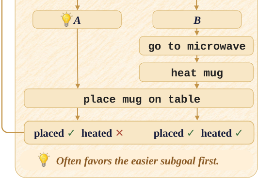
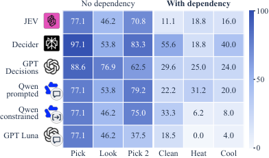
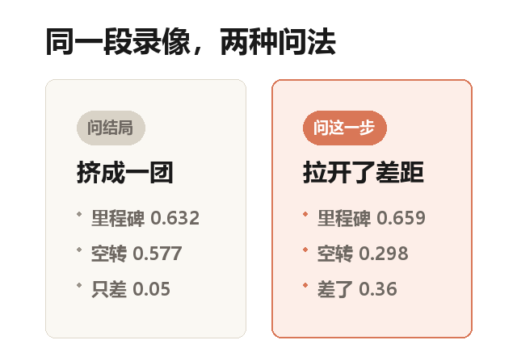
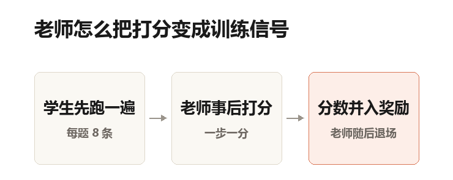
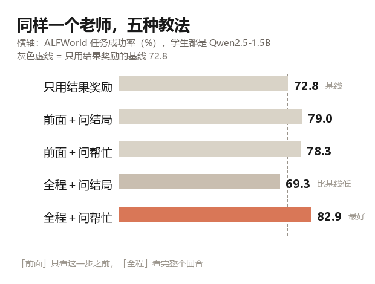

:::lead 写在前面
一个模型自己去做家务任务，十次只成四次。
同一个模型站到旁边，看别人做完再给每一步打分，教出来的小模型成了八成。
中间没有换模型，只换了两个旋钮：给它看多少，问它什么。
:::

## 杯子还是凉的

任务写在一行字里：把加热过的马克杯放到边桌上。

这是一个文字游戏。所有动作靠打字完成——走过去、拿起来、放进微波炉、按开始。
环境回一行字，告诉你现在看到什么。

此刻它手里拿着杯子，人就站在桌边。眼前三条路：

A，直接放下。B，去微波炉。C，看一眼。

选 A，一步就完成了「放在桌上」这半句。
杯子还是凉的，「加热过」那半句没做。

选 B，要多走三步：去、热、回来放。

六个模型里，它经常选 A。

:::caption 论文原图（Figure 1 下半部分）
两条路的结局。走 A，一步到位，最后一行是「放好了 ✓、加热了 ✗」。
走 B，多花三步，最后是「放好了 ✓、加热了 ✓」。
图底部那句是作者写的：它常常先挑容易的那一步。
:::

## 六款模型，栽在同一个坎上

论文测了六个「决策模型」。

说人话：决策模型不是聊天机器人。
你给它一道选择题，它不回一段话，而是给每个选项一个概率。
问「下一步选哪个」，它答「A 有 0.64，B 有 0.15」。

这类模型快、便宜，过去主要被当成「现场操作员」来研究。

研究团队把它们放进 ALFWorld——一个文字版的家务环境。
六类任务按「要不要讲先后」分成两组：

不讲究顺序的，比如「把两支铅笔放进抽屉」，谁先谁后都行。
讲究顺序的，比如「把加热过的杯子放好」，必须先加热。

结果整齐得有点残酷。

:::caption 论文原图（Figure 2）
六行是六个模型，六列是六类任务，右边三列是要讲先后的那组。
JEV 在「随便放两支笔」上有 70.8%，到「先加热再放」只剩 11.1%、18.8%、16.0%，总分 42.9%。
六行没有一行能在右边三列站住。
:::

最强的那个（Decider v1.2，总分 63.6%），在「加热」这一类上也只有 18.8%。

这不是「不会做家务」。
这是「知道该干什么，手却先动了」。

## 它知道该加热，只是被顺手那一步吸走

作者做了个很干净的实验。

他们挑了 116 个现场，全部长一个样。
人站在目的地，手里拿着还没加热的杯子。
「放下」一步就能完成，「加热」还悬着。

同一个状态问两遍，只改目标那句话。

第一遍：「把加热过的杯子放到边桌上」。
第二遍：「加热一个杯子」——把「放下」这半句删掉。

JEV 的反应是这样的：

第一遍，63.8% 的概率给「直接放下」，只有 14.6% 给「去加热」。
第二遍，这两个数变成 2.5% 和 77.6%。

六个模型全部同向。
它一直知道该加热；只要目标里同时摆着一个更容易的选项，概率就被拽走了。

那提醒它一句行不行？
在提示里加「注意任务要求之间可能有先后」，六个模型的成功率变化在 −2.8% 到 +5.2% 之间。
约等于没用。

给一个具体例子会好一些——「杯子没热也没放，应该先加热」：
Qwen 的一个版本（把答案限制成几个固定标签）从 41.7% 到 58.3%，JEV 从 19.0% 到 24.1%。

也有反着走的：Decider 从 89.7% 掉到 85.3%。

这里 41.7% 的意思是，这批现场接着往下走、能把任务做完的比例。
一半上下，说明连「先热再放」这条最基础的顺序都还站不稳。

## 换个位置，同一双眼睛突然看懂了

论文的转折在这儿：不再让它动手，改成让它看录像。

看录像也有两个开关。

看到哪：只看这一步之前（Prefix），还是看完整段（Hindsight）。
问什么：做完这一步任务最后会成功吗（Value），还是这一步有没有帮上忙（Progress）。

先看第一个开关。

有一步叫「打开微波炉」。在一条真实轨迹里，它的分数是这样变的：

只看这一步之前，0.20。
加上执行后的反馈（门开了），0.18。
看到后面「把杯子放进去加热」，0.66。
看到整段结束，0.76。

同一步动作，0.18 和 0.76，中间差的是「允许它往后看多远」。

反过来的例子是「把冷杯子提前放进柜子」。
只看前面，0.79——柜子里确实多了个杯子，看起来是好事。
看到整段，掉到 0.60——后面它又被拿出来重新加热了。

JEV 给关键步骤的平均分，从只看前面的 0.41，升到看完整段的 0.59。

作者用的数据是 167 条轨迹、2,849 个动作。
看得越全，动作的排名挪得越远：多给一步反馈挪 1.95 位，全看挪 3.30 位。

这一段特别像回看球赛录像。
场上你不知道这一脚传得对不对；回放里后面那两脚一出来，就全明白了。

## 同样是看完，问法差一点，信号差七倍

第二个开关更关键。

462 条轨迹，每条都有两类动作。
里程碑动作：真的完成了一个小目标，比如把杯子热好。
空转动作：什么也没改变，比如再看一眼已经看过的地方。

同一段录像，只换问题。

问「任务最后会成功吗」，JEV 给三类动作打 0.632、0.604、0.577。
几乎一样。因为整条轨迹只有一个结局，每个动作的答案都是同一个。

问「这一步有没有帮上忙」，变成 0.659、0.440、0.298。
同一条轨迹里，里程碑比空转高 0.36；前一种问法只高 0.05。

:::caption 本号自制：同一段录像，两个问法
左边问结局，三类动作的分数挤在一起，等于把最后的成败又抄了一遍。
右边问贡献，分数才落到单个动作上。0.36 和 0.05，差七倍。
:::

六款模型方向一致。
按分数取每条轨迹的前几名，问贡献比问结局多捞回 8% 到 16% 的真里程碑。

## 那就让它当老师

到这儿逻辑就顺了：既然它事后打分准，就拿这个分数去训练别的模型。

三步。

:::caption 本号自制：老师的分数怎么进训练
学生对着同一道题跑 8 条轨迹，每条最多 30 步。
跑完，老师逐步打分；分数先减掉同组平均分，再加到原本的奖励上。
老师全程冻结，测试时不再出现。
:::

原来的训练方法叫 GRPO。
说人话：同一道题让学生做 8 遍，比这 8 遍谁好谁坏，好的加分，坏的减分。

问题是，一条轨迹只有结尾一个「成 / 不成」。
30 步拿一样的分数。
哪一步是关键，哪一步在原地打转，分不出来。

老师的分数补的就是这一块。

学生是 Qwen2.5-1.5B，15 亿参数，算小模型。
结果：

:::caption 本号自制：五种教法的成绩（数据来自论文表 3）
只用结果奖励 72.8%。看完整段再问「有没有帮忙」，82.9%。
中间那根灰柱要注意：看完整段却仍问「会不会成功」，只有 69.3%——比不加老师还低。
:::

三个数字值得单独说。

第一，82.9% 对 72.8%，涨了 10 个点。
参照系：同一批任务里，换个更强的 7B 学生（70 亿参数）、只用结果奖励，是 77.6%。

第二，那个 69.3%。
看得更全，却问错了问题，比什么都不加还差。
因为分数都差不多，减掉平均之后几乎是常数，加进去只剩噪声。

第三，涨得最狠的地方，正是老师最不会的地方。
有先后的任务上，学生做到 86.8%，比其他组合高 6.9 到 16.2 个点。
而这个老师自己在这类任务上只有 14.7%。

学生也没变啰嗦：20 步内完成 74.5% 的任务，其他组合是 63.6% 到 69.5%。

成本是一次训练的老师接口费 22 到 30 美元。
四次实验分别是 30.07、24.50、22.21、26.83，参照系：一顿正经的火锅。

## 为什么事后看就行

一句话：动手要在结果出现前猜后果，打分是在结果已经摊开之后回头看。

球员在场上只能凭感觉出脚。
教练看录像，能看到这一脚是为三秒后那一下做铺垫。
而教练不必打得过球员。

论文的说法更紧：回合结束后评判一个动作，恰好把它动手时必须预判的后果补上了。

这也解释了为什么这套只能事后用。
想在过程中实时拦动作，手里只有前半段，那个优势就没了。

## 这篇没说的地方

- 两个环境都是纯文字，一条轨迹最多 30 步（购物环境 WebShop 是 15 步）。写代码、调工具、当助理，轨迹长得多、依赖更杂，这套还没验过。
- 只能事后打分。想在线筛动作、实时纠偏，用不上，那时候只有前半段可看。
- 两个主力模型闭源：JEV 连底座模型都不公开，GPT Decisions 的改造方法也没写。所以「什么样的训练让一个模型成为好裁判」，论文答不了。
- 只训了 Qwen2.5 的 1.5B 和 7B 两个学生，同一家。换别的模型家族会不会一样，不知道。
- GRPO 的基线数字引自别人的论文（GiGPO），不是自己重跑；成功率是三个推理种子取平均，不是三次独立训练。
- 116 个诊断现场来自 66 个任务，样本不算大。表里那些成功率也带 ±3 到 ±8 的误差。
- 代码开源（Apache-2.0），但仓库只给了 1.5B 的训练脚本，7B 那组没有。

还有件事得说清楚：82.9% 是模拟器里的成功率，不等于真实软件里能干成八成的事。

## 最后

评价一个模型，我们习惯问「它有多强」。
这篇问的是「你让它站哪个位置」。

同一个模型，站在现场是 42.9%，站在旁边看录像，能教出 82.9%。
中间没换模型，只换了两个旋钮。

下次你想让 AI 帮你判断一件事，先看清你问的那句话——
是在问结局，还是在问这一步。

:::meta 论文档案
标题：Actor, Judge, or Teacher? Understanding Decision Models in Long-Horizon Agents
作者：Haochen Liu、Qianhao Zhu、Zixuan Wang、Dingming Li、Tongbo Chen、Peng Qiu、Yingqi Qu、Weiming Lu、Jun Xiao、Yongliang Shen（前三人并列一作）
机构：浙江大学、百度
会议：无，预印本 v1，2026-11-12 提交
arXiv：2611.17167
:::

:::links
**论文：** https://arxiv.org/abs/2611.17167
**代码：** https://github.com/ZJU-REAL/decision-agents
**项目页：** https://zjureal.com/decision-agents/
:::

图片版权：标注「论文原图」的图截自 arXiv 2611.17167 的 Figure 1 与 Figure 2，版权归论文作者所有；标注「本号自制」的由本号绘制，数据取自论文表 3、图 5 与第 3.2 节。
