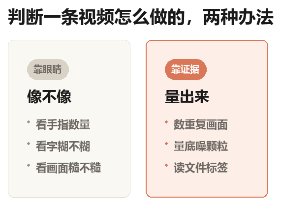
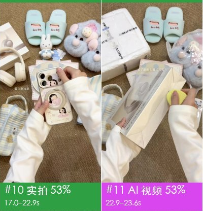
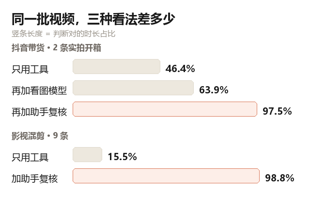
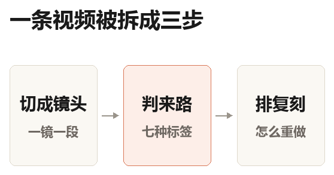
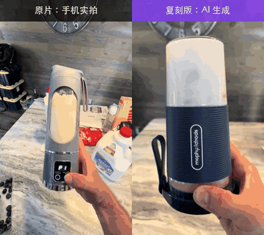

:::lead 写在前面
一条 72 秒的沉浸式开箱视频，一个人、一个机位、一块地毯，全是真拍的。
把它交给一个开源工具，工具按镜头时长算出：三成半是 AI 生成的。
不是工具坏了，是它量的那些证据，在平台转码时被洗掉了一半。
这篇讲清它到底在量什么，以及它什么时候会量错。
:::

## 先看这只手

一只戴白手套的手，从牛皮纸箱里抽出一双薄荷绿拖鞋，轻轻摆在地毯上。

镜头一动不动，只有手在动。没有脸，没有说话，只有塑料膜被撕开的窸窣声。

这是一条 72 秒的沉浸式开箱视频，一共 29 个镜头。器材是一块地毯、一个架在头顶的手机。

有人把它交给一个叫 rea-video 的工具，只问了一句：这些画面是怎么做的？

工具的回答是：按时长算，35% 的画面是 AI 生成。

要说明的是，交给它的是从平台下载的转码版，不是作者手里的原始文件。这一点很关键，后面会讲。

可它一个镜头都不是。

rea-video 是个开源项目，10 月 29 日建库，不到一个月攒到 1.27 万星。作者是 JuneYaooo，Python 写的，Apache-2.0 许可。

它做的事叫「逆向工程」。说人话就是：手里只有一道做好的菜，反推出配方和火候。

## 它不猜「像不像」，它量三样东西

大多数人判断一条视频是不是 AI 做的，靠看：手指有没有六根，字糊不糊，光影对不对。

这套办法在人眼上很灵，在程序里很难写成规则。rea-video 干脆绕开它，改去量三样能算出数来的东西。

**第一样，重复的画面。**

视频是一秒若干张照片连起来放的。手机常见 30 张，也就是 30 帧。

现在的视频生成模型，大多只输出 24 帧。要转成 30 帧，就得补帧。补的方法常常是直接复制上一张。

结果是：每 5 帧里有 1 帧和前一帧一模一样。这个 20% 的重复率，就是模型的指纹。

**第二样，底噪的颗粒。**

手机在光线一般的地方拍东西，画面里有一层细密的雪花点，叫传感器噪声。

AI 生成的画面太干净了。它能学会「像照片」，但很难凭空长出这种均匀的随机颗粒。

工具会估这一层噪声的强度。它还能数画面里有多少个 8×8 的小方块是完全平坦的——渲染出来的图，平坦块特别多。

**第三样，文件里藏的标签。**

视频文件除了画面，还带一串说明文字，叫元数据。里面有拍摄设备型号、剪辑软件、导出参数。

国内从 2025 年起要求 AI 生成内容带隐式标识，对应国标 GB 45438。有些平台还会写入 C2PA 这类来源凭证。

这类标签只要还在，就是最硬的证据——不用猜，文件自己说了。

麻烦在于，平台转码时经常把它整段剥掉。

:::caption 本号自制
左边是人眼惯用的三条判断，右边是工具真正在量的三条。差别不在谁更聪明，在于右边那三条可以被写成代码，也可以被复现。
:::

## 一转码，证据就少了一半

你在抖音刷到的视频，不是作者上传的那个文件。

平台会重新压一遍：降码率、统一到 30 帧、剥掉元数据。这一压，噪声被抹平，重复帧的规律也被打乱。

工具第一版规则在这上面栽了跟头。作者从两篇公众号文章里下了 10 条转码后的视频，平均准确率只有 0.79。

于是他加了三条补丁：

一是认出转码本身。文件里会留下 `Tencent CAPD MTS`、`Wxmm_`、`vid:v` 这类痕迹。见到这些，就把「没有噪声」这条证据作废。

二是看整片的帧率。如果一条 30 帧的视频里，实拍类镜头有七成以上时长没有重复帧，那更像手机直出。生成模型转出来的片子，重复帧躲不掉。

三是把几乎没有彩色、只用个位数颜色的平面画面，判成界面或文档，不判成 3D。

补完之后，同一组的平均准确率从 0.79 涨到 0.92。再让能看图的模型过一遍，判断对的时长占比到 99.6%。

可就算是最终报告，也还留着一格错的。

:::caption 仓库案例截图（docs/cases/unboxing）
同一条全真拍视频，报告里相邻的两格。左边 #10 判「实拍」，右边 #11 判「AI 视频」——两个判断的把握都只有 53%。
:::

右边那一格只有 0.7 秒，画面是手在撕包装膜。撕开的瞬间，整块塑料膜在均匀地抖，噪声被运动糊掉了。

这就是 3% 的去向：不是大错，是一格看不清。

## 真正难的不是 AI，是「影视片段」

带货组那两条视频，只用工具判断，准确率 46.4%。差不多等于抛硬币。

原因很具体。工具能测的只有纹理和噪声，而这两样在「画面几乎不动」时最不可靠。

带货组的固定机位镜头，准确率只有 41%。同一组里主体在动的镜头，是 99%。

更难的是混剪。9 条影视混剪视频，只用工具只有 15.5% 对。因为工具的分类里根本没有「影视剧片段」，它只能往实拍或 AI 上硬套。

解法不是把规则写得更细，是让另一个能看图的角色来投票。

作者试了三种组合。第一种只用工具。第二种接一个能看视频的模型，比如 Gemini、豆包。第三种再让 agent 逐镜看截图——agent 就是能自己读文件、跑命令的 AI 助手。

:::caption 本号自制，数据来自仓库 eval/RESULTS.md
抖音带货那一组是三档叠加：46.4% → 63.9% → 97.5%。影视混剪那一组只有两档，98.8% 是只让 agent 逐镜看图复核的结果。两条都按镜头时长加权。
:::

有个细节很有意思：不是投票的人越多越好。

作者试过「三方里两方说了算」，转码视频那一组反而从 98.4% 掉到 91.9%。因为两个看图模型经常把同一个画面错看成同一类，一起把工具的正确判断推翻了。

最后定下的规则是：工具和任意一个看图方意见一致，就按这个走。两个看图方一起反对工具，也不强制改判。

还有一条更硬的：工具对实拍、AI、3D 这三类的信任权重，只有 0.6，其它类别是 1.0 到 1.6。等于承认这三类自己看不准，把话语权让给能看图的。

## 判完还要告诉你怎么重做

如果只是判个真假，这工具的价值有限——你想知道的其实是「我能不能也做一条」。

所以它每判完一个镜头，就给一条复刻路线。一共七种标签，每种对应一套做法：

实拍镜头，给机位、景别、运镜和布光方案，一共 12 种标准布光，附器材清单。

AI 镜头，反推这个画面大概用了什么提示词，几个镜头能合并成一次生成，该用哪个模型。

代码做的动效，直接给一个能重建成 Remotion 工程的描述。Remotion 说人话就是：用写代码的方式做视频，跟用代码排 PPT 动画差不多。

有两个案例很能说明问题。一条 70 秒的产品宣传片，83% 是代码动效、12% 是录屏。一个 Remotion 工程就能做完，根本不用视频模型。

另一条 67 秒的 3D 科普片，讲咸鸭蛋为什么流油。21 个镜头可以拆成 10 次生成。也可以让模型直接写代码渲染，Blender、Three.js 都行。

:::caption 本号自制
三步里只有中间那步是判断，前后两步都是纯工程活。先按画面突变切成镜头，最后按镜头类型排复刻方案。
:::

输出有两份。给人看的是一份网页报告，逐镜截图、判断依据、提示词、拍法、声音拆解都在里面。

给 AI 看的是一份叫 VIDEO.md 的文件。整份拆解可能有几十万个 token。token 是模型处理文字的最小单位。分层写好之后，agent 只读和问题相关的那几层。

:::caption 仓库演示图（docs/cases/demo.gif 末帧）
左边是 TikTok 上的手机实拍原片，右边是别人用 AI 换了个产品重做的版本。看杯身上那圈白字：字母糊成一团，拼不出一个词。这是 AI 造字时最常见的破绽，也是人眼最快能抓住的一处。
:::

## 这些问题它也解决不了

最要紧的一条：它是给能跑命令的 agent 用的，不是一个装了就能点的软件。

电脑上要先有 ffmpeg，也就是命令行剪视频的工具，外加 Python 3.10 以上。然后打开 Claude Code 或 Codex 这类 agent。说一句：「装它，然后拆这条视频」。

样本也薄。评测里真正的实拍视频只有 3 条，全是 60 帧的抖音手机片子。缓慢推拉那类经典镜头，只在合成视频上测过。

已知的漏检很具体。暗色主题的网页截图、暗底上半透明的背景照片，都会被漏掉。实拍或 AI 画面上叠的商品图和 Logo，它也一律不管。

声音是更大的坑。普通视频里的配乐到底是不是 AI 做的，它判断不了。Suno 生成的器乐和曲库里的器乐，在信号上分不开。三条错例摆在那里，所以报告里遇到普通配乐，一律写「倾向曲库，待确认」。

音效更差。确定性那一层的精度大约 0.2，跟闭着眼睛猜差不多。完整的音效清单得交给能听声音的模型。

还有两件事容易误会。它不渲染视频，只给方案——实拍素材得你自己拍，录屏得你自己录，版权也得你自己清。

它的评测视频不随仓库分发，所以那串 99% 的分数，外人复现不了，只能信作者。

## 最后

人眼判断「这是不是 AI 做的」，靠的是一瞬间的不对劲：字糊了、手指多了、影子方向错了。

这些破绽会一个个被修掉。

真正留下来的，是那些不打算给人看的东西：帧的节奏、噪声的颗粒、文件里的标签。

所以下次刷到一条让你停下来的视频，可以先不夸它拍得好。

先问一句：这条视频，是谁做的？

:::meta 项目档案
仓库：JuneYaooo/rea-video
star：12,739（2026-11-24 查）
许可证：Apache-2.0
语言：Python（≥3.10，需 ffmpeg）
:::

:::links
**仓库：** https://github.com/JuneYaooo/rea-video
**官网：** https://www.reavideo.ai
**VIDEO.md 格式：** https://videomd.github.io/videomd/
:::

图片版权：标注「仓库演示图」「仓库案例截图」的图片出自 rea-video 仓库（docs/cases），版权归项目作者；标注「本号自制」的图表由本号绘制，数据取自仓库 eval/RESULTS.md。
