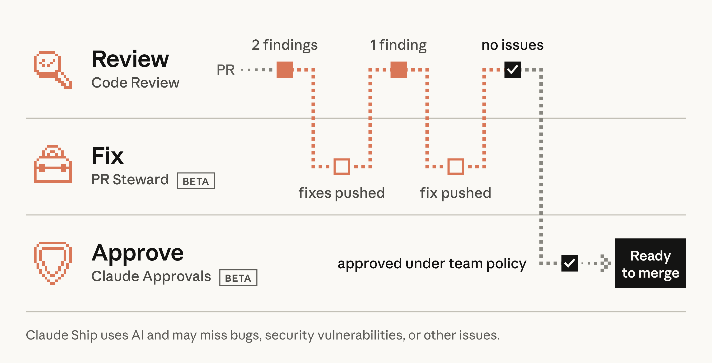
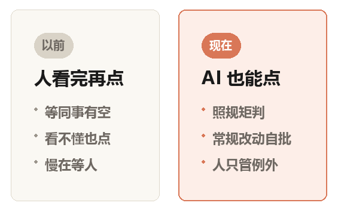
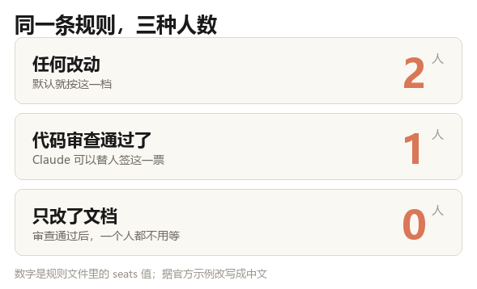

:::lead 写在前面
一行代码进正式版本前，总要有人点一下「同意」。Anthropic 周一把这个动作交给了 AI。
值得看的不是它能点，而是官方文档里自己写着：规则没设对，作者一个人就能凑够票。
:::

## 先说清楚那道手续

你手机里的 App 隔几周更新一次。某次更新说，修好了一个付款按钮。

改那几行代码的人，写完不能直接发。他得把改动打包交上去，等另一个人看一眼，点个「同意」。

这个动作叫代码评审。打包交上去的那个东西，叫 pull request，中文常译「合并请求」。

说人话就是：我把改动放这儿了，谁来看一眼，看过没问题再并进正式版本。

公司越大，这道手续越慢。看代码的那个人手里压着十几个待看的包，你的是第五个。

他可能一眼扫过，也可能根本没看懂，但为了不卡住别人，还是点了同意。

## 周一，这道手续被拆成了三件事

11 月 23 日，Anthropic 发了个新东西，叫 Claude Ship。

TechCrunch、The Verge 都写了报道。一个发布会能让这两家同时动笔，说明它碰到的不是小功能。

它由三个部分组成，各管一段：

- **Code Review 管「看」**：把改动和它周围的代码一起读，标出逻辑错误、安全漏洞，贴在对应那一行上。已经正式可用。
- **PR Steward 管「修」**：测试挂了、代码冲突了、有人提了意见，它去改。改完推上去，还要说明改了什么、怎么撤回。测试版。
- **Claude Approvals 管「批」**：按团队写在仓库里的规则，判断这次改动能不能放行。必要时，它会自己发一个「批准」。测试版。

:::caption 官方发布图（Anthropic，2026-11-23）
三条横线从上到下是三个角色：查、修、批。
橙色方块是每一次审查发现的问题数，虚线是它在两行之间来回跑。最后那个黑框「Ready to merge」是「可以合并」。
图最下面那行灰字是官方自己加的：这套东西用了 AI，可能漏掉缺陷、漏洞或其他问题。
:::

一句话总结三者的分工：一个负责找问题，一个负责改到通过，一个负责签字。

官方举了一个他们自己团队的例子。

一位产品经理读用户反馈，发现是一处文档措辞让人误会。她跟 Claude 讨论了几句，让它开了一个 PR。

代码审查没发现阻塞问题。负责文档的同事签了字，Claude Approvals 按策略放行。

当天晚上，这个改动合了进去。

注意这里还有人：最后签字的是那位同事，不是 Claude。AI 的作用是让「等她有空」这段等待消失了。

## 为什么是现在

Anthropic 在公告里给了一个理由，也给了两个数字。

理由很实在：在他们的 Claude Code 团队，代码大部分是 Claude 写的。

数字是：今年 6 月到 9 月，这个团队合并的 PR 多了一倍以上。

同一段时间，被回滚的比例降了四成以上。回滚就是把已经合进去的改动再撤出来，等于承认刚才那一下批错了。

参照系得说清楚。这是他们自己一个团队、四个月的数字。

没有第三方核过，也没公布这批 PR 原来有多少条。

但方向不难理解：写代码的那一头变快了，看代码的这一头没变。

一个人一天能写十个改动，但只能认真看三个。剩下的七个，要么排队，要么被草草放过。

:::caption 本号自制
左边是过去几十年的默认做法，右边是这次发布想推到的地方。
注意右边第二行：「常规改动自批」不是无条件的，得先有团队写好的规则文件。
:::

## 规则不是后台开关，是仓库里一个文件

这是这篇公告里最有意思的设计。

审批规则不放在管理后台的下拉菜单里。它写成仓库里的一个文件：`.claude/approvals.yml`。

它跟代码一起存、一起改、一起留痕。谁改过规则、什么时候改的，翻提交记录就能看到。

文件里写的是人话。官方示例第一条大致是这样：

> 所有改动要两个人批准；如果 Claude 的代码审查通过了，一个人就够，而且 Claude 可以替这个人签。

第二条给的是文档目录。只改 `docs/` 下面的文件，审查通过后需要 **0** 个人。

:::caption 本号自制（数字取自官方策略文件示例）
同一条规则，因为文件路径和审查结果不同，需要的人数从 2 掉到 1，再掉到 0。
「0 人」听着吓人，但它只作用于文档目录。改错一段说明文字，和改错一段付款逻辑，代价不是一回事。
:::

这个设计的聪明之处在于：它把「谁有权放行」变成了可以 review 的东西。

以前这个权力在某个资深工程师的脑子里。现在它是一段文本，写错了能被同事指出来。

## 但那个文件里，留了几个口子

官方文档里有一个警告框。原文大意是：开了 GitHub 的自动合并或合并队列，而策略又不要求人批准。

这时候，改动可以在没人动手的情况下，自己合进去。

顺着这条线往下翻，还能看到几处更细的设定。这几条决定了「AI 批准的代码」到底安不安全。

**第一，作者自己也算一票。** 有写权限的人开的 PR，作者本人可以占掉一个席位。所以「需要 1 人批准」的规则，实际可能是自己批自己。

**第二，机器人也算人。** 席位可以从 bots 这个池子里取。如果所有规则都允许 Claude 批准，它在签字之前就先占了一票。

**第三，「可以批准」不等于「看过」。** 允许批准这个设定本身不发起审查。规则要是不读任何检查结果，它完全可能批准一份没人读过的改动。

**第四，不设成必需检查，它就只是一条评论。** GitHub 只在你把它设成必需检查的时候，才会因为它不通过而拦住合并。

**第五，观察模式也计费。** 想先让它只看不判、积累几天信任，这段时间照样按 token 收钱。

说人话：这不是漏洞，是一排旋钮。官方把旋钮都露出来了，也写了哪几个位置危险。

问题在于默认位置不一定安全。文档自己也建议：先在观察模式跑，再考虑把它设成必需检查。

## 谁能用，多少钱

- **谁能用**：Claude 的 Team 和 Enterprise 订阅，而且只支持 GitHub 上的仓库。
- **谁用不了**：把数据留存关到零的组织、走医疗合规配置（HIPAA）的组织、自己管加密密钥的组织。医疗这类最敏感的场景，反而被挡在门外。
- **怎么收钱**：按 token 计（token 是模型处理文字的最小单位，一段代码就是几百上千个）。审查级别越高、PR 越大，花得越多。
- **额度**：符合条件的企业可以领至少 1 万美元的抵扣，2027 年 1 月 15 日前领，领完 30 天内用完。
- **一个细节**：文档写着，关掉用量额度不等于代理停下来了。已经在跑的还会继续跑、继续记账，得按顺序一个个关。

## 还没确认的部分

这一段是给你一把尺子，不是免责声明。

**翻倍和降四成，是厂商自述。** 单一团队、四个月、没有第三方复核，也没公布基数。它证明不了在别的公司也这样。

**客户案例只有形容词。** TELUS 和 Carvana 的话里没有数字，只说「省了处理反馈的时间」。

**没有第三方基准。** 发布当天没有任何独立测评。别家代码库上表现如何，目前没人测过。

**「批准」不等于「合并」。** 最终能不能进主干，还是 GitHub 的分支保护规则说了算。这一层没被替换。

**中国大陆能不能用、怎么买，官方没写。**

我没法自己复现。要用它得先有 Team 或 Enterprise 订阅。还得有一个 GitHub 仓库。这两样我都没有。

所以这篇里所有关于「它实际怎么判」的描述，都来自官方文档和那几张官方截图。

## 最后

过去那道手续，责任落在一个具体的人身上。他点了同意，出事他担着。

现在它变成仓库里的一个文件。文件写得松，代码走得快，也可能走得没人看过。

这件事没有取消评审。它只是把「谁签字」，换成了「谁的规则」。

:::meta 事件档案
时间：2026-11-23（美国时间）发布
状态：Code Review 已正式可用，另两项是测试版
当事方：Anthropic
信源数：官方一手 2 篇（公告、文档）+ 独立报道 2 家（TechCrunch、The Verge）
:::

:::links
**官方公告：** https://claude.com/blog/introducing-claude-ship
**官方文档：** https://code.claude.com/docs/en/claude-ship
:::

图片版权：标注「官方发布图」的来自 Anthropic 官方博客，版权归其所有；标注「本号自制」的由本号绘制。
