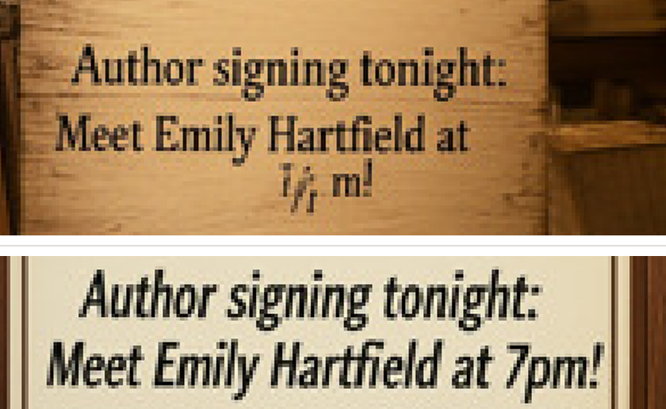
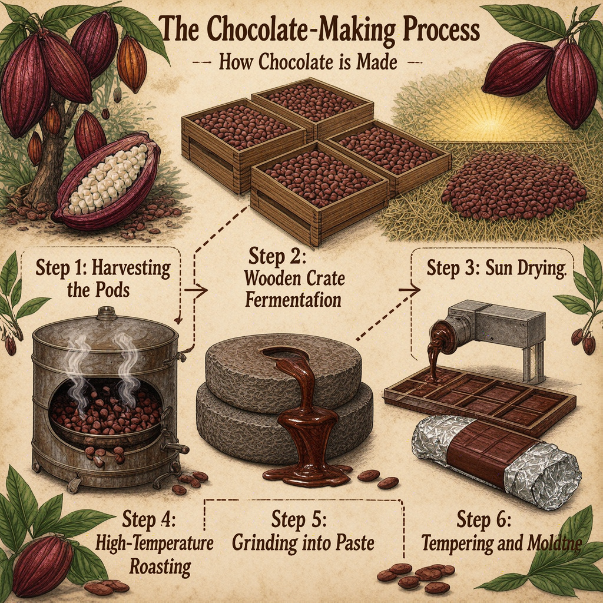
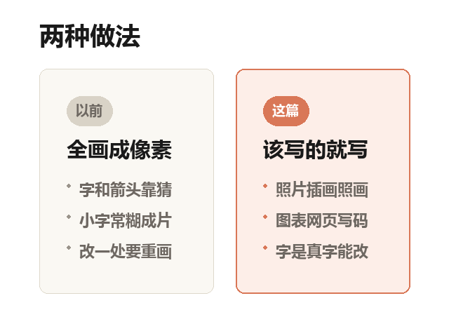
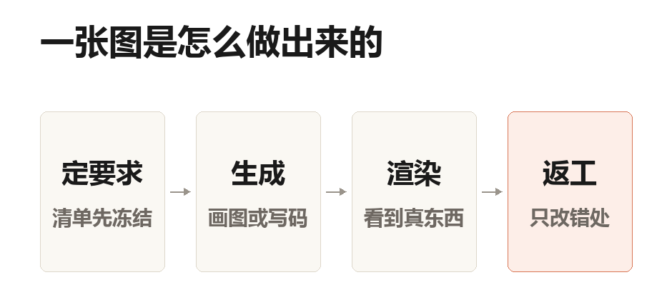
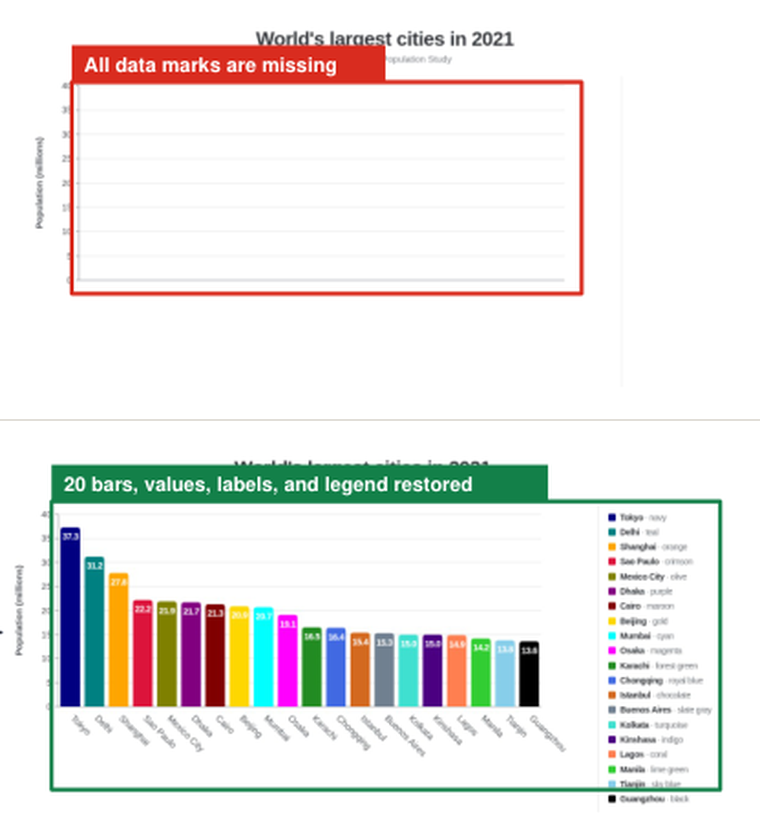

:::lead 写在前面
一张书店招牌，画面很好，时间那行却是乱码。
英伟达的新框架：照片继续画，图表网页写代码。
写完渲染成图，自己看一眼，错了只改那一处。
:::

## 招牌上那行时间，第一版是乱码

先看两张图。同一句提示词，同一个模型家族，只差训练方式和外面那层流程。

提示词写得很细。
书店门口要暖光，木招牌上写店名，再加一句英文口号。
下面一行小字写「今晚签售：7 点，Emily Hartfield」。
牌子底部再放一行手写体，写「店内供应咖啡和点心」。

第一版交出来的图，气氛对了，大字也对了。
只有两处不对：时间那行变成了「1:½ m!」，底部手写体拼不出一个完整的词。

:::caption 论文原图（Figure 8 局部裁切）
上：训练中途的模型，时间写成「1:½ m!」，底部手写一行认不出。
下：按结果打分再训练、再加一层「看一眼再改」的流程之后，7pm 写得清清楚楚。
:::

后一版，招牌、小字、手写体全对。
这里同时动了两样东西：训练方式，和外面那层流程。
论文没把两者的功劳拆开算，只说流程那部分「进一步提高了文字和数量的准确度」。

## 同一套系统做成的另一张

一张巧克力制作流程图。六个步骤，从采果、木箱发酵、晒干，到烘烤、研磨、调温成型。
每一步都有编号和英文说明，箭头方向也对得上。木刻版画的质感，是画出来的。
这张图里最难的部分不是质感，是那一整页的字。

:::caption 论文原图（Figure 1 局部）
六步流程、箭头、说明文字都由模型一次生成，这张图里没有一处后期排版。
放大看步骤名，字是清楚的——这件事三年前还做不到。
:::

现在的生图模型写大字已经不错，海报标题基本不会错。
难的是一整页小字，还有排版里的对齐。
图表的数值要对、图例要全，网页的按钮要落在按钮该在的位置。

## 字是「画」出来的，所以会歪

说人话：主流生图模型，本质在猜像素。
它见过几亿张图，知道「7pm」这几个字符在这个位置通常长什么样，就照着印象落笔。
可文字要求每一笔精确。猜得再像，也可能差一个弯。

所以你会看到那种典型故障：招牌上的英文很漂亮，数字却像被揉过。
它不是不会写字，是没有「写字」这个动作，只有「画字」这个动作。

这套框架叫 Nemotron-Labs-VisualCreation。它做的第一件事是把活分开。

## 一类靠画，一类靠写

:::caption 本号自制
左边是常见做法：所有东西都变成像素去猜。
右边是这篇的分工：外观交给像素，结构和文字交给代码。
:::

分开之后，两种产物的处理方式完全不同。

照片、插画、质感这一类，切成 16×16 的小方块，每块查一次字典，换成一个编号。
字典里有 19.6 万条「色块条目」，模型像写字一样，一个编号接一个编号往下吐。
这种一个接一个往下猜的做法，叫自回归。
负责查字典的这一环叫 tokenizer。说人话就是翻译器：把图翻成编号，再把编号翻回图。

图表、网页、幻灯片、文档这一类，直接写成 SVG、HTML 或者绘图代码。
说人话，SVG 是用一串指令描述一个图形的格式，HTML 是网页的图纸。
浏览器照着图纸画：字是真字，位置是真位置，想改一个数字就改一个数字。

论文把这件事叫「像素即代码」（Pixel as Code）。
翻成白话：能写成代码的，就别去猜像素。

## 写完不算完，它自己看一眼

:::caption 本号自制
四步一个循环。第三步是关键：它把做出来的东西渲染成图，再用眼睛看一遍。
:::

具体一点。开工之前，它先把你的要求冻成一份清单。
再加一份版式约定：哪块放标题、哪块放图、文字多长。
清单冻结的意思是，后面每一步都对着同一份要求验收，不会越改越跑偏。

然后生成。网页这类东西，它会让两个模型各写一版，再挑一版。
渲染出来之后，一个视觉模型负责找毛病：字压到图上了、按钮跑到框外了、图例少了一项。
找到的毛病会被判给某一个环节——是计划错了、素材错了、版式错了，还是代码写错了。
只有被点名的那一处会改，其他部分不动。

论文给的默认上限是：最多试八轮，接受三次修改，保留其中最好的一版。

## 图表塌了，它知道该怪谁

有个例子很能说明这套流程。

:::caption 论文原图（Figure 6c）
上：第一次渲染出来的柱状图，柱子一根都没有，只剩坐标轴。
下：返工之后，20 根柱子、数值、城市名、图例全都回来了。
:::

第一版的问题是数据全丢。这种事在纯像素模型那里几乎没法救——只能重新生成，然后祈祷这次别丢。
在这里，问题被归到「代码与内容」那一栏：绘图代码里画柱子的那几行没跑通。
改那几行，重新渲染，柱子就回来了。

## 分数：赢的地方很具体

先看它自己的零件。

把图翻成编号、再翻回来的保真度，用 PSNR 衡量，越高越像原图。
它拿到 29.57 分，对手 Emu3.5 是 26.08 分，差 3.49 分。
涨得最多的是文档、图表、界面截图这三类，每类涨 4.63 到 5.35 分。
这三类恰好都是「小字多、线细」的图。

速度也快了一个量级。
一张 1024×1024 的图，编码只要 41 毫秒、解码 37 毫秒。这是在 A100 显卡上测的。
对手是 295 毫秒和 405 毫秒。

再看整套系统。同一个画图模型，只把外面那层流程加上去：
GenEval2 从 31.71 涨到 52.56。这个榜考的是「画出来的东西符不符合描述」。
WISE 从 46.30 涨到 88.60。它考的是画出来的东西符不符合常识。
作对照，谷歌的 Nano Banana Pro 在这个榜上是 87.60。

结构化那一路更夸张。
换成专门写代码的版本，网页还原的复合得分从 0.7528 到 0.9314。
这个分数把渲染成功、像素相似、文字相似合起来算。
文档还原成结构化代码，一次编译通过的比例从 20.25% 到 94.25%。
说人话：以前一百次里二十次能编译，现在九十四次。

## 「超过 GPT Image 2」，得看清是谁在跑

模型卡上有一张表，气势很足：多项跑分超过 GPT Image 2。
国内几家媒体照着这张表发了稿。数字没错，读法要小心。

那张表取的是「各榜最好成绩」。
其中好几项的最好成绩，是拿 GPT-6 当大脑跑出来的。
规划、检查、挑图都交给 GPT-6，只有出图那一步用自己的模型。

换成自家的模型当大脑，分数就变成这样。
BizGenEval 考商业设计。自家配置 64.7，GPT Image 2 是 83.2。
同一个配置换成 GPT-6 当大脑，86.0。
GenEval2：自家 52.56，GPT Image 2 是 81.00。换成 GPT-6，65.43。

论文自己把两种配置分开列，写得很清楚。
准确的说法是：流程配上一个很强的规划模型，能打赢单打的 GPT Image 2。
流程配上自家的规划模型，还差一截。

还有两项它明确落后。
综合审美榜 OneIG：54.63。Nano Banana Pro 是 58.30。
另一张综合榜 Qwen-Image-Bench：52.46。GPT Image 2 是 65.23。
这两项考的是「整体好不好看、贴不贴题」，不是「字对不对」。

## 论文没说的地方

第一，开源的不全。放出来的是画图那个模型和它的翻译器，300 亿参数。
它每次只动用 30 亿：模型里分了很多小组，每次只叫最对口的几个出来。
调度台和写代码那个模型，都写着「法务通过后放」。
也就是说，你现在能跑单张图，跑不出论文里那套流程。

第二，账要算清。许可证是非商用。示例代码要求四张 H100，每张 80G 显存。
家里那台机器跑不动，这一步就把大多数读者挡在门外。

第三，翻译器仍然有损。论文自己承认，两种翻译器都会改掉一些细节和小字。
29.57 分比 26.08 好，但离无损还很远。真要做印刷品，这一步会是瓶颈。

第四，论文没有单独的局限性章节。上面这些，是从发布计划、许可证和表格里翻出来的。
收益到底来自哪一环，论文也没拆开算，只说「测不出是哪一项能力带来的」。

第五，对比数字来自各家自己的报告和榜单，没有统一重跑。
同一个指标出现多个来源时，它取的是低值。
这做法偏保守，也意味着不同行的数字未必在同一把尺子上。

## 最后

这篇里最难的活，不是把图画得更好看。
是先判断：这块内容该画，还是该写。
判断对了，剩下的交给流程——渲染、看一眼、改一处。
以前交一张图，现在交一份能改的文件。

:::meta 论文档案
标题：Nemotron-Labs-VisualCreation: Pixel as Code for Agentic Visual Creation
作者：Guo Chen、Fuxiao Liu、Haoqin Tu、Yiyang Zhou、Andrew Tao、Bryan Catanzaro、Guilin Liu 等 12 人
机构：NVIDIA（标题下唯一署名单位）
会议：无，预印本 v1，2026-11-23 提交
arXiv：2611.31358
:::

:::links
**论文：** https://arxiv.org/abs/2611.31358
**模型：** https://huggingface.co/nvidia/Nemotron-Labs-Image-30B-A3B
**作品集：** https://fuxiaoliu-nemotron-labs-visualcreation-gallery.static.hf.space/index.html
:::

图片版权：标注「论文原图」的图来自论文原文，版权归作者所有，本号做了裁切与拼接；标注「本号自制」的由本号绘制。
