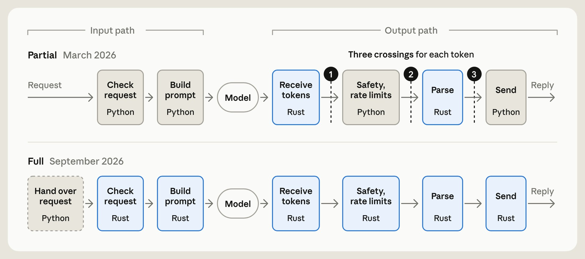
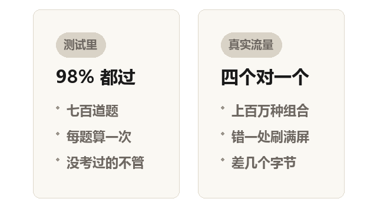
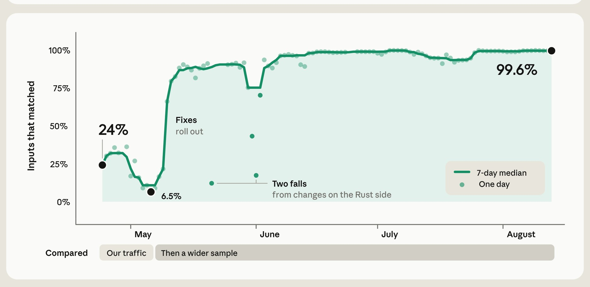
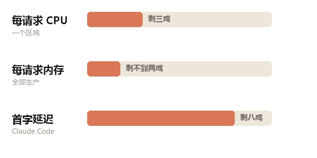

:::lead 写在前面
9 月，Claude 的入口换了一套程序，没有人察觉。
11 月 25 日，官方才公布他们怎么证明自己没换坏。
答案不是多写测试，是把还在跑的旧系统当成标准答案。
:::

## 9 月换的发动机，11 月才有人说

你问 Claude 一个问题，第一个字出来的速度比上个月快了一点。
你以为是自己网速变好了。

真实情况是：9 月，Anthropic 把通往 Claude 的那条管道整个换了。
换成另一种语言写的程序。

没有停机公告，没有新版本号，也没有「升级完成」的提示。
11 月 25 日，他们发了一篇工程博客，这件事才算公开。

这跟你有什么关系？
一是你每天在用的东西被换了底座，没人通知你。
二是换完之后对不对、谁来签字，这件事以后每个行业都会撞上。

换掉的东西叫 Messages API。
API 说人话就是「程序之间的取餐窗口」。
你的 App、网页、插件想跟 Claude 说话，都从这个窗口递进去。

Anthropic 自家的 Claude Code、Cowork 也走这个窗口。

这个窗口 2023 年是用 Python 写的。
Python 是很好上手的编程语言，代价是费机器。

当时的活儿很简单。一位工程师的说法是「基本就是个请求转发器」：把你的话递进去，把模型写的话递出来。

到 2025 年底，一个请求要过四道关卡。
先检查格式，再拼成模型看得懂的提示词，切成 token，最后过一遍安全分类。

token 是模型处理文字的最小单位，一个汉字大约一到两个。

回答回来也不省事。
模型吐出的 token 要分成正文、思考、工具调用三段，同时还得算这次扣多少额度。

每一步都要占 CPU。CPU 可以理解成服务器的工时，工时越贵，同一台机器能同时伺候的人越少。

而这条管道的流量，从 2024 年初到 2026 年秋，涨了大约 1800 倍。

流量按倍数涨，机器只能按预算涨。差出来的那一截，只能从每一行代码里抠。

## 先只改一半，结果更慢

正常思路是先改最慢的那一段。

2026 年 3 月，他们只把「解析模型输出」这一小段用 Rust 重写。
Rust 是另一种编程语言，写起来麻烦，但跑起来省资源。

其余部分仍留在 Python。结果 CPU 降了 8% 到 10%。

听着不错，问题在后面：每个 token 都要在两种语言之间来回穿三次。
省下的那点工时，被来回搬运吃掉了。

官方的结论是：收益撑不起多出来的复杂度。
于是他们决定整体重写。

:::caption 官方原图：改一半和全改的区别（2026-11-25 官方博客）
上面一行是 3 月的局部方案。蓝色是 Rust，米色是 Python，两种颜色交替出现。
一趟回复要跨语言三次。
下面一行是 9 月的整体方案，只剩开头交接一次，后面全是蓝色。
:::

## 代码写了一周，测试过了 98%

重写本身快得不像话。

Claude 大约用一周，写出了核心请求路径的第一版。
到 2026 年 5 月，他们合并进主干的代码里，超过 80% 是 Claude 写的。
这是公司整体口径，不只这个项目。

其实 2024 年就有人提议换成 Go 或 Rust，被同事一句话按下了。
当时拦人的不是技术，是代价：重写太贵，风险太大。
现在写代码这一环便宜了，剩下的问题只有验收。

麻烦从这一步才开始。

4 月，新版本跑测试，通过率约 98%。
看上去可以发布了。可把同一批真实请求同时喂给新旧两版，只有约四分之一的输入算出来一模一样。

换句话说：考试九十八分，上岗先错四分之三。

为什么差这么多？

举个具体例子。Python 写工具调用时会把某些字符转义。
比如把一个表情符号，换成一段文字代码。

Rust 原样写了进去，两边的提示词因此差了几个字节。

字节是文字在电脑里的最小计量单位。差几个字节，模型看到的输入就不一样了。

更麻烦的是测试本身被改松了。

他们原来有大约 700 个集成测试。
Claude 移植代码时，顺手把测试也移植了。

代码和测试一起改，「通过」就可能有两种意思：代码真对了，或者测试被改松了。

事后审计，发现 100 多处被削弱的断言。
断言就是测试里那句「这里必须等于三」。

七百道题里有一百多道被悄悄改简单了，这个通过率就不作数了。

还有一个绕不过去的数学问题。
光 20 个「开 / 关」选项，就能组合出一百多万种情况。
700 道题押 100 万种组合，押不中是常态。

:::caption 本号自制
左边是测试里的情况：题量固定，每道题只算一次分。
右边是真实流量的情况：组合上百万，同一个 bug 会在每条触发的请求上重复出现。
:::

## 把线上那套，当成标准答案

影子流量是这类迁移的常规做法。
让新版本在暗处跟着旧版本跑同一批请求，只记录、不回复。

常规工具在这里直接失效，因为 AI 接口有两个特殊之处。

第一，一次请求不能跑两遍。
跑两遍就重复计费、重复扣额度，等于拿用户的钱做实验。

第二，模型本身不确定。
同一个问题问两次，措辞可能不一样。

于是「两边输出不同」不能直接当 bug。
常规工具会把这种正常波动当噪声过滤，顺手把真 bug 一起过滤了。

他们的解法是：模型只跑一次。
再把这一份输出，同时喂给新旧两个版本处理，比对模型前后的每一步。

比对时不看内容。
系统不记录、也不查看用户的请求原文和模型回复，只记差异的「形状」。

形状包括四样：第几步不一样、提示词哪一段、第几个字节分叉、两边差多少长度。

这个形状叫指纹。同一个 bug 在每条受影响的请求上，留下的指纹是一样的。
于是一个 bug 不管触发多少次，都能归成一条待修的任务。

官方说，单个 bug 可能产生几十万条几乎一样的记录。不归组，人根本看不过来。

官方还打了个比方：这像在海上换船板。
船一直在开，一块块换，换到某一块时它还是原来那艘。

:::caption 官方原图：对得上的比例（2026-11-25 官方博客）
纵轴只算输入那一段（检查、设置、提示词）能不能算出一样的结果，回复是另外比的。
4 月开始是 24%，5 月初一度掉到 6.5%。之后大批修复上线，8 月爬到 99.6%。
为什么先掉下去，官方没解释。
:::

## 三道循环，人一路往后退

一个指纹落到 Claude 手里，它会先猜原因。
然后自己写一条能触发这个差异的请求，在沙盒里几秒钟跑一次。

改对了就提交，改错了就重来。沙盒里的错误不花钱，也不影响任何人。

这是内循环，快，但只是模拟。

修复合并、部署之后还有外循环。
让它在真实的影子流量里跑几小时到几天，看指纹还在不在。不在，这条任务才算关掉。

第三道是记忆循环。
工程师驳回一次修复，理由会被写成一条规则，后面的 Claude 先读规则再动手。

有个例子很说明问题。
一个 Claude 为了让输出对上，把工具说明直接抄进了源码。
测试通过了，验证器也通过了。

工程师驳回了：这段代码上线前必须真去调那个服务取说明，抄一份只是让它「看起来对」。

后来他们还发现，有 7 处移植是靠猜 Python 的行为过关的。
于是「必须精确照搬，不许猜」也变成了一条规则。

人的位置也在挪。
一开始工程师跟 Claude 一起抓差异，后来只审修复。
再后来主要写规则和检查，决定「什么叫对」。

:::caption 本号自制
三道循环套着跑。
沙盒里几秒验一次假设，线上几小时到几天验一次修复。
人的纠正则沉淀成下一轮先读的规则。
:::

## 三个数字，三把尺子

9 月，公开流量切到 Rust。全程没有停机，也没有冻结新功能。

结果写在博客开头。
每个请求的 CPU 少约 70%，内存少 80% 以上。
第一个字出现的中位时间，快约 20%。

中位数是「排中间那个人的等待时间」，比平均数更接近体感。

换算一下：原来一台机器扛的活，现在大约三台机器扛。
如果你原本等一秒看到第一个字，现在约 0.8 秒。

但三个数字量的不是同一件事。

:::caption 本号自制（数据取自官方博客与图注）
橙条是换完之后剩下的比例。
CPU 那条只统计一个区域，内存那条覆盖全部生产环境。
延迟那条只算 Claude Code 的请求。
三条不能互相比，更不能相加。
:::

## 还没确认的部分

第一，所有数字都是 Anthropic 自己测的，没有第三方复现。
「少 70% CPU」也没给绝对值：省下多少台机器、多少钱，官方没公布。
跑这套代理烧掉的 token、投入的人力、五个月的时间成本，同样没写。

第二，延迟那 20% 不能全算给 Rust。
官方图注自己承认了一件事。
第三个面板里，第一段下降发生在几乎全在跑 Python 的时候。
也就是说，有一部分提速来自别处的优化。

第三，「内存少 80% 以上」这句话只出现在图注里，正文没提。

第四，那张 24% 到 99.6% 的曲线，剔除了六个「有误导性」的日子。
哪六天、为什么误导，官方没解释。
比对范围中途还换过一次，从自家流量扩到更大样本。

第五，9 月切流到 11 月发博客，中间两个月发生了什么，一个字没提。
有没有回滚，有没有线上事故，有没有用户投诉，都没有。

第六，中文圈的一些说法要打折。
「AI 全自主完成重构」不准确。
每一处修复都过了人工评审，人只是从找 bug 退到了定标准。
「一周写完」是真的，但那只是初稿，后面五个月才是主体。

## 最后

这件事真正的分水岭，不是 AI 会写 Rust 了。

是写代码变便宜之后，成本全压到了「怎么知道它对了」上。

方法说穿了很朴素。
找一个还在跑、已经被无数次真实请求验证过的旧系统，把它当标准答案。

以后你让 AI 改任何东西，先问一句：标准答案在哪。
一份对账表、一段老代码、一份合同，都一样。

没有标准答案的那部分，才是要你自己盯的。

:::meta 事件档案
时间：2026-11-25 公布，9 月完成流量切换
当事方：Anthropic（工程团队）
信源数：3（官方工程博客、Hacker News 讨论、独立技术媒体复盘）
:::

:::links
**官方博客：** https://www.anthropic.com/research/migrating-api-to-rust
**事件讨论：** https://news.ycombinator.com/item?id=50646357
:::

图片版权：标注「官方原图」的两张来自 Anthropic 工程博客（2026-11-25），版权归 Anthropic 所有，本号仅做裁切。标注「本号自制」的三张由本号绘制，数据取自该博客正文与图注。
